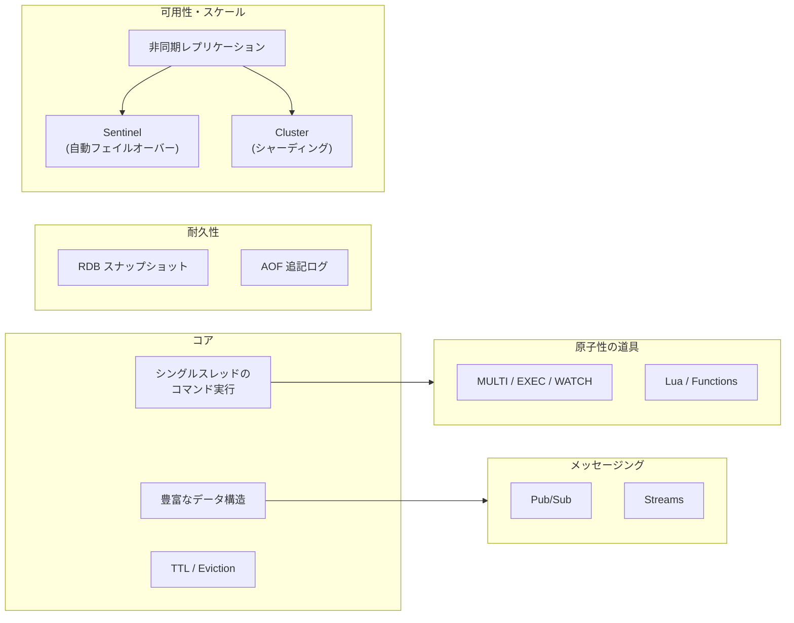
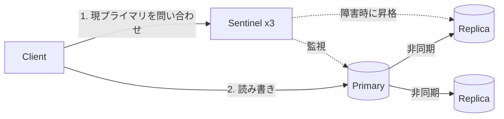

# 01. Redis の特徴(全体像)

キュー・キャッシュ・レプリケーションの一般論は分かっている前提で、**「Redis ならではの性質」** に絞って整理する。
Cluster と Lua は別ファイルで深掘りする([02-cluster.md](02-cluster.md) / [03-scripting.md](03-scripting.md))。

## 1. 全体マップ

## 2. シングルスレッドのコマンド実行 — すべての特徴の土台

- コマンドの **実行** は 1 本のメインスレッドで、1 つずつ順番に行われる(イベントループ)
- だから **1 コマンドは必ず原子的**。`INCR` や `ZADD` に競合制御はいらない
- Redis 6.0 以降、**ネットワーク I/O(ソケットの読み書き・パース)だけ** をスレッド化できる(`io-threads`)。コマンド実行自体は今でも単一スレッド
- 速い理由: メモリ上で完結 / ロック不要 / epoll による多重化 / 単純なデータ構造

**裏返しの注意点**

- 重いコマンドが 1 つあると **全クライアントが待たされる**。`KEYS *`、巨大な `SMEMBERS`、`HGETALL`、長い Lua スクリプトは禁物
  - 走査は `SCAN` / `HSCAN` / `SSCAN` / `ZSCAN`(カーソル方式で少しずつ)
  - 巨大キーの削除は `UNLINK`(実メモリ解放をバックグラウンドで行う)
- 1 インスタンスで使える CPU は実質 1 コア → スケールアウトは Cluster か複数インスタンスで

## 3. データ構造 — 「値の型」ごとにサーバー側の操作がある

| 型 | 中身 | 代表コマンド | 典型ユースケース |
| --- | --- | --- | --- |
| String | バイト列(数値としても扱える) | `GET` `SET NX EX` `INCR` | キャッシュ、カウンタ、ロック |
| Hash | フィールド→値のマップ | `HSET` `HINCRBY` | オブジェクト(ユーザー情報など) |
| List | 双方向リンクリスト | `LPUSH` `BRPOP` `LMOVE` | 単純なキュー |
| Set | 重複なし集合 | `SADD` `SINTER` | タグ、ユニーク訪問者 |
| Sorted Set (ZSet) | スコア付き集合(順序あり) | `ZADD` `ZRANGE` `ZINCRBY` | ランキング、遅延キュー、スライディングウィンドウ |
| Stream | 追記型ログ + コンシューマグループ | `XADD` `XREADGROUP` `XACK` | イベントログ、信頼性のあるキュー |
| その他 | Bitmap / HyperLogLog / Geo / Bitfield | `SETBIT` `PFADD` `GEOSEARCH` | フラグ、概算ユニーク数、位置検索 |

- Redis 8 では、以前は Redis Stack(モジュール)だった **JSON・Search(検索/ベクトル検索)・Time Series・確率的データ構造(Bloom など)** がコアに統合された
- Redis 7.4 から **Hash のフィールド単位の TTL**(`HEXPIRE`)が使える

ポイント: 「アプリで GET → 加工 → SET」ではなく、**加工そのものを Redis に任せる**(`ZINCRBY` など)と競合しない。データ構造の選択が設計の中心になる。

## 4. 有効期限(TTL)とメモリ溢れ時の追い出し(Eviction)

- `EXPIRE` / `SET ... EX` でキー単位に TTL。期限切れキーは「アクセス時に消す(lazy)」+「定期的にサンプリングして消す(active)」の 2 段構え
- `maxmemory` に達したときの挙動を `maxmemory-policy` で選ぶ

| ポリシー | 対象 | 方式 |
| --- | --- | --- |
| `noeviction`(デフォルト) | ― | 書き込みをエラーにする |
| `allkeys-lru` / `allkeys-lfu` | 全キー | 最近使われていない / 使用頻度が低いものから |
| `volatile-lru` / `volatile-lfu` / `volatile-ttl` | TTL 付きキーのみ | 同上 / 期限が近い順 |
| `allkeys-random` / `volatile-random` | ― | ランダム |

- LRU / LFU は **近似**(数個サンプリングして一番古いものを消す)。正確な LRU ではない
- **純キャッシュなら `allkeys-lru` / `allkeys-lfu`**。キューやロックなど「消えたら困る」データを同居させるなら `noeviction` か `volatile-*` にしてインスタンスを分けるのが定石

## 5. 永続化 — RDB と AOF

| | RDB | AOF |
| --- | --- | --- |
| 方式 | ある時点のスナップショットをファイルに書く | 書き込みコマンドを追記していく |
| 仕組み | `fork()` して子プロセスが書く(Copy-on-Write) | `appendfsync` で fsync 頻度を選ぶ(`always` / `everysec`(推奨・既定) / `no`) |
| 失うデータ | 最後のスナップショット以降すべて | `everysec` なら最大 約 1 秒分 |
| 再起動の速さ | 速い | 遅め(リプレイ) |

- 通常は **両方 ON** が推奨(AOF で耐久性、RDB でバックアップ・高速起動)
- AOF は肥大化するので裏でリライト(圧縮)する。Redis 7.0 から **Multi-Part AOF**(ベース + 増分ファイル群)
- 注意: `fork()` の瞬間にレイテンシのスパイク、書き込みが多いと CoW でメモリが一時的に最大 2 倍近く要る → **maxmemory は物理メモリの余裕を残して設定**

## 6. レプリケーションと Sentinel

- **プライマリ → レプリカの非同期レプリケーション**。プライマリは書き込みを受けた時点でクライアントに OK を返す
  - 初回 / 大きく遅れたら **フル同期**(RDB を送る)、通常は **部分同期**(replication backlog から差分)
  - `WAIT numreplicas timeout` で「N 台に届くまで待つ」ことはできるが、**強い一貫性は保証しない**(フェイルオーバー時にロストし得る)
- **Sentinel**: 非クラスタ構成向けの監視・自動フェイルオーバーの仕組み
  - 複数の Sentinel プロセスが多数決(quorum)でプライマリ停止を判断し、レプリカを昇格
  - クライアントは Sentinel に「今のプライマリはどれ?」を問い合わせて接続
- シャーディングも必要なら Sentinel ではなく **Cluster**(フェイルオーバー機能を内蔵)→ [02-cluster.md](02-cluster.md)

## 7. 原子性の道具 — 複数コマンドをどうまとめるか

| 手段 | 何ができる | 一言 |
| --- | --- | --- |
| 単一コマンド | 1 操作が原子的 | まずこれで済ませられないか考える |
| パイプライン | 複数コマンドを 1 往復で送る | **速くなるだけ。原子性はない** |
| `MULTI` / `EXEC` | まとめて連続実行(間に他クライアントが割り込まない) | 途中の結果を見て分岐できない。ロールバックもない |
| `WATCH` + `MULTI` | 楽観ロック(監視キーが変わったら EXEC 失敗) | リトライ前提 |
| Lua / Functions | **条件分岐込みのロジックをサーバー側で原子的に実行** | 最も柔軟。重いと全体が止まる |

詳細は [03-scripting.md](03-scripting.md)。

## 8. メッセージング機能 — キューとして見たときの性質

キューの一般論は既知の前提で、**Redis の各機能がどの保証を持つか** だけ比較する。

| 機能 | 配信保証 | 永続化 | 複数コンシューマ | 向いている用途 |
| --- | --- | --- | --- | --- |
| Pub/Sub | **at-most-once**(購読者がいなければ消える) | なし | 全購読者にブロードキャスト | キャッシュ無効化通知、チャット、リアルタイム通知 |
| List(`LPUSH` + `BRPOP`) | 取り出した瞬間に消える(処理中クラッシュでロスト) | あり | 競合消費 | 簡易ジョブキュー |
| List + `LMOVE`/`BLMOVE` | 処理中リストへ退避 → 完了で削除(自前で at-least-once) | あり | 競合消費 | 信頼性を少し上げたキュー |
| Stream + Consumer Group | **at-least-once**(`XACK` まで PEL に残る) | あり | グループ内で競合消費、グループ間でファンアウト | 本格的なキュー / イベントログ |

- Stream の要点: エントリ ID(`<ミリ秒>-<連番>`)で順序付け、未 ACK は **PEL(Pending Entries List)** に残り、`XPENDING` で確認、`XAUTOCLAIM` で死んだコンシューマの分を奪い取る。`MAXLEN` / `MINID` で長さを切り詰め
- Kafka との違い: Stream は **メモリに載る範囲** のログ。長期保持・大量リプレイ・パーティションの水平スケールは Kafka の領域
- Redis 7.0 から **Sharded Pub/Sub**(`SPUBLISH` / `SSUBSCRIBE`): Cluster で全ノードにブロードキャストせず、チャンネルのスロットを持つシャード内だけで配信

## 9. 注意点・トレードオフまとめ

- **データはメモリ量が上限**。コストは GB 単価で効いてくる
- **非同期レプリケーション** → フェイルオーバー時に直近の書き込みをロストし得る。「正本」には向かない
- **重いコマンド・巨大キー(Big Key)・ホットキー** が単一スレッドを詰まらせる最大の運用リスク
- 分散ロック: 単一インスタンスの `SET key token NX PX 30000` + 安全な解放(Lua で token を確認して DEL)が基本。複数インスタンスの **Redlock** は安全性に議論がある(Martin Kleppmann の批判)。正確性が必要なら fencing token や合意系(etcd / ZooKeeper)を検討

## 10. 似た技術との比較

| | Redis | Memcached | Valkey | Kafka |
| --- | --- | --- | --- | --- |
| 立ち位置 | 多機能インメモリ DS サーバー | 純粋な KV キャッシュ | Redis 7.2 からの OSS フォーク | 分散ログ |
| データ構造 | 豊富 | String のみ | Redis と同等 | ログ(トピック/パーティション) |
| 永続化 | RDB / AOF | なし | 同等 | ディスクが主 |
| スレッド | 実行は単一(I/O はマルチ可) | マルチスレッド | I/O スレッドを強化 | ― |
| 使い分け | 迷ったらこれ | 単純キャッシュをマルチコアで | ライセンスで Redis を避けたい / マネージドで安い | 大量・長期保持のイベント |

## 出典

- Redis 公式ドキュメント: https://redis.io/docs/latest/
- データ型: https://redis.io/docs/latest/develop/data-types/
- Eviction: https://redis.io/docs/latest/develop/reference/eviction/
- 永続化: https://redis.io/docs/latest/operate/oss_and_stack/management/persistence/
- レプリケーション: https://redis.io/docs/latest/operate/oss_and_stack/management/replication/
- Sentinel: https://redis.io/docs/latest/operate/oss_and_stack/management/sentinel/
- Streams: https://redis.io/docs/latest/develop/data-types/streams/
- 分散ロック(Redlock): https://redis.io/docs/latest/develop/use/patterns/distributed-locks/
- Kleppmann「How to do distributed locking」: https://martin.kleppmann.com/2016/02/08/how-to-do-distributed-locking.html
- ライセンス変更(Redis 8 / AGPL): https://redis.io/blog/agplv3/
- Valkey: https://valkey.io/
