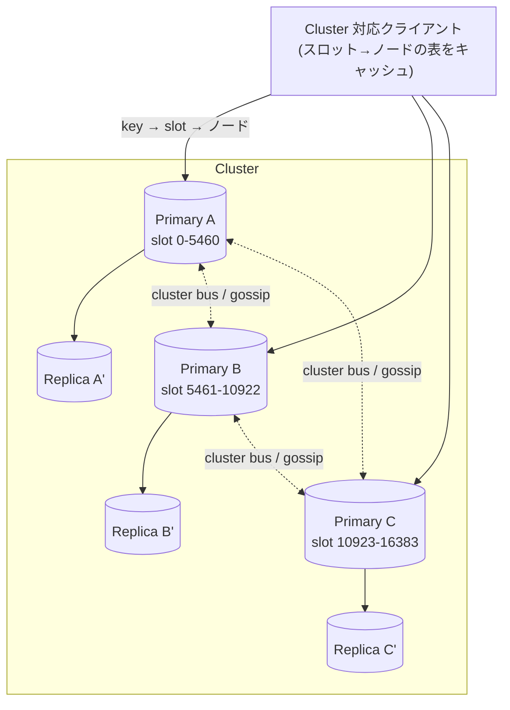
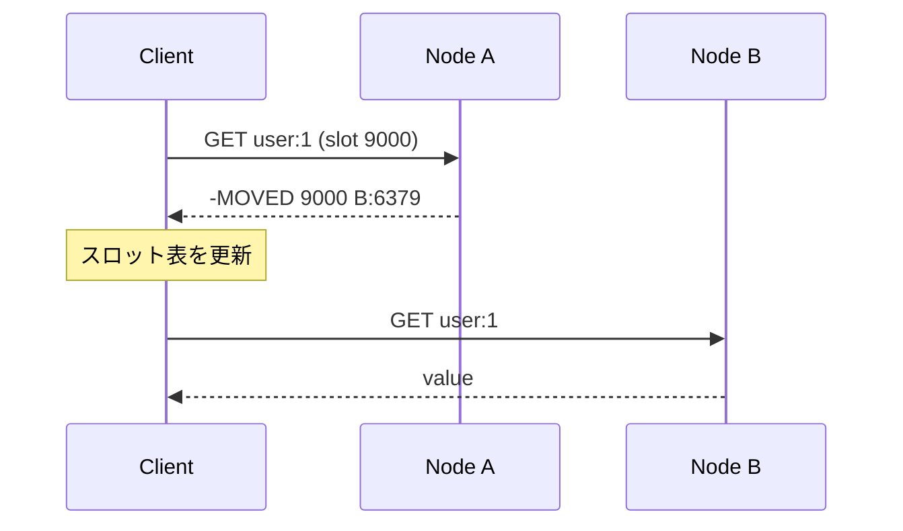

# 02. Redis Cluster

1 台のメモリ・CPU(実質 1 コア)を超えるために、**データを複数のプライマリにシャーディング** し、**フェイルオーバーも内蔵** した構成。
外部のプロキシやコーディネーター(ZooKeeper など)を使わず、**ノード同士が直接やりとりする分散型** なのが特徴。

## 1. 仕組みの全体像

- 最小構成の目安: **プライマリ 3 台 + 各 1 レプリカ = 6 ノード**
- ノード間通信は **cluster bus**(既定でクライアントポート + 10000、例: 6379 → 16379)。gossip プロトコルで状態・障害情報を交換する

## 2. ハッシュスロット — どのキーがどこに住むか

- キー空間は **16384 個のハッシュスロット** に分割されている
- `slot = CRC16(key) mod 16384`
- 各プライマリが「スロットの範囲」を担当する。ノード追加・削除は **スロット単位でキーを移動**(リシャーディング)して行う

> なぜコンシステントハッシュではないのか: スロットという「固定数のバケツ」を明示的にノードへ割り当てる方が、移動の単位・所有者が明確で、運用(どのスロットを誰が持つか)が単純になるため。

### ハッシュタグ `{...}`

- キーに `{` `}` が含まれると、**その中身だけ** でスロットを計算する
- `user:{42}:profile` と `user:{42}:cart` は同じスロット → 同じノードに乗る
- 複数キー操作・トランザクション・Lua をまとめて実行したいキーは **ハッシュタグで同居させる** のが Cluster 設計の基本テクニック
- 注意: 1 つのタグに集めすぎると **そのスロット(=ノード)だけが偏る**(ホットスロット)

## 3. リダイレクト — MOVED と ASK

クライアントはスロット表をキャッシュして直接正しいノードに投げる。表が古いとノードが教えてくれる。

| | MOVED | ASK |
| --- | --- | --- |
| 意味 | 「このスロットは恒久的に別ノードの担当」 | 「スロットを移動中。このキーは一時的に移動先にある」 |
| クライアントの動作 | スロット表を更新して再送 | 表は更新せず、移動先に `ASKING` を送ってから **その 1 回だけ** 再送 |

- 普通のクライアントライブラリ(Lettuce / redis-py の RedisCluster / ioredis など)はこれを自動で処理する
- アプリ側はほぼ意識しないが、**「Cluster 非対応のクライアントでは使えない」** ことは知っておく

## 4. 障害検知とフェイルオーバー

1. ノードが `cluster-node-timeout` の間応答しない → 他ノードが **PFAIL**(疑わしい)とマーク
2. gossip で過半数のプライマリが PFAIL と報告 → **FAIL** に昇格
3. そのプライマリのレプリカが選挙を開始し、**過半数のプライマリの投票** を得たものが新プライマリに
4. 他ノードにスロット担当の変更が伝わる

- Sentinel は不要(Cluster 自体が持っている)
- **過半数のプライマリが生きていないとクラスタは動けない**(スプリットブレイン対策)
- 既定(`cluster-require-full-coverage yes`)では、**どこかのスロットが担当不在になるとクラスタ全体が書き込みを拒否**。`no` にすると生きているスロットだけ処理を続けられる

### 書き込みロストの可能性

レプリケーションは非同期のまま。以下でロストし得る:

- プライマリが OK を返した直後、レプリカに届く前に落ちた
- ネットワーク分断で少数派側に取り残されたプライマリに書き込み続けた(`node-timeout` 経過後に少数派プライマリは書き込みを止めるが、それまでの分は失われる)

→ Cluster は **可用性とスケールのための仕組みで、強い一貫性は提供しない**。

## 5. Cluster の制約(設計で効いてくるところ)

| 制約 | 内容 | 対処 |
| --- | --- | --- |
| マルチキー操作 | `MGET` `SUNION` `RENAME` などは **全キーが同一スロット** でないと `CROSSSLOT` エラー | ハッシュタグで同居 / アプリ側で分割して投げる |
| トランザクション・Lua | `MULTI`/`EXEC` や Lua が触るキーも同一スロット(同一ノード)必須 | 同上 |
| DB 番号 | **DB 0 のみ**(`SELECT` 不可) | キー接頭辞で名前空間を分ける |
| `KEYS` / `SCAN` | ノード単位でしか動かない | 全プライマリに対して実行 |
| Pub/Sub | 通常の `PUBLISH` は **全ノードにブロードキャスト** され、ノード数が増えると重い | Sharded Pub/Sub(`SPUBLISH`、7.0〜) |
| 大きなキー | 1 キーは 1 スロット = 1 ノード。巨大な Hash / ZSet は分散されない | キー自体を分割(例: `rank:{shard0}` …) |

## 6. Sentinel 構成との比較

| | Sentinel 構成 | Cluster |
| --- | --- | --- |
| シャーディング | なし(1 プライマリに全データ) | あり(16384 スロットを分割) |
| フェイルオーバー | 外部の Sentinel プロセス | ノード自身が内蔵 |
| マルチキー操作 | 制約なし | 同一スロットのみ |
| クライアント | Sentinel 対応 | Cluster 対応 |
| 選び方 | データが 1 台に収まり、書き込みも 1 台で捌ける | メモリ or 書き込みスループットが 1 台を超える |

- マネージドサービス(ElastiCache / Azure Cache for Redis / Memorystore)では「クラスタモード有効 / 無効」として選ぶことが多い。無効 ≒ Sentinel 相当(自動フェイルオーバーはサービス側が担う)
- 読み取りスケールだけならレプリカから読む(`READONLY`)手もあるが、非同期なので **古い値を読む** ことを許容できる場合のみ

## 出典

- Cluster 仕様: https://redis.io/docs/latest/operate/oss_and_stack/reference/cluster-spec/
- Cluster チュートリアル(スケーリング): https://redis.io/docs/latest/operate/oss_and_stack/management/scaling/
- Sharded Pub/Sub: https://redis.io/docs/latest/develop/interact/pubsub/
