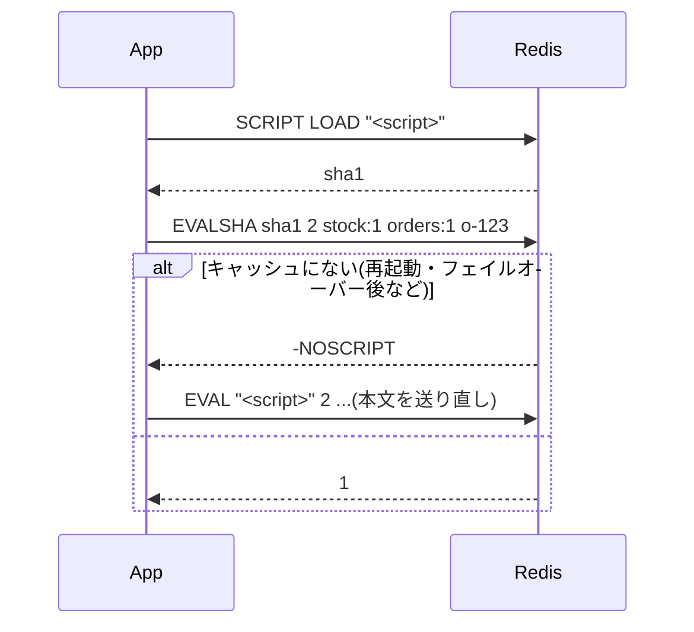
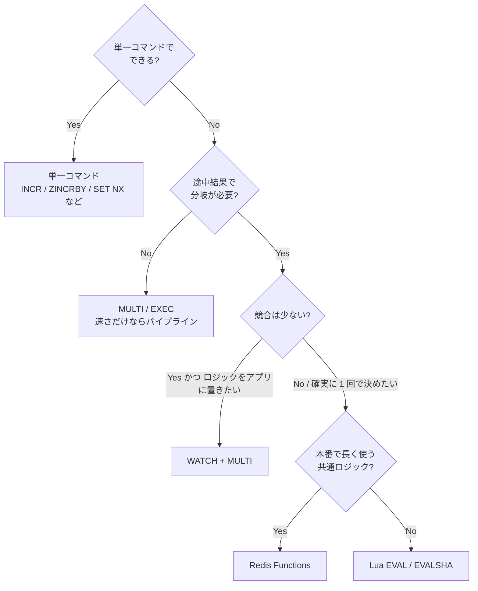

# 03. 原子性の道具箱 — MULTI/EXEC、WATCH、Lua、Functions

Redis で「複数の操作をまとめて、他のクライアントに割り込まれずに実行したい」ときの選択肢を整理する。
主役は **Lua スクリプト** と、その後継の **Redis Functions**。

## 1. なぜ Lua が必要になるのか

例: 「在庫が 1 以上なら 1 減らして注文 ID を記録、0 なら失敗」

- `GET` → アプリで判定 → `DECR` では、**GET と DECR の間に他クライアントが割り込む**(Check-then-Act の競合)
- `MULTI`/`EXEC` では、**キューに積んだコマンドの結果を見て分岐できない**(EXEC するまで結果が返らない)
- `WATCH` なら書けるが、競合が多いと **リトライ地獄**

→ **「読む・判定する・書く」を丸ごとサーバー側で 1 つの原子的な処理として実行する** のが Lua スクリプト。

## 2. MULTI / EXEC と WATCH(比較のため)

```text
WATCH stock:1           # 楽観ロック開始
GET stock:1             # → 5(アプリで判定)
MULTI
DECR stock:1
RPUSH orders:1 o-123
EXEC                    # stock:1 が他から変更されていたら nil(失敗)→ リトライ
```

- `MULTI`〜`EXEC` の間のコマンドは **キューに積まれ、EXEC で連続実行** される(その間に他クライアントは割り込まない)
- **ロールバックはない**: 途中のコマンドが実行時エラー(型違いなど)になっても、他のコマンドはそのまま実行される
- `WATCH` は CAS(Compare-And-Set)的な楽観ロック

## 3. Lua スクリプト(EVAL)

### 基本

```text
EVAL "<script>" numkeys key1 key2 ... arg1 arg2 ...
```

```lua
-- 在庫を減らす: KEYS[1]=在庫キー, KEYS[2]=注文リスト, ARGV[1]=注文ID
local stock = tonumber(redis.call('GET', KEYS[1]) or '0')
if stock <= 0 then
  return 0
end
redis.call('DECR', KEYS[1])
redis.call('RPUSH', KEYS[2], ARGV[1])
return 1
```

- `redis.call()`: コマンドを実行(エラーならスクリプトを中断して呼び出し元へエラー)
- `redis.pcall()`: エラーを Lua の値として受け取り、スクリプト内で処理できる
- **スクリプト全体が原子的**: 実行中は他のコマンドが一切走らない(単一スレッドなので「ロック」ではなく「独占」)

### KEYS と ARGV を分ける理由

- スクリプトが触るキーは **必ず `KEYS` で渡す**(スクリプト内でキー名を組み立てない)
- Cluster では Redis / クライアントが `KEYS` を見て **どのスロット(ノード)で実行するか** を決めるため。全キーが同一スロットでないと `CROSSSLOT` エラー → ハッシュタグで揃える([02-cluster.md](02-cluster.md))

### スクリプトキャッシュ: EVALSHA



- 毎回スクリプト本文を送らず SHA1 で呼べる
- スクリプトキャッシュは **揮発性**(再起動・フェイルオーバー・`SCRIPT FLUSH` で消える)→ `NOSCRIPT` 時に `EVAL` へフォールバックするのが定石(多くのクライアントライブラリが自動でやる)

### レプリケーションと永続化での扱い

- Redis 7.0 以降、スクリプトは **効果(実際に行われた書き込みコマンド)としてレプリカ・AOF に伝わる**(effects replication)
- そのためスクリプト内で時刻や乱数を使っても、レプリカと結果がズレない

### 長時間実行のリスク

- 実行中は **サーバー全体が止まる**。既定 5 秒(`busy-reply-threshold`、旧 `lua-time-limit`)を超えると、他クライアントには `BUSY` エラーが返り始める
- 止める手段:
  - まだ書き込みしていなければ `SCRIPT KILL`
  - 書き込み済みなら原子性を壊せないので `SHUTDOWN NOSAVE` しかない
- → **スクリプトは短く、ループ回数をデータ量に比例させない**(大量キーの走査などは不可)

### 使えないこと

- スクリプト内から外部 I/O(ネットワーク・ファイル)はできない(サンドボックス)
- グローバル変数の定義不可
- ブロッキングコマンド(`BLPOP` など)はブロックしない

## 4. Redis Functions(7.0〜)

Lua スクリプトの運用上の弱点(キャッシュが揮発、アプリが毎回本文を持つ必要)を解消した後継機能。

```lua
#!lua name=inventory
redis.register_function('reserve', function(keys, args)
  local stock = tonumber(redis.call('GET', keys[1]) or '0')
  if stock <= 0 then return 0 end
  redis.call('DECR', keys[1])
  redis.call('RPUSH', keys[2], args[1])
  return 1
end)
```

```text
FUNCTION LOAD "<上のライブラリ>"
FCALL reserve 2 stock:{1} orders:{1} o-123
```

| | EVAL / EVALSHA | Functions |
| --- | --- | --- |
| 登録 | なし(毎回本文 or SHA) | `FUNCTION LOAD` でライブラリとして登録 |
| 永続化・複製 | されない(キャッシュは揮発) | **RDB / AOF に保存され、レプリカにも複製される** |
| 呼び出し | SHA1 | 名前(`FCALL reserve`) |
| 位置づけ | アプリの一部 | **DB 側のストアドプロシージャ** 的 |
| 読み取り専用 | `EVAL_RO` / `EVALSHA_RO` | `FCALL_RO`(`no-writes` フラグ付き関数) |

- 原子性・単一スレッドを止めるリスク・KEYS の扱いは Lua スクリプトと同じ
- トレードオフ: デプロイが「アプリ」と「Redis」の 2 箇所に分かれる。バージョン管理・登録手順の仕組みが必要
- Cluster では **全プライマリに `FUNCTION LOAD` する必要がある**(ノードを追加したときも)

## 5. 典型的な使いどころ

| パターン | Lua で何をするか |
| --- | --- |
| 分散ロックの安全な解放 | 「値が自分の token なら DEL」(他人のロックを消さない) |
| レート制限 | ZSet のスライディングウィンドウ: 古いエントリ削除 → 件数確認 → 追加 → TTL 設定 |
| 在庫引当・座席確保 | 残数確認 → 減算 → 予約記録 |
| 遅延キューの取り出し | `ZRANGEBYSCORE` で期限到来分を取得 → `ZREM` → List / Stream に移す |
| 複合カウンタ | 複数キーの整合した更新 |

ロック解放の例(定番):

```lua
if redis.call('GET', KEYS[1]) == ARGV[1] then
  return redis.call('DEL', KEYS[1])
end
return 0
```

## 6. 選び方のまとめ



## 出典

- Lua スクリプト: https://redis.io/docs/latest/develop/interact/programmability/eval-intro/
- Lua API(redis.call など): https://redis.io/docs/latest/develop/interact/programmability/lua-api/
- Redis Functions: https://redis.io/docs/latest/develop/interact/programmability/functions-intro/
- トランザクション: https://redis.io/docs/latest/develop/interact/transactions/
