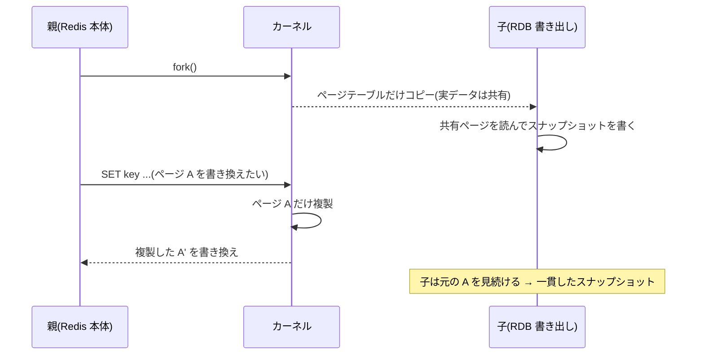
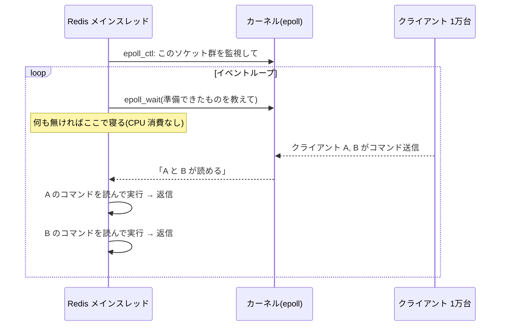

# Redis Q&A

質問と回答のログ。見出しは `Q01` から連番。

## Q01. CoW(Copy-on-Write)とは?

[01-overview.md](01-overview.md) の「5. 永続化」に出てくる用語。

**一言でいうと**: 「コピーしたことにしておいて、実際にコピーするのは書き換えが起きたときだけ」という OS(Linux カーネル)の仕組み。

### fork() と組み合わせた動き

1. Redis が RDB 保存や AOF リライトのために `fork()` で子プロセスを作る
2. このときメモリの中身(数 GB〜)は**コピーしない**。親と子が同じ物理メモリページ(通常 4KB 単位)を共有し、両方から読み取り専用として扱う
3. 子はその共有ページを読んで、fork した瞬間のデータをファイルに書き出す
4. 親(Redis 本体)はクライアントからの書き込みを受け続ける。あるページを書き換えようとした瞬間に、カーネルが**そのページだけ**複製し、親は複製側を書き換える。子は元のページを見続ける

### なぜ便利か

- 全データをコピーしなくても、**fork した瞬間の一貫したスナップショット**が手に入る
- 親はロックせずに書き込みを続けられる

### 注意点(01-overview.md の注意書きの意味)

- **メモリが最大 約 2 倍**: 子が書き出している間に親がほぼ全ページを書き換えると、ほぼ全ページが複製される。書き込みが多いほどメモリ使用量が増えるので、`maxmemory` は物理メモリに余裕を残す
- **fork() 自体のレイテンシ**: データ本体はコピーしないが、ページテーブル(仮想アドレス → 物理ページの対応表)はコピーするため、メモリが大きいと fork に数十〜数百 ms かかり、その間 Redis が止まる。`INFO stats` の `latest_fork_usec` で確認できる
- **Transparent Huge Pages(THP)は無効化推奨**: ページが 2MB になると、1 バイト書き換えただけで 2MB 複製され CoW の負担が増えるため。Redis 起動時にも警告が出る

### 他での CoW

ファイルシステム(ZFS、Btrfs のスナップショット)、プログラミング言語(Swift の配列、Rust の `Cow`)などでも同じ考え方が使われる。

出典:

- Redis persistence: https://redis.io/docs/latest/operate/oss_and_stack/management/persistence/
- Redis latency(fork / THP): https://redis.io/docs/latest/operate/oss_and_stack/management/optimization/latency/

## Q02. epoll による多重化とは?

[01-overview.md](01-overview.md) の「2. シングルスレッドのコマンド実行」に出てくる用語。

**一言でいうと**: 1 本のスレッドで何万もの接続(ソケット)を同時に面倒見るために、「データが届いて読める状態になった接続だけ」を OS(Linux カーネル)に教えてもらう仕組み。これを **I/O 多重化(I/O multiplexing)** と呼び、Linux でそれを実現するシステムコールが `epoll`。

### 何が問題なのか

クライアントが 1 万人つながっているとする。素朴な作り方は 2 つあるが、どちらもつらい。

| 方式 | やり方 | 問題 |
| --- | --- | --- |
| 1 接続 1 スレッド | 各スレッドが `read()` でデータ到着を待つ(ブロッキング) | スレッド 1 万本 → メモリ・コンテキストスイッチが重い。データ共有にロックも必要 |
| 1 スレッドで順番に `read()` | 接続 1 から順に読む | 接続 1 が何も送ってこないと、そこで止まって他を処理できない |

ほとんどの接続は **ほとんどの時間アイドル**(何も送ってこない)。本当に知りたいのは「**今読める接続はどれか**」だけ。

### epoll の動き

1. 起動時・接続時に、監視したいソケットを `epoll_ctl` でカーネルに登録しておく
2. `epoll_wait` を呼ぶと、**準備できたソケットの一覧だけ**が返ってくる(無ければ寝て待つ)
3. 返ってきたものだけを順に処理し、また 2 に戻る

これが「イベントループ」の中身。Redis では自前の小さなライブラリ `ae`(`ae_epoll.c` など)がこれを包んでいる。

### なぜ速いのか(select / poll との違い)

古い仕組み `select` / `poll` も同じ目的だが、呼ぶたびに **監視対象の全ソケットをカーネルに渡し、全部をチェック** する(O(監視数))。1 万接続なら毎回 1 万件走査。

`epoll` は監視対象をカーネル側に登録済みで、準備できたものだけをリストで返す(O(準備できた数))。**接続数が増えても遅くならない** のがポイント。

| 仕組み | OS | 1 回のコスト |
| --- | --- | --- |
| `select` / `poll` | ほぼ全 OS | 監視数に比例 |
| `epoll` | Linux | 準備できた数に比例 |
| `kqueue` | macOS / BSD | 準備できた数に比例 |

Redis はビルド時に OS に応じて `epoll` / `kqueue` / `evport` / `select` を自動選択する。

### シングルスレッドとの関係

- epoll のおかげで **1 スレッドでも大量接続を待てる** → スレッドを増やす必要がない → ロック不要で原子性も保てる
- ただし「待ち」を効率化するだけで、**処理そのものは 1 つずつ**。だから重いコマンドが 1 つあると全員が待たされる(01-overview の注意点)
- Node.js、Nginx も同じ「epoll + イベントループ」モデル

出典:

- epoll(7) man page: https://man7.org/linux/man-pages/man7/epoll.7.html
- Redis source `ae.c`(多重化 API の選択): https://github.com/redis/redis/blob/unstable/src/ae.c
