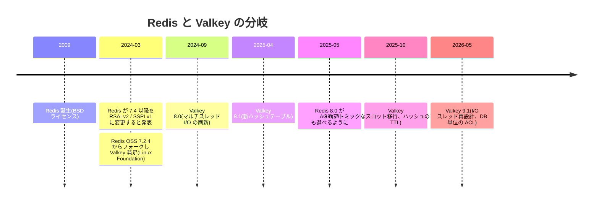
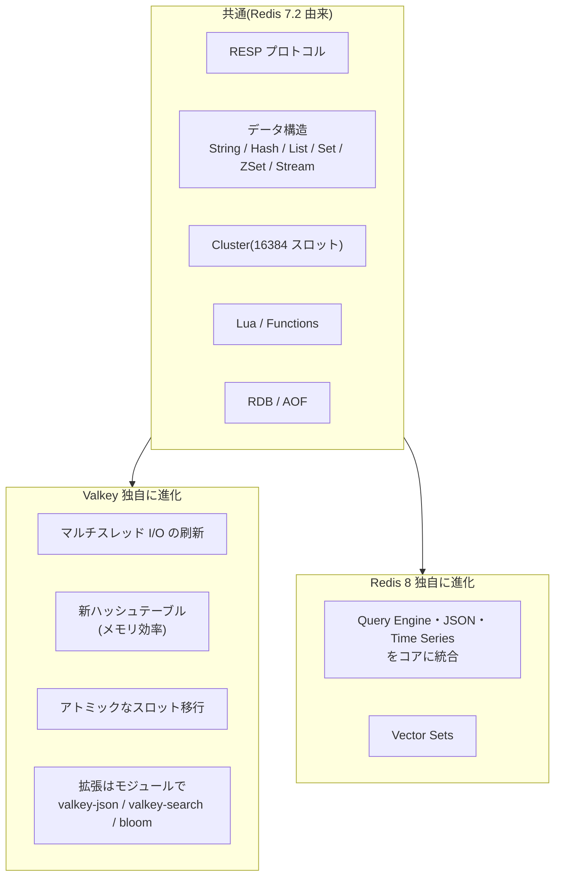
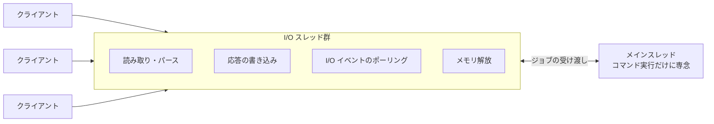

# 01. Valkey の全体像

Redis の基本(シングルスレッド実行、データ構造、永続化、Cluster、Lua)は分かっている前提で、**「Valkey ならではの点」** に絞って整理する。
共通部分は [../redis/01-overview.md](../redis/01-overview.md) を参照。

## 1. 誕生の経緯

- **RSALv2 / SSPLv1**: ソースは公開されているが、「Redis をそのままマネージドサービスとして提供する」ことなどを制限するライセンス。OSI(オープンソースの定義を管理する団体)の基準では OSS ではない
- これに反発した AWS・Google・Oracle などのメンテナが中心になり、ライセンス変更前の最後のバージョン(7.2.4)からフォークした。名前は Valkey、管理は中立な Linux Foundation
- その後 Redis 8.0 で **AGPLv3**(OSI 承認の OSS ライセンス)も選べるようになった。ただし AGPL は「ネットワーク越しに提供する改変版のソースも公開せよ」という強いコピーレフトで、社内規定で使えない企業も多い。そのため「Redis = OSS でない」は今は不正確で、**違いは BSD(緩い)か AGPL(強い)か** と捉えるのが正しい

| | Valkey | Redis |
| --- | --- | --- |
| ライセンス | BSD 3-Clause | AGPLv3 / RSALv2 / SSPLv1 から選択 |
| 管理 | Linux Foundation(複数企業) | Redis Ltd.(1 社) |
| 分岐元 | Redis OSS 7.2.4 | 本家 |
| 最新(2026-10 時点) | 9.1 系 | 8.x 系 |

## 2. Redis との互換性 — 何が同じで、何が違うか

- **クライアントはそのまま使える**。redis-py、Jedis、Lettuce、ioredis などの Redis クライアントで接続できる(Valkey 公式の GLIDE クライアントもある)
- **Redis 7.2 までのコマンドは同じ**。分岐後に双方が追加したコマンドは互換とは限らない
    - 例: ハッシュのフィールド単位 TTL(`HEXPIRE`)は両方にあるが、Valkey 側の `DELIFEQ`、`CLUSTERSCAN` などは Valkey だけ
- **拡張機能の載せ方が違う**。Redis 8 は JSON・検索などを本体に組み込んだ。Valkey は本体を小さく保ち、`valkey-json` / `valkey-search` / `valkey-bloom` を別モジュールとして提供する(`valkey-search` は RediSearch の一部機能に相当)
- **移行の目安**: Redis 7.2 以前 → Valkey はデータ(RDB)もそのまま読めるので、ほぼ差し替えで済む。Redis 7.4 以降・Redis 8 の独自機能を使っている場合は個別に確認が必要

## 3. バージョンごとの主な改良

### 3.1 Valkey 8.0 — I/O スレッドの刷新

Redis 6 から「ネットワーク I/O だけスレッド化」する仕組みはあったが、メインスレッドと I/O スレッドが交互に動く方式で、伸びしろが小さかった。8.0 で次のように作り直した。

- メインスレッドと I/O スレッドが **同時に** 動き、メインスレッドはコマンド実行に集中できる
- **コマンド実行は今もシングルスレッド** なので、「1 コマンドは原子的」という Redis の性質は変わらない
- 公式ベンチマークでは、7.2 と比べてスループット約 3.3 倍(36 万 → 119 万 req/s)、平均レイテンシ約 70% 減
- データのプリフェッチ(次に使うメモリを先読みして CPU キャッシュミスを減らす)も入った

### 3.2 Valkey 8.1 — 新ハッシュテーブル

- キー空間と Hash / Set / ZSet の内部で使うハッシュテーブルを書き直した
- 1 キーあたり約 20 バイト(TTL 付きなら最大約 30 バイト)のメモリ削減。キーが数億あるとそのまま GB 単位で効く

### 3.3 Valkey 9.0 — Cluster の運用性

| 機能 | 何が嬉しいか |
| --- | --- |
| アトミックなスロット移行 | 従来はキーを 1 個ずつ移すので、大きなキー・ホットなキーで止まりやすかった。9.0 からはスロット単位でまとめて流すので、シャード追加(リシャーディング)が安定する |
| ハッシュのフィールド単位 TTL(`HEXPIRE`) | 従来の TTL はキー単位だけ。Hash の一部のフィールドだけ期限切れにできる |
| Cluster モードで複数 DB | 従来 Cluster では DB 0 しか使えなかった。`SELECT` で名前空間を分けられる |
| 規模 | 最大 2,000 ノード・10 億 req/s 超のクラスタを実証 |

### 3.4 Valkey 9.1 — 性能・セキュリティ

- I/O スレッドを再設計し、単一サーバで 210 万 req/s
- **DB 単位の ACL**(`ACL SETUSER ... db=`): ユーザーの権限を特定の DB 番号に限定できる。9.0 の複数 DB と組み合わせると、1 クラスタを複数テナントで安全に共有しやすい
- 小さい文字列(128 バイト未満)のメモリを最大 20% 削減、ZSet も最大 10% 削減
- TLS 証明書の自動再読み込み(無停止でローテーション)、JSON 形式のログ
- **Lua がモジュール化**: スクリプトを使わない環境では Lua エンジンを外せる。逆に、Lua を使う場合(レート制限の `EVALSHA` など)は自前運用だと有効になっているか確認する

## 4. マネージドサービス

主要クラウドは新規提供の中心を Valkey に移しつつある。

| サービス | 備考 |
| --- | --- |
| Amazon ElastiCache for Valkey | ノード型と Serverless の 2 種類。Redis OSS エンジンより安い |
| Amazon MemoryDB for Valkey | 書き込みを複数 AZ のログに残し、主データにも使える耐久性重視版 |
| Google Cloud Memorystore for Valkey | — |
| Azure | Azure Managed Redis は Redis Ltd. の Redis Enterprise ベースで、Valkey ではない |

### ElastiCache Serverless for Valkey の料金(Redis OSS との比較)

| 項目 | Valkey | Redis OSS |
| --- | --- | --- |
| ECPU 単価 | Redis OSS より 33% 安い | 基準 |
| データ保存量の単価 | Redis OSS より 33% 安い | 基準 |
| 最低課金のデータ量 | **100 MB** / キャッシュ | 1 GB / キャッシュ |

- **ECPU**(ElastiCache Processing Unit): Serverless の課金単位。単純な `GET` / `SET` は転送 1 KB ごとに 1 ECPU。CPU を多く使うコマンド(Lua スクリプトなど)は、CPU 時間に応じてさらに多く消費する
- 最低課金が 1/10 なので、開発環境や小さいキャッシュを多数作る場合に特に差が出る
- 単価はリージョンで違うので、具体的な金額は料金ページで確認する

## 5. 注意点・トレードオフ

- **Redis と完全に同じではなくなってきている**。分岐から 2 年以上たち、双方が独自コマンドを追加している。「Redis の記事に書いてあるコマンド」が Valkey にあるとは限らない(逆も同じ)
- **拡張機能はモジュールの導入が必要**。JSON・全文検索・ベクトル検索が必要なら、マネージドサービスで対応しているかを確認する
- **性能の数字はベンチマーク条件つき**。I/O スレッドの効果は、コア数が多く、接続数・リクエスト数が多いときに大きい。小さいインスタンスでは差が出にくい
- **シングルスレッド実行由来の注意(重いコマンド禁止、ホットキー)は Redis と同じ**

## 6. 似た技術との比較

| | Valkey | Redis 8 | Memcached | DragonflyDB |
| --- | --- | --- | --- | --- |
| ライセンス | BSD | AGPL / RSAL / SSPL | BSD | BSL(ソース公開) |
| データ構造 | 豊富 | 豊富 + JSON・Vector Sets 組み込み | String のみ | Redis 互換 |
| コマンド実行 | シングルスレッド + I/O スレッド | 同左 | マルチスレッド | マルチスレッド(シェアードナッシング) |
| 永続化・レプリケーション | あり | あり | なし | あり |
| 向いている場面 | Redis 互換を OSS で | Redis 独自機能を使う | 単純なキャッシュだけ | 1 台で大きく縦に伸ばしたい |

## 出典

- Valkey 9.0 ダウンロードページ(主要機能): https://valkey.io/download/9.0
- Valkey 9.1 ダウンロードページ(主要機能・リリース日): https://valkey.io/download/9.1
- Valkey 9.1 リリースブログ: https://valkey.io/blog/valkey-9-1-delivers-improvements-in-security-performance-and-more
- Valkey 8.0 の I/O スレッド: https://valkey.io/blog/unlock-one-million-rps
- Valkey 8.1 GA(新ハッシュテーブル): https://valkey.io/blog/valkey-8-1-0-ga
- Linux Foundation の Valkey 9.0 発表(2025-10-21): https://www.linuxfoundation.org/press/valkey-9.0-delivers-performance-and-resiliency-for-real-time-workloads
- AWS「Redis OSS と Valkey の違い」: https://aws.amazon.com/elasticache/redis
- ElastiCache 料金: https://aws.amazon.com/elasticache/pricing/
- Valkey vs Redis 比較(2026-07、ライセンス・モジュールの現状): https://redisson.pro/blog/valkey-vs-redis-comparision.html
