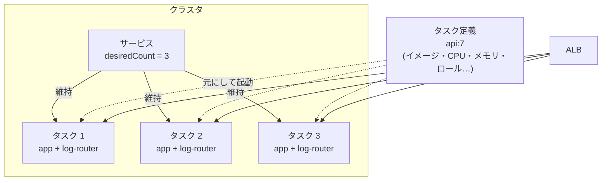
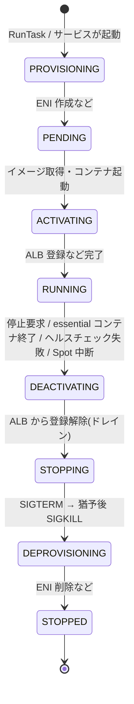

# 01. ECS タスクとは(全体像)

Docker で `docker run` したコンテナを、AWS 上で「決めた設定で・決めた数だけ・落ちたら作り直して」動かすのが ECS。
その **実行の単位** がタスク。

## 1. 用語の関係 — 4 つだけ押さえる

| 用語 | 一言で | 例え |
| --- | --- | --- |
| **クラスタ** | タスクを動かす場所の論理的なグループ | 工場 |
| **タスク定義**(Task Definition) | タスクの設計図(JSON)。イメージ・CPU/メモリ・ポート・環境変数・IAM ロールなど | 設計図 |
| **タスク**(Task) | タスク定義から起動された実体。1〜複数のコンテナの集まり | 設計図から作った製品 1 個 |
| **サービス**(Service) | 「このタスク定義のタスクを常に N 個動かす」を保証する仕組み。ALB 登録・オートスケール・ローリング更新も担当 | 生産ラインの管理者 |



- タスク定義は **リビジョン管理** される(`api:7` = ファミリー名 `api` のリビジョン 7)。中身を変えると新リビジョンになり、サービスを新リビジョンに更新するとタスクが順に入れ替わる(ローリング更新)
- タスクの起動方法は 2 通り
    - **サービス経由**: 常駐させたいもの(Web / API)。落ちたら自動で作り直される
    - **スタンドアロン(RunTask)**: 1 回走って終わるもの(バッチ、マイグレーション)。EventBridge Scheduler から定期起動もできる。落ちても作り直されない

## 2. タスクの中身 — 「Pod」と同じく複数コンテナを束ねる

1 つのタスク定義に最大 10 個のコンテナ定義を書ける。同じタスク内のコンテナは:

- **同じホストに配置**される(バラバラにならない)
- `awsvpc` モードなら **同じ ENI(= 同じ IP)を共有** し、`localhost` で互いに通信できる
- タスクレベルの **ボリュームを共有** できる

典型的な組み合わせ:

| メインのコンテナ | 一緒に入れるもの(サイドカー) |
| --- | --- |
| API アプリ | ログルーター(FireLens / Fluent Bit)、メトリクス・トレースのエージェント(ADOT、Datadog など) |
| アプリ | Envoy プロキシ(Service Connect 使用時は ECS が自動で注入) |

- 各コンテナに `essential: true/false` を指定する。**essential なコンテナが 1 つでも止まるとタスク全体が止まる**
- `dependsOn` で起動順(例: ログルーターが起動してからアプリ)を制御できる
- 「別々にスケールさせたいもの」は同じタスクに入れない(API とワーカーは別タスク定義・別サービスにする)

## 3. どこで動くか — 起動タイプ(キャパシティ)

| | Fargate | EC2 | ECS Managed Instances |
| --- | --- | --- | --- |
| ホスト管理 | 不要(AWS がタスクごとに隔離された環境を用意) | 自分で EC2 を用意・パッチ・スケール | AWS が EC2 を管理(パッチ・スケール)。インスタンスタイプは選べる |
| 課金 | タスクの vCPU・メモリ × 秒 | EC2 インスタンス代 | EC2 代 + 管理料 |
| 向き | ほとんどの Web / API / バッチ | GPU、大量タスクの集約でコスト最適化、ホストへの細かい制御 | GPU や特定インスタンスを使いたいが運用は任せたい |

- **Fargate Spot**: 余剰キャパシティを最大 70% 引きで使える。代わりに AWS の都合で **2 分前の予告(SIGTERM)付きで停止** されうる。中断に強いワーカー・バッチ向け
- Fargate のタスクサイズは CPU とメモリの決まった組み合わせから選ぶ(0.25 vCPU / 0.5 GB 〜 16 vCPU / 120 GB)。エフェメラルストレージは既定 20 GiB、最大 200 GiB

## 4. ライフサイクル — 起動から停止まで



**停止時の流れ(グレースフルシャットダウン)が実務で一番大事**

1. ALB のターゲットから外される(登録解除の遅延 `deregistration_delay` の間、既存リクエストは流れ続ける)
2. 各コンテナに **SIGTERM** が送られる
3. `stopTimeout`(既定 30 秒、Fargate は最大 120 秒)待っても終わらなければ **SIGKILL**

→ アプリは SIGTERM を受けたら「新規受付をやめ、処理中のものを片付け、メモリ上のバッファを吐き出して終了」するよう作る。
例: [URL 短縮の設計](../../../../readings/system/url-shortener/aws/DESIGN.md) で「1 秒ぶん溜めて SQS に送る」クリックのバッファは、SIGTERM 時にフラッシュしないと失われる。

- 停止したタスクは **作り直されるのではなく、別の新しいタスクに置き換わる**(IP もメモリも引き継がない)。だからタスクは **使い捨て(ephemeral)** として設計する
- 停止理由は `stoppedReason` / `stopCode` で確認できる(`OutOfMemoryError`、ヘルスチェック失敗、イメージ取得失敗など)

## 5. ネットワーク — awsvpc モード

| モード | 内容 | 使える場所 |
| --- | --- | --- |
| **awsvpc** | タスクごとに専用の ENI(= プライベート IP)を割り当てる | Fargate は **これのみ**。EC2 でも推奨 |
| bridge | ホスト内の Docker 仮想ネットワーク。ホストのポートをマッピング | EC2 |
| host | ホストのネットワークをそのまま使う | EC2 |

`awsvpc` だと:

- **タスク単位でセキュリティグループ** をつけられる(「ALB からの 8080 だけ許可」など)
- ALB のターゲットタイプは **`ip`**(タスクの IP を直接登録)
- タスクを置く **サブネットを指定** する → サブネットが AZ に属するので、複数 AZ のサブネットを渡せばサービスが AZ に分散配置してくれる
- プライベートサブネットに置いた場合、ECR からのイメージ取得や AWS API 呼び出しには **NAT Gateway か VPC エンドポイント** が必要

## 6. 2 つの IAM ロール — 混同しやすい

| ロール | 誰が使う | 何のため | 例 |
| --- | --- | --- | --- |
| **タスク実行ロール**(Task Execution Role) | ECS エージェント(AWS 側) | タスクを **起動するための準備** | ECR からイメージ pull、CloudWatch Logs へのログ送信、Secrets Manager / SSM から環境変数用のシークレット取得 |
| **タスクロール**(Task Role) | コンテナ内の **アプリ** | アプリが **AWS API を呼ぶため** | DynamoDB の読み書き、SQS への送信、S3 へのアップロード |

- アプリは AWS SDK を使うだけで、タスクロールの一時クレデンシャルを自動で取得する(アクセスキーをイメージや環境変数に入れない)
- 「イメージが pull できない」→ 実行ロール、「アプリが AccessDenied」→ タスクロール、と切り分ける

## 7. 注意点・トレードオフ

- **タスクはいつ消えてもよいように作る**: デプロイ・スケールイン・ホスト障害・Spot 中断で普通に止まる。状態は外(DB / キャッシュ / S3)に置く。メモリに持つなら「失っても困らない」ものだけ(例: URL 短縮の ID ブロックは失われても欠番になるだけ)
- **ローカルディスクも消える**: エフェメラルストレージはタスク停止で消える。永続化が必要なら EFS をマウントする
- **ログは stdout / stderr へ**: `awslogs` ドライバや FireLens で CloudWatch Logs などに送る。コンテナ内のファイルに書くとタスクと一緒に消える
- **メモリ上限を超えると即 kill**: `OutOfMemoryError: Container killed due to memory usage`。JVM などはヒープ上限をタスクメモリに合わせる
- **起動は数十秒〜分単位**: イメージ pull + ENI 作成があるため Lambda より遅い。急なスパイクにはオートスケールが間に合わないことがあるので、最低タスク数に余裕を持たせる。イメージを小さくする、SOCI で遅延読み込みする、などで短縮できる

## 8. 似たものとの比較

| | ECS タスク | Kubernetes Pod(EKS) | Lambda 関数の実行 |
| --- | --- | --- | --- |
| 実行単位 | 1〜10 コンテナ | 1〜複数コンテナ | 1 関数 |
| 設計図 | タスク定義(JSON) | Pod spec(YAML、Deployment に内包) | 関数設定 + コード / イメージ |
| 数の維持 | サービス | Deployment / ReplicaSet | 不要(リクエストごとに起動) |
| 最大実行時間 | 無制限 | 無制限 | 15 分 |
| 学習・運用コスト | 低い(AWS 機能だけで完結) | 高い(コントロールプレーン・エコシステム) | 最も低い |
| 向き | 常駐 API、長いバッチ | マルチクラウド、K8s エコシステム活用 | イベント駆動の短い処理 |

## 9. 最小のタスク定義の例(Fargate)

```json
{
  "family": "api",
  "requiresCompatibilities": ["FARGATE"],
  "networkMode": "awsvpc",
  "cpu": "512",
  "memory": "1024",
  "executionRoleArn": "arn:aws:iam::123456789012:role/ecsTaskExecutionRole",
  "taskRoleArn": "arn:aws:iam::123456789012:role/api-task-role",
  "containerDefinitions": [
    {
      "name": "app",
      "image": "123456789012.dkr.ecr.ap-northeast-1.amazonaws.com/api:1.4.2",
      "essential": true,
      "portMappings": [{ "containerPort": 8080 }],
      "stopTimeout": 60,
      "logConfiguration": {
        "logDriver": "awslogs",
        "options": {
          "awslogs-group": "/ecs/api",
          "awslogs-region": "ap-northeast-1",
          "awslogs-stream-prefix": "app"
        }
      }
    }
  ]
}
```

- `cpu: 512` = 0.5 vCPU(1024 = 1 vCPU)、`memory` は MiB
- イメージは `latest` ではなく **固定タグかダイジェスト** を使う(どのリビジョンが何を動かしているか分からなくなるため)

## 出典

- Amazon ECS task definitions: https://docs.aws.amazon.com/AmazonECS/latest/developerguide/task_definitions.html
- Amazon ECS task lifecycle: https://docs.aws.amazon.com/AmazonECS/latest/developerguide/task-lifecycle-explanation.html
- Task size for Fargate(CPU・メモリの組み合わせ): https://docs.aws.amazon.com/AmazonECS/latest/developerguide/fargate-tasks-services.html
- Amazon ECS task networking(awsvpc): https://docs.aws.amazon.com/AmazonECS/latest/developerguide/task-networking-awsvpc.html
- Task execution IAM role: https://docs.aws.amazon.com/AmazonECS/latest/developerguide/task_execution_IAM_role.html
- Task IAM role: https://docs.aws.amazon.com/AmazonECS/latest/developerguide/task-iam-roles.html
- Container definitions(essential / stopTimeout / dependsOn): https://docs.aws.amazon.com/AmazonECS/latest/developerguide/task_definition_parameters.html
- Fargate Spot の中断: https://docs.aws.amazon.com/AmazonECS/latest/developerguide/fargate-capacity-providers.html
- Amazon ECS Managed Instances: https://docs.aws.amazon.com/AmazonECS/latest/developerguide/ManagedInstances.html
