# 図解:注文イベント配信を Kafka で組む

[ANSWER.md](ANSWER.md) の内容を、図を中心にまとめ直したもの。細かい理由づけは ANSWER.md を参照。

## 全体像(決めたこと一覧)

| 設問 | 決定 | 一言でいうと |
|---|---|---|
| 1. キー | `order_id` | 順序を守りたい最小の単位 |
| 2. パーティション数 | 40(最低 30) | 600 イベント/秒 ÷ 20 件/秒 = 30、そこに約1.3倍の余裕 |
| 3. コンシューマグループ | サービスごとに3グループ | 全サービスが全件を受け取るため |
| 4. コミット | 処理の後に手動コミット | 取りこぼしより重複のほうがまし |
| 5. 失敗し続けるイベント | リトライ上限 → DLQ | パーティション全体を止めないため |

完成形の構成は次のとおり。

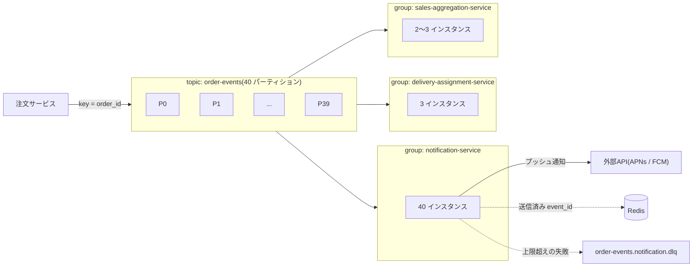

---

## 1. メッセージキー:`order_id`

Kafka が順序を保証するのは **同じパーティションの中だけ**。パーティションは `hash(key) % パーティション数` で決まるので、キーが同じなら必ず同じパーティションに入る。

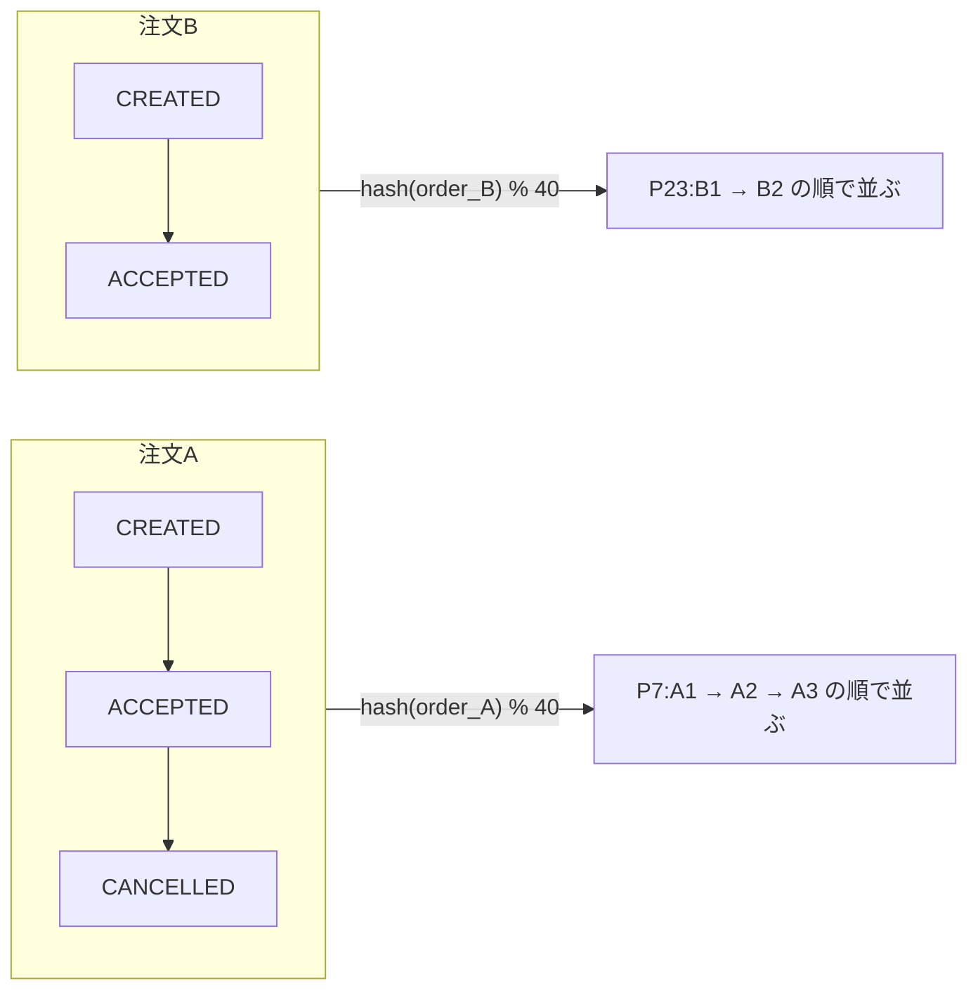

同じ注文のイベントは1つのパーティションに発生順で並ぶ。違う注文は別々のパーティションに散らばるので、負荷も分散する。

### キーなしだと順序が壊れる

キーなしだと、同じ注文のイベントが別々のパーティションに入る。パーティションごとに処理の進み具合が違うので、後に発生したイベントが先に処理されうる。

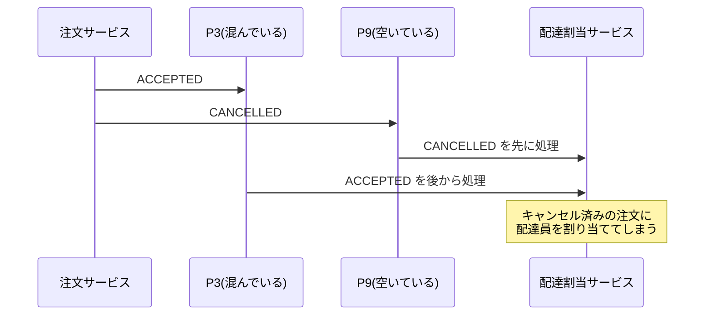

### `user_id` / `store_id` だと偏る

順序は守られるが、まとめる単位が大きすぎる。注文の多いユーザーや人気店のイベントが1つのパーティションに集中する(ホットパーティション)。

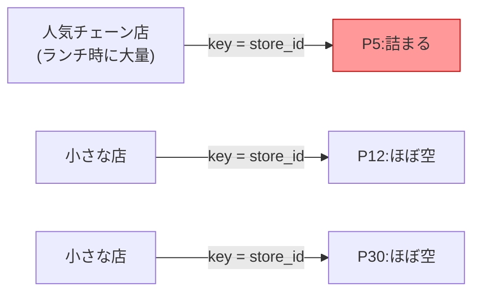

| キー | 同じ注文の順序 | 問題 |
|---|---|---|
| `order_id` | 守られる | なし(採用) |
| `user_id` | 守られる | ヘビーユーザー・法人アカウントの分が偏る |
| `store_id` | 守られる | 人気店でホットパーティションになる |
| キーなし | **壊れる** | `CANCELLED` が `ACCEPTED` より先に処理される |

---

## 2. パーティション数:40(最低 30)

### 計算

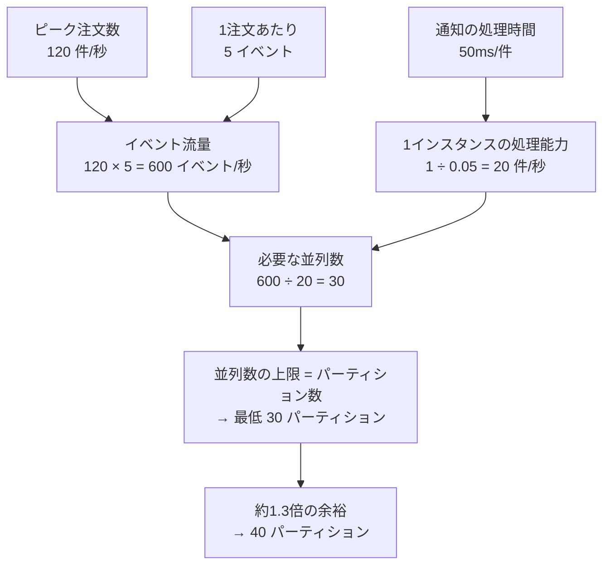

グループ内では1パーティションを1インスタンスしか担当できないので、**並列数の上限 = パーティション数**。だから必要な並列数がそのまま最低パーティション数になる。

### なぜ 30 ちょうどではダメか

| パーティション数 | 1パーティションあたり | 稼働率 | 状態 |
|---|---|---|---|
| 30 | 20 件/秒 | 100% | 少しでも遅れるとラグが増え続ける |
| 40 | 15 件/秒 | 75% | 25% の余力で一時的なラグを解消できる |

余裕が必要な理由は3つ。

- 50ms は平均値で、外部APIが遅くなることがある
- `hash(order_id) % N` は完全には均等にならない
- パーティション数を後から増やすと `order_id` の割り当て先が変わり、切り替え前後で順序が崩れうる。だから最初に多めに取る

---

## 3. コンシューマグループ:サービスごとに分ける

### ルール

- **同じグループ** の中では、1件のイベントはどれか1インスタンスにしか届かない(分担)
- **違うグループ** は、それぞれ独立したオフセットでトピックを全部読む(全員が全件受け取る)

### 1グループにまとめた場合(NG)

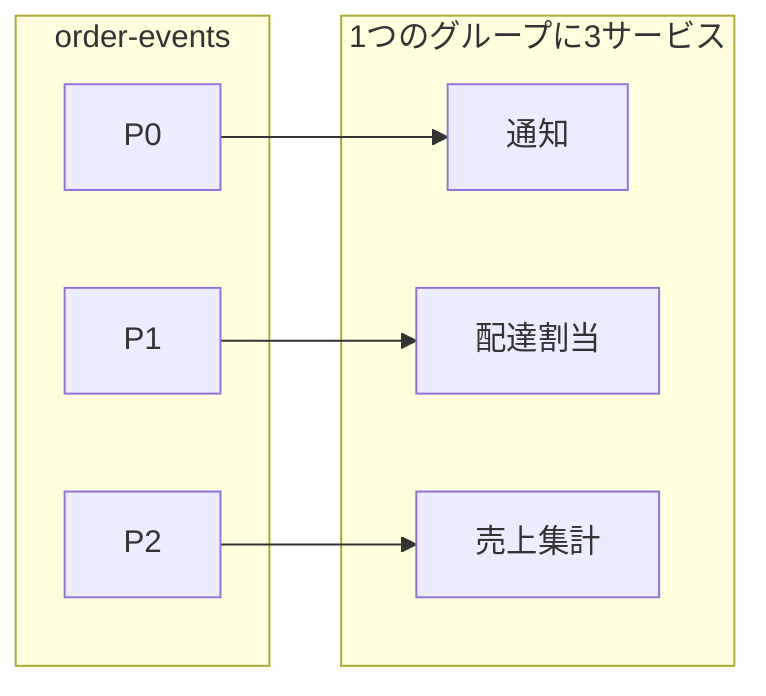

P0 のイベントは通知サービスにしか届かず、配達割当・売上集計は受け取れない。「それぞれが全イベントを受け取る」という要件を満たせない。

### サービスごとに分けた場合(採用)

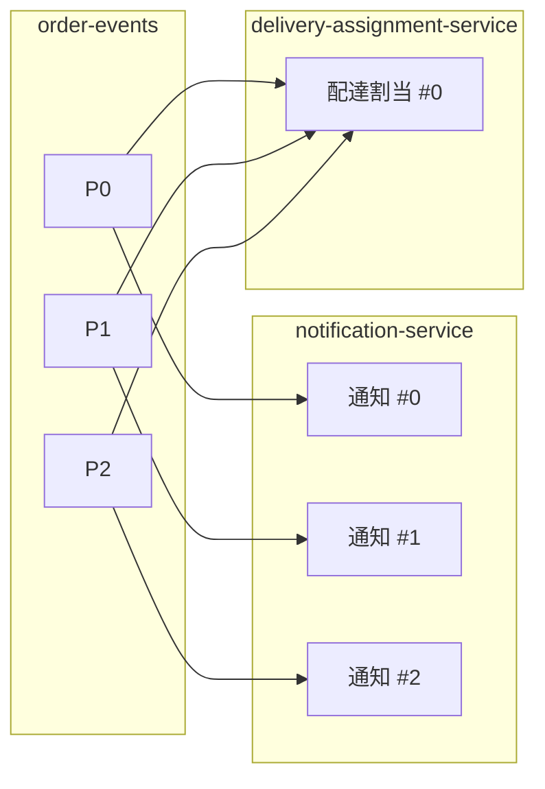

(売上集計グループも同様。図では省略)

各グループが独立したオフセットを持つので、通知サービスが外部APIの遅れでラグをためても、他のサービスには影響しない。スケールやデプロイもサービスごとにできる。

| グループ | インスタンス数 | 理由 |
|---|---|---|
| `notification-service` | 40 | パーティション数と同じ。最低でも 30 台必要 |
| `delivery-assignment-service` | 3 程度 | 処理が速いので、可用性のために複数あれば十分 |
| `sales-aggregation-service` | 2〜3 | 同上 |

### インスタンスをパーティション数より多くすると

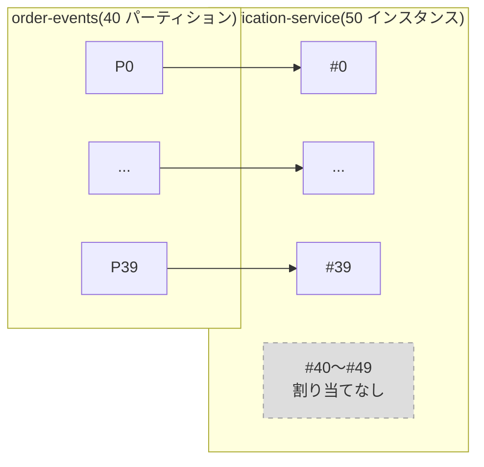

1パーティションを同時に担当できるのは1インスタンスだけなので、余った 10 台は何もしない。処理能力は 40 台のときと変わらない。並列度をもっと上げたいなら、パーティションを増やす必要がある。

---

## 4. オフセットコミット:処理の後に手動コミット

### 処理の前にコミット → 取りこぼし(at-most-once)

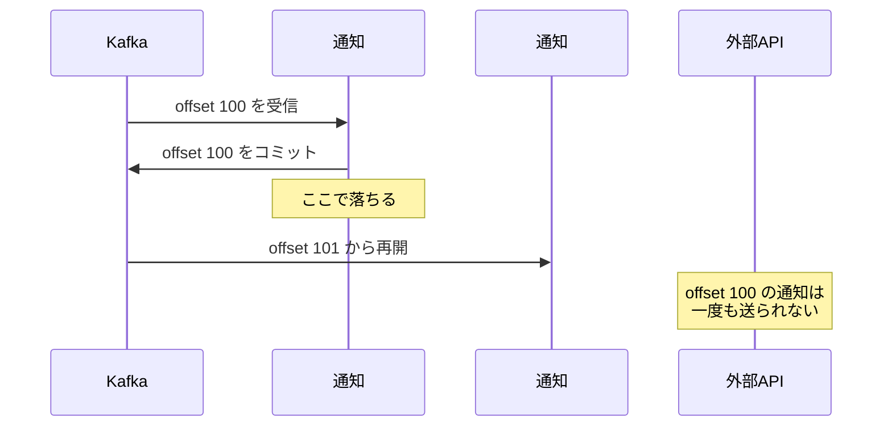

### 処理の後にコミット → 重複(at-least-once)

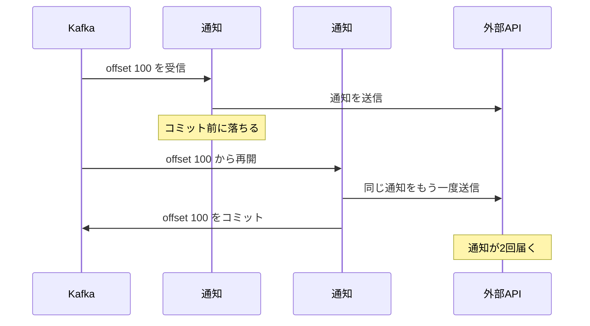

要件は「取りこぼし厳禁」「重複はなるべく避けたい」。取りこぼしは後から取り戻せないので、**処理の後にコミット**を選ぶ。自動コミット(`enable.auto.commit=true`)は処理の完了を待たずにコミットするので切る。

### 重複をゼロにできない理由

外部APIへの送信と、自社側の記録(コミットや Redis への書き込み)は1つのトランザクションにできない。そのため「送信した直後・記録する前」に落ちると、送ったという事実がどこにも残らない。外部APIは冪等キーに対応しておらず変更もできないので、この1件の重複は原理的に残る。

### 重複を減らす方法

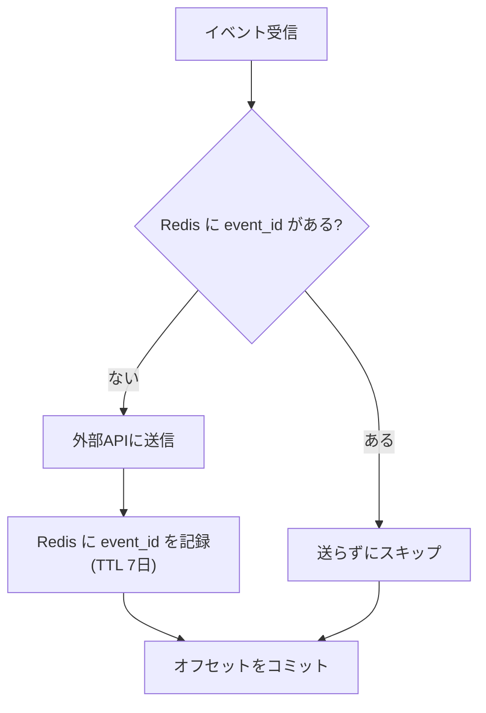

| 方法 | 効く場面 |
|---|---|
| グレースフルシャットダウン | デプロイ時(本命)。処理中の1件を終わらせ、コミットしてから止まる |
| コミット間隔を短くする | 落ちたときに読み直す件数を減らす |
| `event_id` を Redis に記録 | コミットを数十件ごとにまとめる場合や、コミット失敗時の読み直し |
| `apns-collapse-id` / `collapse_key` | 補助。端末上で同じ通知を1件にまとめて見せる |

デプロイ時のグレースフルシャットダウンの流れは次のとおり。計画的な停止なら「送信後・コミット前」で落ちる状況そのものが起きない。

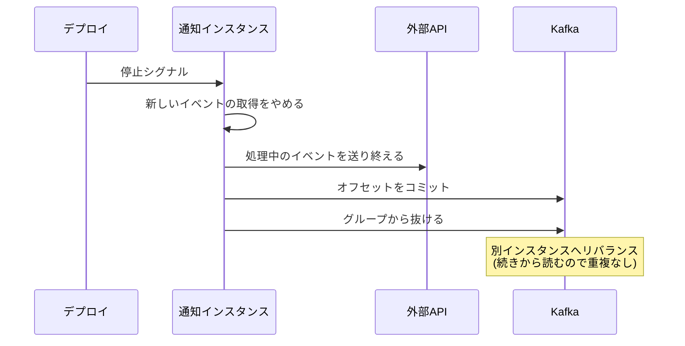

---

## 5. 失敗し続けるイベント:リトライ上限 → DLQ

### 何が起きるか(head-of-line blocking)

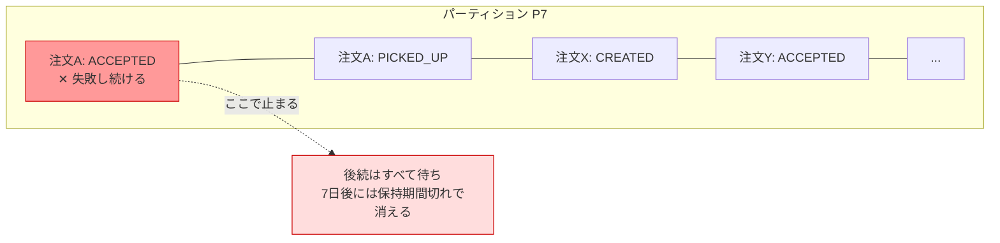

止まるのは同じ注文のイベントだけではなく、**同じパーティションに入っている他の注文のイベントもすべて**。放置すると保持期間切れで、設問4で避けたはずの取りこぼしになる。再起動しても同じイベントで失敗するだけなので解決しない。

### 対処の流れ

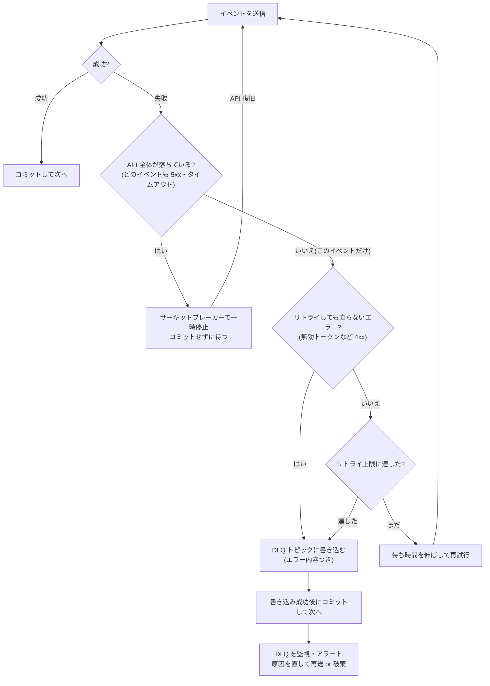

ポイントは2つ。

- **DLQ への書き込みが成功してからコミットする**。順番を逆にすると、DLQ に書く前に落ちたときにイベントが消える
- **DLQ が効くのはイベント固有の失敗だけ**。API 全体が落ちているときに全部 DLQ に流すと、DLQ が本流の代わりになるだけ。その場合はサーキットブレーカーで止めて待てば、Kafka に残っているイベントを復旧後に続きから処理できる

### (参考)順序を厳密に守りたい場合

B を DLQ に移すと、その注文の通知は `A → B → C` ではなく `A → C` になる。通知なら許容できるが、配達割当サービスのように状態を持つ処理では、B を飛ばして C を処理すると状態が壊れうる。その場合は失敗した `order_id` を保留として記録し、同じ `order_id` の後続イベントも DLQ(または保留用の場所)に回す。

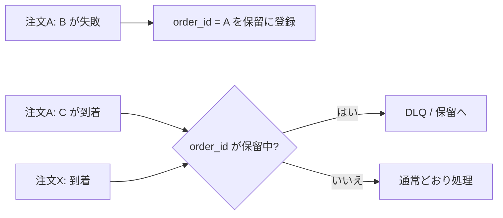

こうすると、止まるのは注文A だけで、他の注文の処理は続けられ、注文A の中の順序も守られる。
