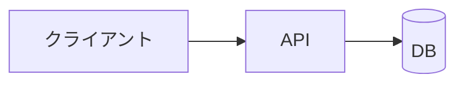
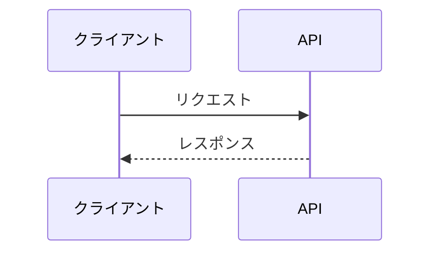
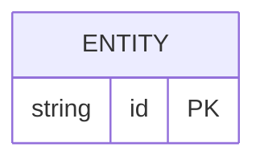

# 設計: <題材名>

## 1. 全体構成

<図の要点を 2〜3 行>

## 2. 主要フロー

### 2.1 <フロー名>

## 3. コンポーネント

| コンポーネント | 役割 | 技術 | 関連質問 |
| --- | --- | --- | --- |
| API | <役割> | <技術> | Q01 |

## 4. データモデル

## 5. 設計判断の要約

| 論点 | 選んだもの | 主な理由 | 関連質問 |
| --- | --- | --- | --- |
| <論点> | <選択> | <理由 1 行> | Q0X |
