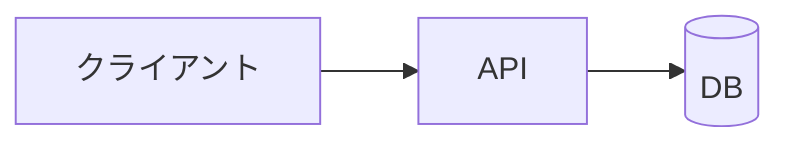
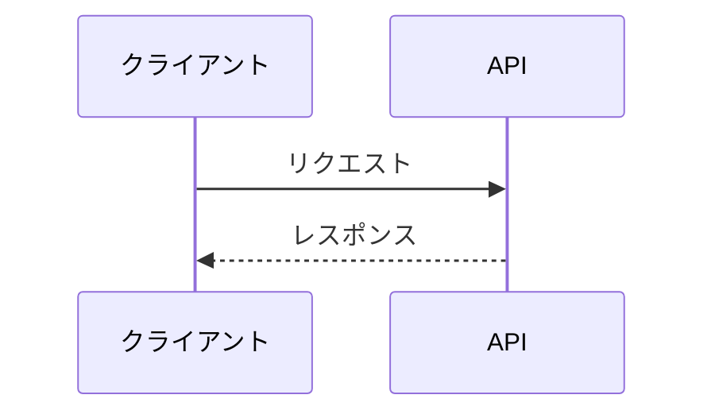

# 設計: <題材名>(<バリアント名>)

base: [../base/DESIGN.md](../base/DESIGN.md)

## 1. base との対応

| base の要素 | このバリアント | 変えた理由 | 関連質問 |
| --- | --- | --- | --- |
| <例: KVS> | <例: DynamoDB(オンデマンド)> | <1 行> | Q01 |

## 2. 全体構成

<base から変わった点を 2〜3 行>

## 3. 変わったフロー

base と同じフローは省略し、変わったものだけ描く。

### 3.1 <フロー名>

## 4. サービス固有の詳細

<このバリアントでしか学べない設定・制約・料金・上限など。数値は出典を添える>

| 項目 | 設定・値 | 理由・出典 | 関連質問 |
| --- | --- | --- | --- |
| <項目> | <値> | <理由> | Q0X |

## 5. 設計判断の要約

| 論点 | 選んだもの | 主な理由 | 関連質問 |
| --- | --- | --- | --- |
| <論点> | <選択> | <理由 1 行> | Q0X |
