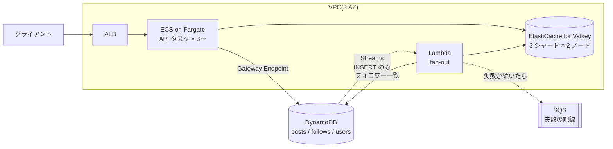
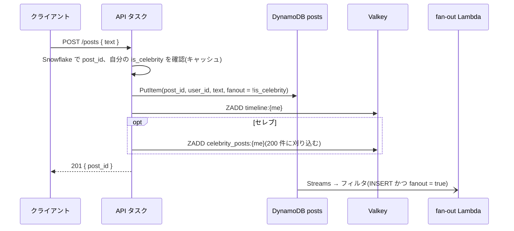
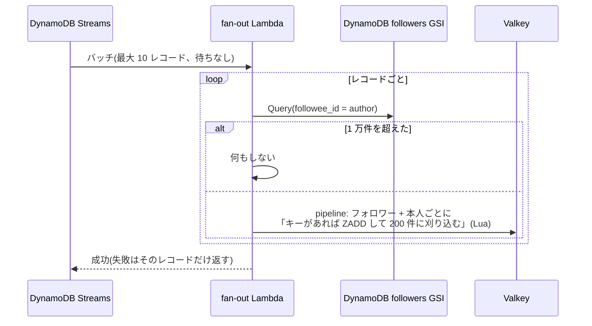
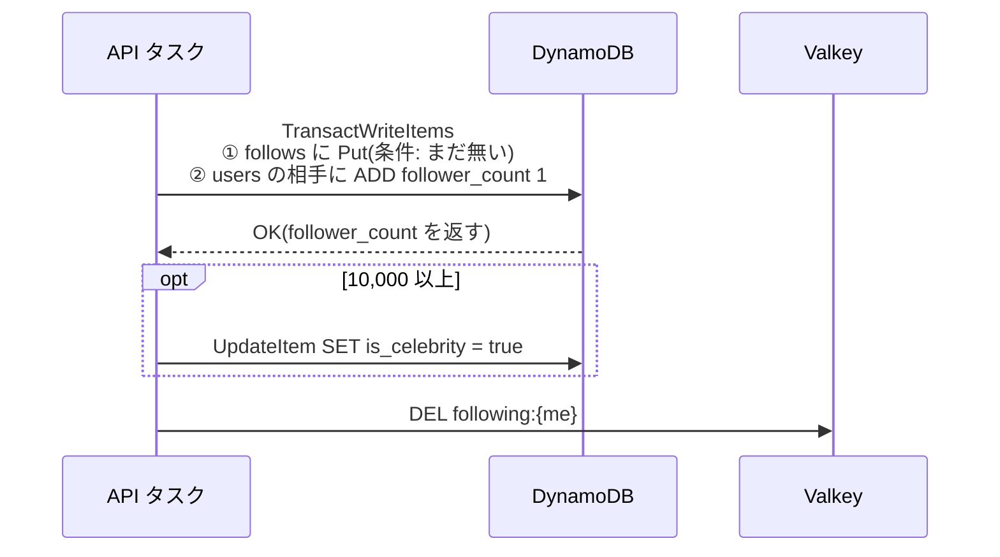

# 設計: ホームタイムライン(AWS 版)

base: [../base/DESIGN.md](../base/DESIGN.md)

## 1. base との対応

| base の要素 | このバリアント | 変えた理由 | 関連質問 |
| --- | --- | --- | --- |
| ロードバランサ | ALB | AZ 分散とヘルスチェックがマネージド | Q13 |
| API サーバ | ECS on Fargate(3 AZ、最低 3 タスク) | Valkey への接続を張りっぱなしにする常駐プロセス | - |
| 投稿ストア | DynamoDB `posts`(PK `post_id`)+ GSI `by_user`(KEYS_ONLY) | 本文は ID で引き、プロフィールは GSI で新しい順 | Q06, Q08 |
| フォロー関係 | DynamoDB `follows`(PK 自分、SK 相手)+ GSI `followers` / `users` | 1 行で両方向を引ける。件数はトランザクションで更新 | Q07 |
| Redis | ElastiCache for Valkey(ノードベース、3 シャード × 2 ノード) | 約 45GB を常時置くので、Serverless より安い | Q05, Q10 |
| キュー + fan-out ワーカー | **DynamoDB Streams + Lambda**(イベントフィルタ付き) | 投稿の保存とイベント送信の二重書き込みをなくす | Q04, Q02 |

## 2. 全体構成

- base の「キューへ送る」をやめ、`posts` への書き込みを **DynamoDB Streams** で拾って fan-out する。保存できた投稿は必ず配られる(→ Q04)
- fan-out Lambda は Valkey に書くので **VPC に接続**する。Streams の読み取りは Lambda サービス側が行うので、Streams 用のエンドポイントは要らない
- Valkey はクラスタモード有効。キーはシャードに散るので、複数キーの一括操作(`MGET`)はシャードごとに分けて送る(→ Q03)

## 3. 変わったフロー

### 3.1 投稿

- API は DynamoDB に書くだけで、fan-out のためのメッセージは送らない。PutItem 後に API が落ちても、Streams のレコードは残る(→ Q01, Q04)
- `fanout` 属性はイベントフィルタのための印。セレブの投稿は Lambda を起動しない(→ Q02)
- プロフィールの GSI は**結果整合性のみ**。投稿直後のプロフィールに出ないことがある(→ Q08)

### 3.2 fan-out

- **タイムラインのキーが無いユーザーには書かない**。しばらくホームを開いていない人のぶんを積まないので、メモリが「DAU × 200 件」で収まる。キーが無い人は次に開いたとき base の手順で作り直す(→ Q10)
- 本人のタイムラインにも書く。API の同期 ZADD が失敗していても、ここで埋まる。ZADD は何度やっても 1 件(→ Q09)
- フォロワー一覧は GSI(KEYS_ONLY、1 件 約 40B)。1 万件でも約 400KB で、Query 1 ページ(1MB)に収まる

### 3.3 フォロー

- 行と件数を 1 トランザクションで書くので、二重フォローで件数だけ増えることがない(→ Q07)
- トランザクションは 1 項目あたり通常の 2 倍の書き込みユニットを消費する

### 3.4 ホームの取得(本文の取り方だけ変わる)

- 本文の `MGET` は、キーが別シャードにあると `CROSSSLOT` エラーになる。クラスタ対応クライアントでシャードごとの `MGET` に分け、並列に投げる(→ Q03)
- キャッシュに無い本文は `BatchGetItem`(1 回最大 100 件)でまとめて取る
- タイムラインを読んだら `EXPIRE timeline:{me} 7 日` で寿命を延ばす

## 4. サービス固有の詳細

### 4.1 設定値

| 項目 | 設定・値 | 理由・出典 | 関連質問 |
| --- | --- | --- | --- |
| DynamoDB キャパシティ | オンデマンド | 朝のピークに追従。テーブルの初期上限は 40,000 RRU / WRU 毎秒([Quotas][ddb-quotas]) | - |
| `posts` の GSI `by_user` | PK `user_id`、SK `post_id`、射影 KEYS_ONLY | 本文を GSI に複製しない(3TB が倍にならない)。GSI は非同期更新・結果整合性のみ([GSI][ddb-gsi]) | Q06, Q08 |
| Streams のビュー | `NEW_IMAGE` | フィルタで `NewImage.fanout` を見るため。レコードは 24 時間で消える([Streams][ddb-streams]) | Q11 |
| イベントフィルタ | `eventName = INSERT` かつ `NewImage.fanout = true` | セレブの投稿・更新・削除で Lambda を起動しない([Filtering][lambda-ddb-filter]) | Q02 |
| バッチ | サイズ 10、ウィンドウ 0 秒 | 反映 5 秒以内のため溜めない。ウィンドウは最大 5 分まで設定できる([Lambda with DynamoDB][lambda-ddb]) | Q01 |
| `ParallelizationFactor` | 2(最大 10) | 1 シャードを複数の呼び出しで並列処理する([ESM パラメータ][lambda-ddb-params]) | Q14 |
| リトライ | `MaximumRetryAttempts` 5、`BisectBatchOnFunctionError` 有効、`ReportBatchItemFailures` 有効 | デフォルト(-1)は 24 時間リトライし続け、**そのシャードの後続が止まる**([ESM パラメータ][lambda-ddb-params]) | Q11 |
| 失敗の送り先 | SQS 標準キュー | 諦めたバッチの情報を残し、後で手で流し直す | Q11 |
| Streams の読み取り料金 | 0 円 | Lambda トリガー経由の `GetRecords` は課金されない([料金][ddb-pricing]) | - |
| Valkey ノード | cache.r7g.xlarge(26.32GB)× 6 | 3 シャード × (プライマリ + レプリカ)。レプリカは別 AZ。クラスタモードは 1〜500 シャード、各 0〜5 レプリカ([Cluster mode][ec-cluster]) | Q05, Q12 |
| `reserved-memory-percent` | 25%(デフォルト) | 複製バッファ・断片化・fork 用。下げてはいけない([Reserved memory][ec-reserved]) | Q10 |
| `maxmemory-policy` | `volatile-lru` | TTL 付きのキー(タイムライン・本文・フォロー中)だけを追い出す。`celebrity_posts` は TTL なしで残す | Q10 |

### 4.2 Valkey のメモリ見積もり

| 中身 | 前提 | 量 |
| --- | --- | --- |
| タイムライン | DAU 200 万 × 200 件 × 100B(base と同じ) | 約 40GB |
| 本文キャッシュ | 1 日ぶん 170 万件 × 約 1KB(TTL 1 日) | 約 2GB |
| フォロー中一覧 | 1 時間に開く人を 50 万人 × 100 件 × 20B と仮定 | 約 1GB |
| セレブの最新 | セレブ 2,000 人と仮定 × 200 件 × 100B | 約 0.04GB |
| 合計 | | **約 45GB** |

- 使える量は 26.32GB × 75%(予約 25% を除く)× 3 シャード ≒ **59GB**。余裕は約 30%
- レプリカは同じデータのコピーなので、容量は増えない(→ Q12)

### 4.3 月額の概算(5 年目、us-east-1)

| 項目 | 前提 | 計算 | 月額 |
| --- | --- | --- | --- |
| Valkey ノード | r7g.xlarge × 6。Valkey は Redis OSS($0.437/h)の 20% 安 | 6 × $0.35 × 730h | 約 $1,530 |
| Valkey のクロス AZ 転送 | 平均 1,000 ホーム/秒 × 約 15KB、2/3 が別 AZ、往復で $0.02/GB | 39TB × 2/3 × $0.02 | 約 $520 |
| DynamoDB 書き込み | 投稿 5,200 万件/月 × (本体 1 + GSI 1) WRU | 104M × $0.625/M | 約 $65 |
| DynamoDB ストレージ | 31 億件 × 1KB + GSI ≒ 3.2TB(Standard) | 3,200 × $0.25 | 約 $800 |
| Lambda | 5,200 万レコード、1 回 50ms・256MB と仮定 | 呼び出し + 実行時間 | 約 $20 |

- 単価の出典: [ElastiCache 料金][ec-pricing](r7g.xlarge $0.437/h、Valkey は 20% 安、AZ 間転送 $0.01/GB)、[DynamoDB オンデマンド料金][ddb-pricing]
- ALB・Fargate・PITR・インターネットへの転送は省略
- Serverless for Valkey にすると、保存だけで 45GB × $0.084 × 730h ≒ **$2,760**。常に大きなデータを置く用途ではノードのほうが安い(→ Q05)
- **クロス AZ 転送が DynamoDB の書き込みより高い**。読みが多いサービスでは見落としやすい(→ Q15)

## 5. 設計判断の要約

| 論点 | 選んだもの | 主な理由 | 関連質問 |
| --- | --- | --- | --- |
| fan-out の起点 | DynamoDB Streams | 保存とイベント送信の二重書き込みがない。Lambda からの読み取りは無料 | Q01, Q04 |
| 不要な起動 | イベントフィルタ | セレブ・更新・削除で Lambda を呼ばない | Q02 |
| 失敗時 | リトライ 5 回 + 二分割 + SQS へ退避 | 1 件の毒レコードでシャード全体を止めない | Q09, Q11 |
| キャッシュ | Valkey ノードベース(3 シャード) | 45GB を常時置くなら Serverless より安い | Q05, Q10 |
| fan-out 先 | キーがある人だけ | メモリを DAU に比例させる | Q10 |
| プロフィール | GSI(KEYS_ONLY)+ 本文キャッシュ | ストレージを倍にしない。投稿直後の遅れは許容 | Q06, Q08 |
| フォロー | TransactWriteItems | 行と件数がずれない | Q07 |

[ddb-quotas]: https://docs.aws.amazon.com/amazondynamodb/latest/developerguide/ServiceQuotas.html
[ddb-gsi]: https://docs.aws.amazon.com/amazondynamodb/latest/developerguide/GSI.html
[ddb-streams]: https://docs.aws.amazon.com/amazondynamodb/latest/developerguide/Streams.html
[ddb-pricing]: https://aws.amazon.com/dynamodb/pricing/on-demand/
[lambda-ddb]: https://docs.aws.amazon.com/lambda/latest/dg/with-ddb.html
[lambda-ddb-params]: https://docs.aws.amazon.com/lambda/latest/dg/services-ddb-params.html
[lambda-ddb-filter]: https://docs.aws.amazon.com/lambda/latest/dg/with-ddb-filtering.html
[ec-pricing]: https://aws.amazon.com/elasticache/pricing/
[ec-reserved]: https://docs.aws.amazon.com/AmazonElastiCache/latest/dg/redis-memory-management.html
[ec-cluster]: https://docs.aws.amazon.com/AmazonElastiCache/latest/dg/Replication.Redis-RedisCluster.html
