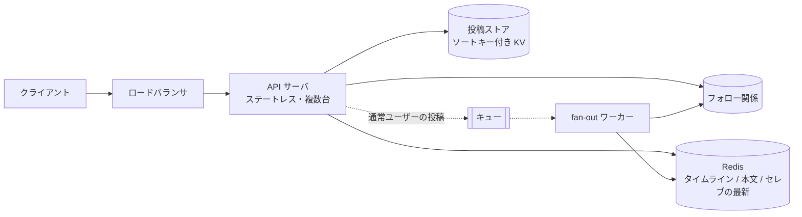
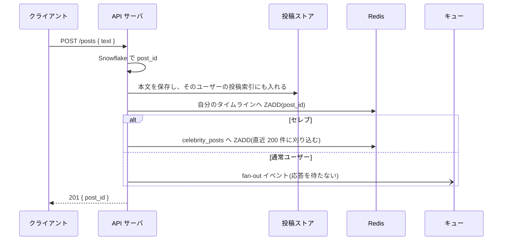
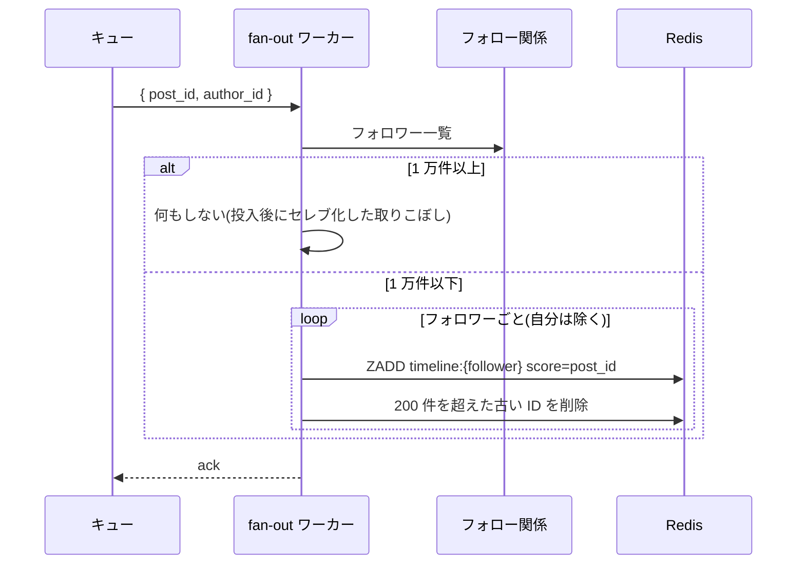
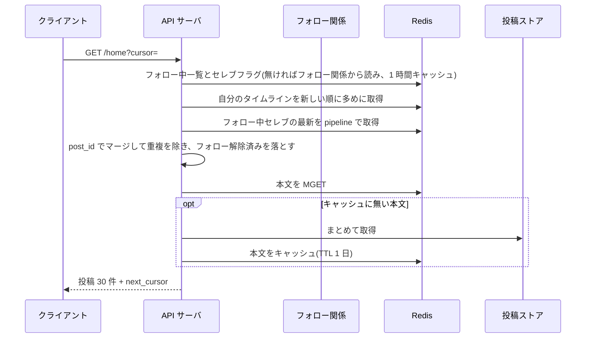
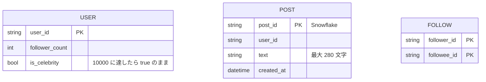

# 設計: ホームタイムライン

## 1. 全体構成

- 投稿本文の正本は投稿ストア。ホームの並びは Redis に作った **再生可能なキャッシュ**(→ Q12, Q13)
- フォロワーが 1 万未満の投稿は、キュー経由でフォロワーのタイムラインへ ID を配る(**書き込み時 fan-out**)(→ Q04, Q05)
- 1 万以上(セレブ)は配らない。ホームを開いたときに、フォロー中セレブの最新投稿を混ぜる(→ Q02, Q14)
- セレブフラグは一度立ったら戻さない。戻すと、その期間の投稿がフォロワーのホームから消える(→ Q11)

## 2. 主要フロー

### 2.1 投稿

- 自分のホームだけは同期で書く。投稿者がリロードしても空にならない(→ Q01)
- プロフィール一覧は投稿ストアの索引を読む。Redis が無くても成立する
- ID は時刻を含む Snowflake。タイムラインのスコアに post_id をそのまま使い、ミリ秒程度の前後は許容する(→ Q06)

### 2.2 フォロワーへの fan-out

- 投稿がすべてフォロワー 100 人のユーザーからなら、100 × 20 投稿/秒 = **約 2,000 回/秒**の ZADD。1 投稿が 1 万回を超えないように閾値を置いている(→ Q04)
- 同じ post_id の ZADD は 1 件のまま。キューが同じイベントを 2 回配っても重複しない(→ Q07, Q10)
- 反映の遅れはキューの滞留時間。要件の 5 秒はこの滞留の上限(→ Q12)

### 2.3 ホームの取得

- ページは 30 件。解除済みを除くと 30 件を割るので、ID は多めに取ってから本文を埋める(→ Q08)
- ピーク 5,000 ホーム/秒 × 30 件 = 本文参照 15 万回/秒。ID 列の取得よりこちらが大きい(→ Q15)
- セレブの最新は「セレブの人数 × 200 件」だけを常時置く。ホーム全体(DAU × 200 件 ≒ 40GB)とは別に、人数が少ないので小さい
- 新規フォローの過去投稿はバックフィルしない。解除と同様、これからの投稿だけが並ぶ(→ Q09)
- タイムラインのキャッシュミスは、フォロー中(セレブ以外)の最近の投稿を投稿ストアから集めて作り直す。フォロー数ぶん索引を読むので、ヒット時より遅い(→ Q03)

## 3. コンポーネント

| コンポーネント | 役割 | 技術(例) | 関連質問 |
| --- | --- | --- | --- |
| API サーバ | 投稿、ホームのマージ、自分のタイムラインへの同期書き込み | 任意の Web フレームワーク | Q01, Q02 |
| 投稿ストア | 本文の正本。ユーザーごとの新しい順索引 | ソートキー付き KV(Cassandra / DynamoDB など) | Q06, Q13 |
| フォロー関係 | フォロー中とフォロワーの両方を引く。フォロワー数とセレブフラグ | 同じ種類のストアの別テーブル | Q04, Q11 |
| Redis | ホームの ID 列、セレブの最新、本文キャッシュ、フォロー中キャッシュ | Redis(ソート済みセット) | Q07, Q15 |
| キュー + fan-out | 通常ユーザーの投稿 ID をフォロワーのホームへ配る | 任意のメッセージキュー | Q10, Q12 |

## 4. データモデル

- 投稿ストアは `post_id` で本文を取り、`user_id` + `post_id` でプロフィールの新しい順を取る
- フォロー 1 件で「誰をフォローしているか」と「誰にフォローされているか」の両方が引けるようにする
- フォロー時に `follower_count` を増減し、1 万に達したら `is_celebrity` を立てる。以降はフォロワーが減っても戻さない。フォロー中キャッシュは、フォローした側のユーザー分だけ捨てる(→ Q11)
- Redis のタイムラインは `member = post_id`, `score = post_id`。200 件で刈り込む

## 5. 設計判断の要約

| 論点 | 選んだもの | 主な理由 | 関連質問 |
| --- | --- | --- | --- |
| 配り方 | ハイブリッド fan-out | フォロワー 100 人なら配れる。1 万以上の 1 投稿は配らない。フラグは戻さない | Q04, Q05, Q11, Q14, Q17 |
| ホームの実体 | Redis の ID 列 | 読みのたびに 100 人分を集めない。消えても作り直せる | Q03, Q13, Q16 |
| 重複 | ソート済みセット | fan-out は at-least-once でも 1 件のまま | Q07, Q10 |
| ID | Snowflake | おおよそ時刻順なので、スコアを別に持たなくてよい | Q06 |
| 自分の投稿 | API が同期で ZADD | キューの遅れを投稿者に見せない | Q01 |
| フォロー直後 | 過去分は戻さない | バックフィルの走査をしない | Q09 |
| 解除 | 表示時に著者で落とす | 配り済み ID を全員分から消さない | Q08 |
