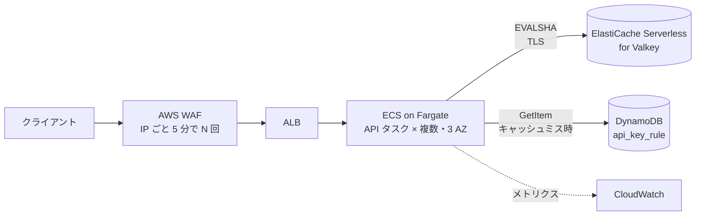
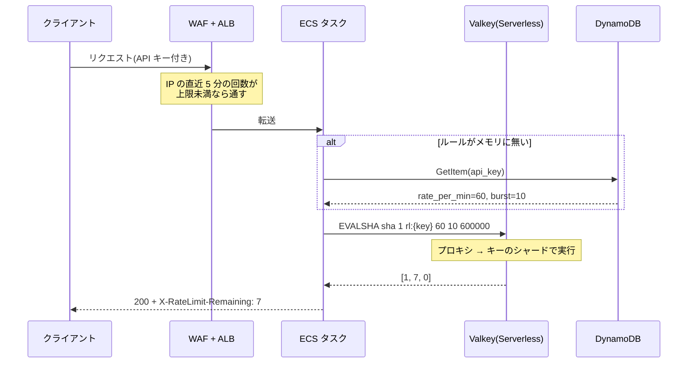
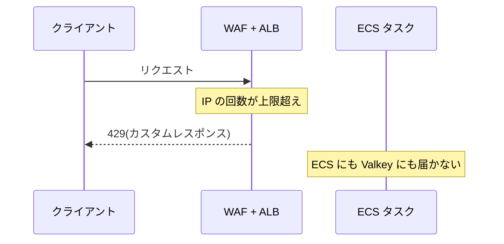

# 設計: API レート制限(AWS)

base: [../base/DESIGN.md](../base/DESIGN.md)

## 1. base との対応

| base の要素 | このバリアント | 変えた理由 | 関連質問 |
| --- | --- | --- | --- |
| ロードバランサ | ALB + AWS WAF(レートベースルール) | IP 単位の粗い制限を ALB の手前で済ませ、ECS と Valkey に届く量を減らす | Q01, Q06 |
| API サーバ | ECS on Fargate(3 AZ に分散) | ステートレスなコンテナをサーバ管理なしで横に増やせる | — |
| Redis | ElastiCache Serverless for Valkey | Lua(`EVALSHA`)が使え、容量計画・AZ 冗長・パッチ当てを任せられる | Q02, Q04 |
| ルール DB(RDB) | DynamoDB(オンデマンド) | 読み方が「API キーで 1 件引く」だけなので KV で足りる | Q05 |
| (無し) | CloudWatch メトリクス | 429 の数と fail-open の回数を見張る | Q08 |

アプリ内の判定ロジック(トークンバケット、Lua 1 回、fail-open、ルールの 60 秒キャッシュ)は base のまま。API Gateway の使用量プランは**使わない**(→ Q03)。

## 2. 全体構成



- 制限は 2 段。WAF は **IP 単位・分単位の粗い上限**で、ECS の判定は **API キー単位の正確な上限**(→ Q01)
- Valkey は Serverless なので、アプリから見えるのは 1 つのエンドポイントだけ。裏ではプロキシがシャードに振り分ける(→ Q02)
- ECS・Valkey・DynamoDB はすべて VPC 内(DynamoDB は VPC ゲートウェイエンドポイント経由)。Valkey は Serverless なので通信は常に TLS

## 3. 変わったフロー

### 3.1 許可されるリクエスト(AWS のサービス名で)



- WAF の判定は base のトークンバケットとは別物。直近の評価ウィンドウ内の回数を見る(→ Q06)
- Valkey へのコマンドにはクライアント側のタイムアウト(例 10ms)をかけ、超えたら fail-open で通す(→ Q08)

### 3.2 WAF で止まるリクエスト



- WAF のブロックは既定で 403。base と揃えるため、カスタムレスポンスで 429 を返す設定にする
- ここで止まった分は Valkey の ECPU を消費しない(→ Q09)

## 4. サービス固有の詳細

### 4.1 設定値

| 項目 | 設定・値 | 理由・出典 | 関連質問 |
| --- | --- | --- | --- |
| WAF 評価ウィンドウ | 300 秒(5 分) | 選べるのは 60 / 120 / 300 / 600 秒で既定は 300。正確さは求めず、極端な IP だけ止める([WAF rate-based settings](https://docs.aws.amazon.com/waf/latest/developerguide/waf-rule-statement-type-rate-based-high-level-settings.html)) | Q06 |
| WAF 上限 | 例: IP ごと 5 分で 3,000 回(= 10 回/秒) | 有料プランの 600 回/分を 1 IP から使っても引っかからない値。最小設定は 10。上限ちょうどでは止まらない(同上) | Q06 |
| WAF 集計キー | 送信元 IP | ALB の手前なので IP は信頼できる。CloudFront を挟むなら `X-Forwarded-For` を指定(同上) | — |
| Valkey 種別 | ElastiCache Serverless for Valkey | `EVAL` / `EVALSHA` / `SCRIPT LOAD` がサポート対象。`SCRIPT FLUSH` は no-op でスクリプトキャッシュはサービスが管理([Supported commands](https://docs.aws.amazon.com/AmazonElastiCache/latest/dg/SupportedCommands.html)) | Q04 |
| Valkey 可用性 | 複数 AZ に自動で複製、SLA 99.99% | 障害ノードは自動で置き換え([How ElastiCache works](https://docs.aws.amazon.com/AmazonElastiCache/latest/dg/WhatIs.corecomponents.html)) | Q07 |
| Valkey 接続 | 1 エンドポイント(プロキシ経由)、TLS 必須 | クライアントがクラスタのトポロジーを追わなくてよい(同上) | Q02 |
| コマンドタイムアウト | 10ms、失敗時は fail-open | 判定の p99 5ms 目標に対し、たまの遅延は許容しつつ API を待たせ続けない | Q08 |
| `NOSCRIPT` 対策 | `EVALSHA` が `NOSCRIPT` なら `EVAL` で再送 | スクリプトキャッシュはサービス管理なので、スケールやノード交換で消えうる前提にする | Q07 |
| DynamoDB | オンデマンド、PK = `api_key` | キャッシュミスは最大でも 5 万キー ÷ 60 秒 ≒ 830 回/秒。キャパシティ計画が不要な量 | Q05 |

### 4.2 アプリ側の呼び出し(実装例)

Valkey で動かすスクリプトは base と同じもの([../base/LUA_SCRIPT.md](../base/LUA_SCRIPT.md))。ここでは ECS タスク(Node.js + iovalkey)側の呼び出しだけを示す。ルールの取得は省略。

```ts
import Valkey from "iovalkey";

const vk = new Valkey.Cluster([{ host: process.env.VALKEY_ENDPOINT!, port: 6379 }], {
  dnsLookup: (addr, cb) => cb(null, addr), // Serverless のエンドポイントは TLS 証明書のホスト名で繋ぐ
  redisOptions: { tls: {}, commandTimeout: 10 },
});
vk.defineCommand("tokenBucket", { numberOfKeys: 1, lua: LUA_SOURCE }); // EVALSHA → NOSCRIPT なら EVAL

export async function check(apiKey: string, rule: { ratePerMin: number; burst: number }) {
  try {
    const [allowed, remaining, retryAfter] = await (vk as any).tokenBucket(
      `rl:{${apiKey}}`, rule.ratePerMin, rule.burst, 600_000, // TTL 10 分
    );
    return { allowed: allowed === 1, remaining, retryAfter };
  } catch {
    metrics.increment("ratelimit.fail_open"); // CloudWatch に出して見張る
    return { allowed: true, remaining: -1, retryAfter: 0 }; // fail-open(base Q12)
  }
}
```

- キーを `rl:{api_key}` と波かっこで囲むのはハッシュタグ。今は 1 キーなので不要だが、日次バケットを足したとき同じスロットに載せるため(base Q18)

### 4.3 料金の目安(us-east-1)

| 項目 | 前提 | 計算 | 1 か月(730 時間) |
| --- | --- | --- | --- |
| Valkey データ保存 | 実データは数 MB だが最小課金 100 MB | 0.1 GB × $0.084/GB-時 | 約 $6 |
| Valkey ECPU | 平均 2,000 req/秒。Lua は GET の約 3 倍の vCPU と**仮定**して 3 ECPU/回 | 2,000 × 3,600 × 3 = 2,160 万 ECPU/時 × $0.0023/100 万 | 約 $36 |

- 単価は [ElastiCache 料金](https://aws.amazon.com/elasticache/pricing/) の例(Valkey: $0.084/GB-時、$0.0023/100 万 ECPU、最小 100 MB)。東京は少し高い
- 「Lua 1 回 = 3 ECPU」は仮定。実際は CloudWatch の `ElastiCacheProcessingUnits` で測って直す(→ Q09)
- WAF・ALB・Fargate・DynamoDB の料金は別途。DynamoDB の読み取りはルールのキャッシュミス時だけなので小さい

## 5. 設計判断の要約

| 論点 | 選んだもの | 主な理由 | 関連質問 |
| --- | --- | --- | --- |
| API キー単位の制限 | アプリ内 + Valkey(base のまま) | API Gateway の使用量プランはベストエフォートで、アカウント全体の既定上限 10,000 RPS がピークと同じ | Q03, Q11 |
| IP 単位の制限 | WAF レートベースルール | アプリに届く前に止められ、Valkey の ECPU を使わない | Q01, Q06 |
| Valkey の形態 | Serverless | 規模が小さく(数 MB・平均 2,000 回/秒)、ノード選定より運用の手間を減らしたい | Q04, Q09 |
| ルールの正本 | DynamoDB | 1 件引くだけで JOIN も集計も無い | Q05, Q12 |
| 障害時 | タイムアウト 10ms で fail-open | base の方針どおり。CloudWatch で fail-open の回数を見張る | Q07, Q08 |
