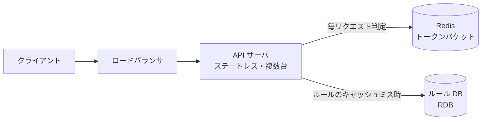
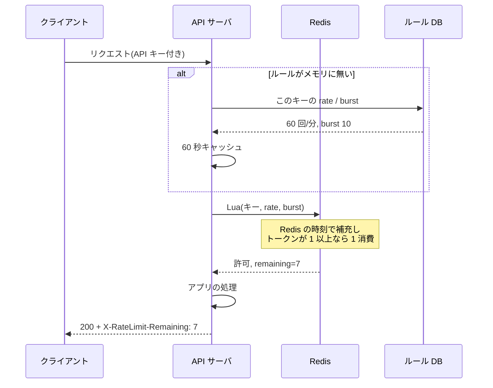
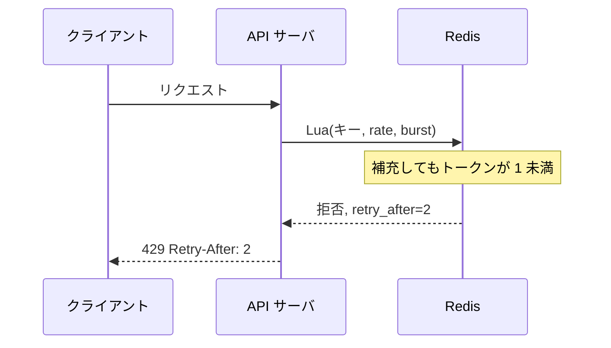
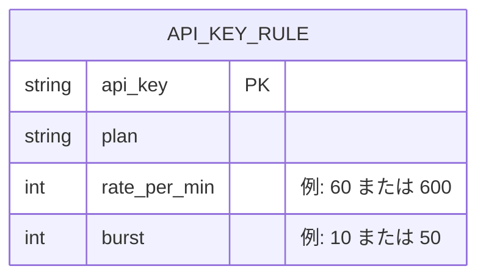

# 設計: API レート制限

## 1. 全体構成

- 判定は API プロセスの中で行う。専用のレート制限サービスは挟まない(往復を 1 回に保つ)(→ Q01, Q06)
- キーごとの残数は **Redis のトークンバケット**。更新は Lua で原子的に行う(→ Q02, Q07)
- 上限値(回/分とバースト)はルール DB が正。API サーバのメモリに 60 秒キャッシュする(→ Q10)

## 2. 主要フロー

### 2.1 許可されるリクエスト

- バケットの中身は `tokens` と `last_refill_ms` だけ。経過時間 × 補充レートを足し、上限はバーストで頭打ちにする(→ Q02, Q05)
- キーが無ければ、満タン(バースト分)から始める。しばらくアクセスが無いと TTL(10 分)で消え、次も満タンからになる(→ Q11)
- 毎回ルールを Redis に書かず、Lua の引数で渡す。プラン変更はメモリキャッシュの 60 秒で効く(→ Q10)

### 2.2 拒否されるリクエスト

- 拒否でも保存し、TTL を延ばす。延ばさないと、拒否され続けているキーが途中で消えて満タンに戻る(→ Q11)
- `Retry-After` は「トークンが 1 貯まるまでの秒」を切り上げたもの(→ Q03)
- アプリの処理には入らない

### 2.3 判定スクリプト(Lua)

- 1 回の呼び出しで「Redis の時刻を取る → 経過時間ぶん補充 → 1 以上なら消費 → 保存して TTL を延ばす」までを済ませる(→ Q02, Q07)
- 入力はキーとルール(rate / burst)、出力は「許可か / 残り / 待ち秒」の 3 つ
- API サーバは起動時にスクリプトを登録し、以降は ID(SHA1)だけ送って呼ぶ
- スクリプトの中身・計算例は [LUA_SCRIPT.md](LUA_SCRIPT.md)

## 3. コンポーネント

| コンポーネント | 役割 | 技術(例) | 関連質問 |
| --- | --- | --- | --- |
| API サーバ | ルールのキャッシュ、Lua の呼び出し、通す/429 | 任意の Web フレームワーク | Q06, Q13 |
| Redis | キーごとのバケット。判定のたびに読み書き | Redis(Lua) | Q07, Q12, Q14 |
| ルール DB | API キー → 回/分・バーストの正本 | RDB | Q10 |

- ピーク 10,000 req/秒 = Lua 10,000 回/秒。短いスクリプトなら Redis 1 台で足りる、という前提。トークンを各サーバへ貸し出さない(→ Q15, Q16)
- 1 つの API キーへの操作は、そのキーの上限で頭打ちになる。全通信が 1 キーに集まるカウンタを置くと、そこが先に詰まる(→ Q14)
- メモリは小さい。5 万キー × 100B 程度で数 MB。TTL は掃除用(→ Q11)

## 4. データモデル

- 残数はルール DB に置かない。再起動で消えてよい実行時状態なので Redis だけが持つ
- Redis のキーは `rl:{api_key}`。ハッシュに `tokens` と `last_refill_ms`

## 5. 設計判断の要約

| 論点 | 選んだもの | 主な理由 | 関連質問 |
| --- | --- | --- | --- |
| アルゴリズム | トークンバケット | 平均レートを守りつつ、バーストを一定量だけ許す | Q04, Q08 |
| 状態の置き場 | Redis に集約 | サーバが複数台でも同じ残数を見る | Q06, Q16 |
| 制限の単位 | API キー | プランの上限をキーにそのまま紐付ける | Q17 |
| 更新 | Lua 1 回 | 読みと減算のあいだに割り込まれない | Q07 |
| 時刻 | Redis の TIME | アプリサーバの時計ずれを判定に入れない | Q09 |
| 障害時 | 通す(fail-open) | 制限は保護であり、API の可用性を優先する | Q12, Q13 |
| ルール反映 | メモリに 60 秒 | リクエストのたびに RDB を読まない | Q10 |
