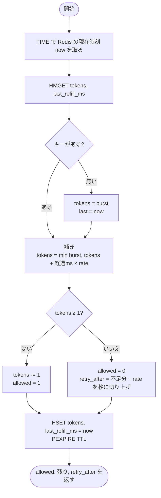
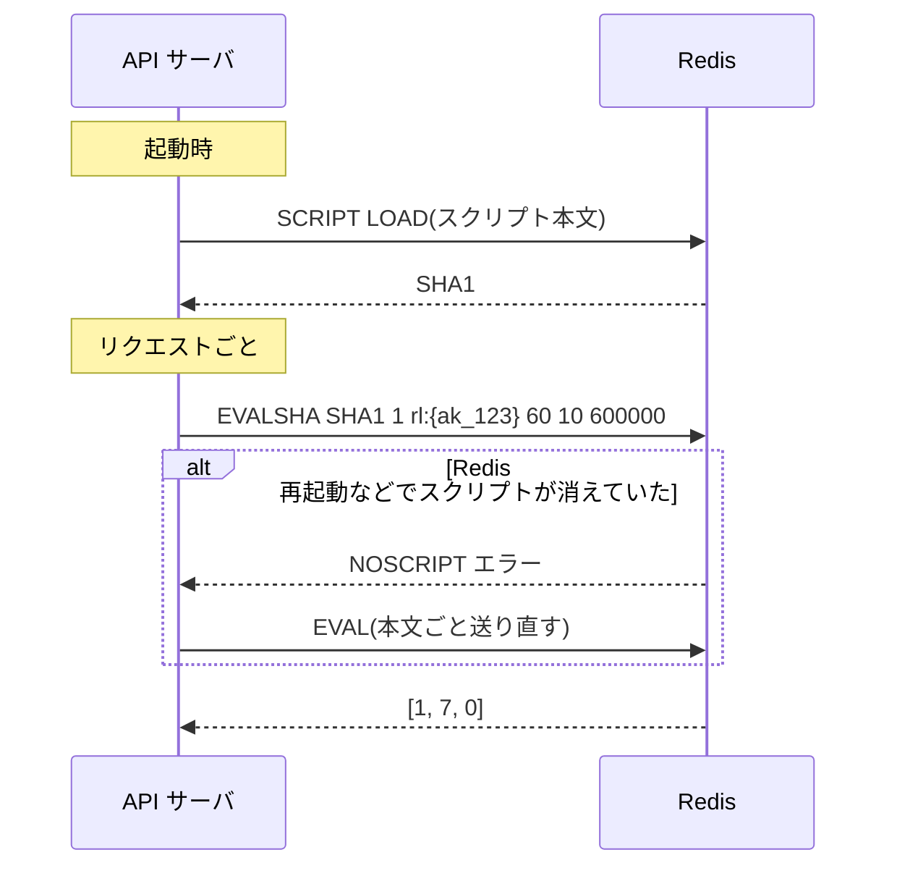

# 判定スクリプト(Lua)の詳細

[DESIGN.md](DESIGN.md) 2.3 の補足。設計の全体像は DESIGN.md を先に読む。

## 入力と出力

| 種類 | 名前 | 中身 | 例 |
| --- | --- | --- | --- |
| 入力(KEYS) | `KEYS[1]` | バケットのキー | `rl:{ak_123}` |
| 入力(ARGV) | `ARGV[1]` | 回/分(rate_per_min) | `60` |
| 入力(ARGV) | `ARGV[2]` | バースト(バケットの容量) | `10` |
| 入力(ARGV) | `ARGV[3]` | TTL(ミリ秒) | `600000`(10 分) |
| 出力 | `[1]` | 許可なら 1、拒否なら 0 | `1` |
| 出力 | `[2]` | 残りトークン(切り捨て) | `7` |
| 出力 | `[3]` | 拒否時の待ち秒(許可なら 0) | `0` |

- 触るキーは `KEYS[1]` の 1 つだけ。Redis Cluster ではスクリプトが触るキーを `KEYS` で宣言する必要があり、1 キーなら必ず 1 シャードで完結する(→ Q07)
- ルール(rate / burst)は毎回 ARGV で渡す。Redis 側にルールを持たないので、プラン変更時に Redis を更新する処理が要らない(→ Q10)

## 処理の流れ



## スクリプト

```lua
-- KEYS[1]: rl:{api_key}
-- ARGV[1]: rate_per_min, ARGV[2]: burst, ARGV[3]: ttl_ms
local key    = KEYS[1]
local rate   = tonumber(ARGV[1]) / 60000   -- 1 ミリ秒あたりに増えるトークン
local burst  = tonumber(ARGV[2])
local ttl_ms = tonumber(ARGV[3])

-- 1. 現在時刻(Redis サーバの時計)
local t   = redis.call('TIME')              -- { 秒, マイクロ秒 }
local now = tonumber(t[1]) * 1000 + math.floor(tonumber(t[2]) / 1000)

-- 2. 現在の状態を読む。無ければ満タンから
local v      = redis.call('HMGET', key, 'tokens', 'last_refill_ms')
local tokens = tonumber(v[1])
local last   = tonumber(v[2])
if tokens == nil or last == nil then
  tokens = burst
  last   = now
end

-- 3. 経過時間ぶん補充し、容量で頭打ち
local elapsed = math.max(0, now - last)     -- 時計が戻っても負にしない
tokens = math.min(burst, tokens + elapsed * rate)

-- 4. 判定
local allowed, retry_after = 0, 0
if tokens >= 1 then
  tokens  = tokens - 1
  allowed = 1
else
  retry_after = math.ceil((1 - tokens) / rate / 1000)
end

-- 5. 保存(許可・拒否どちらでも)
redis.call('HSET', key, 'tokens', tokens, 'last_refill_ms', now)
redis.call('PEXPIRE', key, ttl_ms)

return { allowed, math.floor(tokens), retry_after }
```

- **時刻は `TIME`**: API サーバの時計を ARGV で渡すと、サーバ同士の時計ずれがそのまま補充量のずれになる。Redis 1 台の時計に揃える(→ Q09)。Redis 5 以降はスクリプトの「結果」をレプリカに送るので、`TIME` のような毎回値が変わるコマンドの後に書き込んでもよい
- **`math.max(0, …)`**: フェイルオーバーで時計が少し遅いレプリカがプライマリになると、`now < last` になりうる。負の補充(トークンが減る)を防ぐ
- **トークンは小数のまま保存**: 1 回/秒のキーに 0.3 秒後に来れば 0.3 だけ増える。整数に丸めると、短い間隔のアクセスで補充が切り捨てられ続けてしまう。返すときだけ `math.floor` する(Lua の数値は返り値になると整数に切り捨てられるので、明示しておく)
- **`retry_after` は切り上げ**: 残り 0.3 なら不足 0.7 トークン = 0.7 秒 → 1 秒。切り捨てると 0 秒になり、すぐ再送されて再び 429 になる(→ Q03)
- **TTL は毎回延ばす**: 最後のアクセスから 10 分で消える。10 分あれば 60 回/分のキーでもとっくに満タンに戻っているので、消えて満タンから始め直しても結果は変わらない(→ Q11)
- **短く保つ**: ループも複数キーの読み取りも無い。コマンドは 4 回(TIME / HMGET / HSET / PEXPIRE)で、実行は数十 µs の想定。この間 Redis はほかのコマンドを処理しないため(→ Q07, F01)

## 計算例

rate 60 回/分(= 1 トークン/秒)、burst 10 のキーに、0.1 秒おきに 12 回来て、少し空けてもう 1 回来た場合。

| 時刻(秒) | 補充前 | 補充後 | 判定 | 保存する tokens | 返す remaining / retry_after |
| --- | --- | --- | --- | --- | --- |
| 0.0 | (キー無し) | 10.0 | 許可 | 9.0 | 9 / 0 |
| 0.1 | 9.0 | 9.1 | 許可 | 8.1 | 8 / 0 |
| … | … | … | 許可 | … | … |
| 0.9 | 1.8 | 1.9 | 許可 | 0.9 | 0 / 0 |
| 1.0 | 0.9 | 1.0 | 許可 | 0.0 | 0 / 0 |
| 1.1 | 0.0 | 0.1 | **拒否** | 0.1 | 0 / **1** |
| 3.0 | 0.1 | 2.0 | 許可 | 1.0 | 1 / 0 |

- 最初の 1 秒でバースト 10 + 補充 1 の 11 回が通る。以降は 1 秒に 1 回のペースに落ちる。これが「平均レートを守りつつ、バーストを一定量だけ許す」(→ Q04, Q08)
- 1.1 秒の拒否でも `last_refill_ms` を 1.1 に進め、tokens 0.1 を保存している。3.0 秒の補充は 1.1 からの 1.9 秒分なので、合計は保存しなかった場合と同じ 2.0 になる

## API サーバ側の呼び出し



- 毎回本文を送らず、SHA1 だけ送る(`EVALSHA`)。多くの Redis クライアントライブラリは NOSCRIPT 時の送り直しを自動でやる
- Redis 呼び出しには短いタイムアウト(例: 数 ms)を付ける。タイムアウトや接続エラーなら判定をあきらめて通す(fail-open → Q12, Q13)
- 返ってきた値は、許可なら `X-RateLimit-Remaining`、拒否なら `Retry-After` にそのまま入れる
