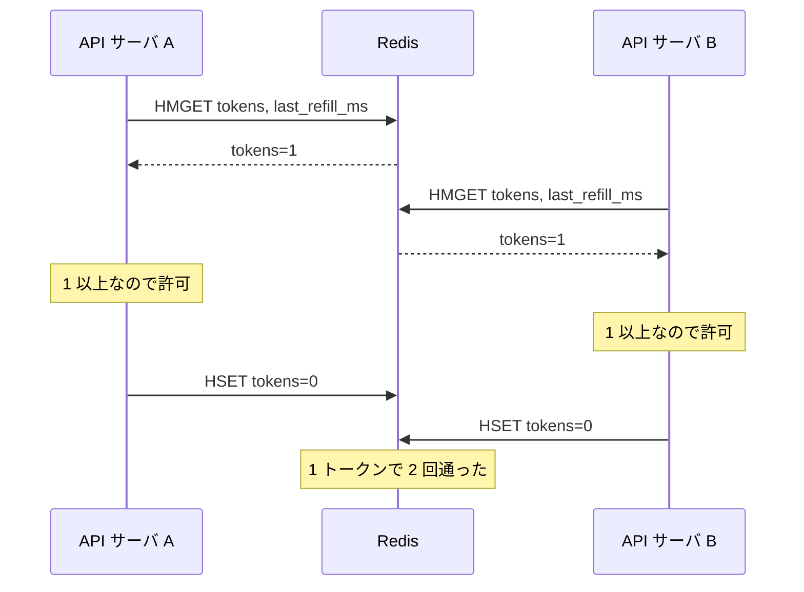
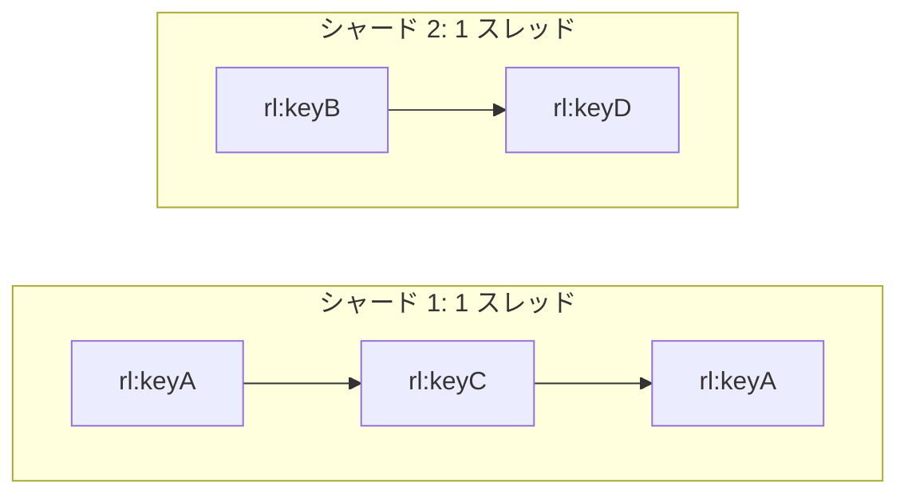

# 質問と回答

<!--
書式:
## Q03: <質問文>   (質問集から) / ## F01: <質問文>   (自由質問)

**結論**: ...

**理由**: ...

**トレードオフ**: ...

**改善案**: (設計の不備が見つかった場合のみ)

**次に聞くと良い質問**: Q0X, ...
-->

## Q07: 残数の取得と減算を別コマンドにせず、Lua で 1 回にするのはなぜ?

**結論**: 読んでから書くまでのあいだに、別の API サーバの読み書きが割り込めないようにするため。2 コマンドに分けると、同じトークンを 2 台が同時に使えてしまい、上限を超えて通る。

**理由**:

分けた場合、こうなる(残り 1 トークンに 2 台が同時に来る):

- 「読む → 判定 → 書く」の典型的な check-then-act の競合。Redis の各コマンドは単体では原子的でも、**コマンドの間**は守られない
- 書き込みは「自分が読んだ古い値から計算した結果」で上書きするので、相手の消費が消える(lost update)。同時アクセスが多いほど超過が増える
- Lua スクリプトは Redis 上で 1 つの単位として実行され、その間ほかのコマンドは走らない(Redis はコマンドを 1 本のスレッドで順に処理する)。補充計算・判定・減算・保存がまとめて行われるので、割り込みが起きない
- ついでに往復も 1 回で済む(分けると最低 2 往復)。毎リクエストの判定なので、レイテンシにそのまま効く

**他の手段と比べると**:

| 手段 | 問題 |
| --- | --- |
| `DECR` だけ | 1 コマンドで原子的だが、「経過時間に応じて補充、バーストで頭打ち」が書けない。固定ウィンドウのカウンタ(`INCR` + `EXPIRE`)なら足りるが、それはトークンバケットではない(→ Q04) |
| `WATCH` + `MULTI/EXEC`(楽観ロック) | 正しく動くが、競合すると EXEC が失敗してやり直し。同じキーに集中するほどリトライが増え、往復も 3 回以上 |
| 分散ロック(`SET NX` で鍵を取る) | 往復が増え、ロックを持ったままサーバが落ちたときの扱いも要る。過剰 |

**トレードオフ**:

- スクリプト実行中は Redis 全体が止まる。だからスクリプトは短く保つ(ループや大きな読み取りを入れない)。今回は 1 キーのハッシュを読み書きするだけなので数十 µs 程度の想定
- Redis Cluster では、1 スクリプトが触るキーは同じスロットに無いといけない。今回は `rl:{api_key}` の 1 キーだけなので問題にならない(複数バケットを同時に見るなら効いてくる → Q18)
- ロジックが Redis 側(Lua)とアプリ側に分かれるので、テストやデプロイの手間が少し増える(`EVALSHA` でスクリプトを登録して呼ぶのが普通)

**次に聞くと良い質問**: Q09(スクリプト内で Redis の時刻を使う理由), Q15(この Lua が 10 万回/秒になったら)

## Q15: ピークが 10 万 req/秒になったら、1 台の Redis に Lua を 10 万回打つことになる。キーを分散させても効かないのはなぜ?

**結論**: 多数の API キーに広く散った 10 万 req/秒なら、Redis Cluster でキーを分散すれば**効く**。効かないのは、負荷が**少数のキーに集中した**ときだけ。1 つのキーは必ず 1 つのシャードに載るので、そのキーへの 10 万回はシャードを何台に増やしても 1 台が全部受ける。そしてこの設計では、拒否されるリクエストも毎回 Lua を打つ。

**理由**:

- **分散が効くケース**: 5 万キーから 2 req/秒ずつ来るような場合。`rl:{api_key}` はキーごとにハッシュスロットが決まり、シャードに散る。スクリプトも 1 キーしか触らないので Cluster でそのまま動く(→ Q07)。シャード 4 台なら 1 台あたり約 2.5 万回/秒
- **分散が効かないケース**: 1 つのキー(攻撃や暴走したクライアント)が 10 万 req/秒を送る場合
    - そのキーの許可は 60 回/分程度しかないのに、**残りの約 10 万回/秒も「拒否」の判定のために Lua を実行する**
    - キー → スロット → シャードは固定なので、その 1 シャードが全部受ける。ほかのシャードは暇なまま
    - Redis はコマンドを 1 スレッドで実行するので、そのシャードの CPU を 1 コア使い切る。短い Lua でも 1 コアあたり数万〜10 万回/秒程度が目安(スクリプトの長さとマシンに依存)。同じシャードに載っている**ほかの正常なキーまで遅くなる**
- **台数・性能を上げても効かない**
    - レプリカを足しても、書き込み(減算)はプライマリでしか実行できない
    - マシンを大きくしても、コマンドの実行は 1 スレッドのまま(I/O スレッドはネットワーク処理だけを並列化する)
- DESIGN.md の「1 つの API キーへの操作は、そのキーの上限で頭打ちになる」は、**通る**リクエストの話としては正しいが、Redis への**判定の回数**は頭打ちにならない。ここは設計の弱点

**トレードオフ**: 毎回 Redis に聞くからこそ、全サーバで残数が正確にそろう。その代わり、Redis への判定の回数が「通る数」ではなく「来た数」に比例する

**改善案**: 拒否結果を API サーバのメモリにキャッシュする(ネガティブキャッシュ)

- Redis から「拒否, retry_after=2」が返ったら、各 API サーバは「このキーは 2 秒後まで拒否」をメモリに持つ。その間は Redis に聞かずに 429 を返す
- 1 つのホットキーが Redis に打つ回数は、おおよそ「API サーバの台数 ÷ retry_after + 許可される数」まで下がる。例: 20 台、retry_after 1 秒なら 約 20 回/秒 + 1 回/秒。10 万回/秒と比べて桁違いに少ない
- 精度はほぼ落ちない。トークンが貯まるのは retry_after 後なので、それまでに Redis に聞いても結果は拒否のまま(例外は、その間にプランが上がったときだけ。ルールの反映もどのみち 60 秒遅れる → Q10)
- さらに手前で弾くなら、LB やエッジで IP ごとの粗い制限をかける(→ Q17)。許可される側の負荷も減らしたいなら、トークンをまとめて借りる方式(→ Q16)

**次に聞くと良い質問**: Q16(トークンをまとめて借りる方式と比べると), Q13(Redis が遅くなったら)

## F01: スクリプト実行中は Redis 全体が止まるなら、異なるキーでも遅くなるのでは?(Q07 と Q15 の関係)

**結論**: その通り。**1 台(1 シャード)の Redis の中では**、異なるキーでも同時には処理されず、1 本の列に並んで順番に実行される。異なるキーが並列に処理されるのは、**キーが別のシャード(別の Redis プロセス)に載っているとき**だけ。Q15 の「分散が効く」は、シャードを複数台に増やした場合の話。

**理由**:

- 同じシャード内: keyA と keyC は別キーでも、前のスクリプトが終わるまで次は待つ。直列
- 別シャード間: シャード 1 と 2 は別プロセスなので同時に動く。並列
- 1 台でも足りるとしている理由: スクリプトが短い(数十 µs)ので、直列でも 1 秒に数万〜10 万回さばける。DESIGN.md の 1 万 req/秒の想定なら 1 台に余裕がある(→ DESIGN.md 3 章)
- 遅くなるのは「列が長くなったとき」。1 万 req/秒なら列はほぼ空なので、待ちは目立たない。10 万 req/秒で 1 コアの上限に近づくと、どのキーも待たされる。そこでシャードを増やして列を複数に分ける。これが Q15 の「キーを分散させると効く」
- Q15 のホットキーの問題は、1 つのキーは 1 つの列にしか並べないので、列を増やしても長い 1 本が残ること

**次に聞くと良い質問**: Q13(Redis への往復が遅くなったら)
