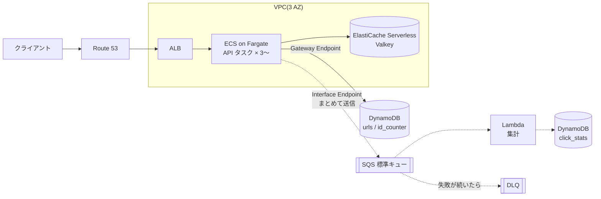
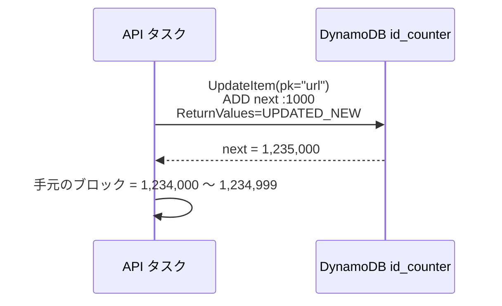
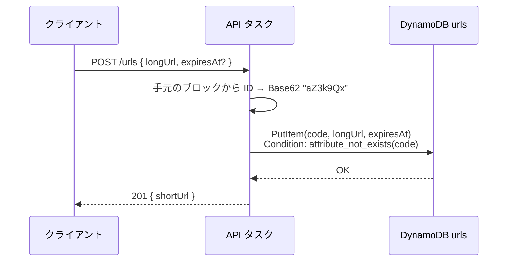
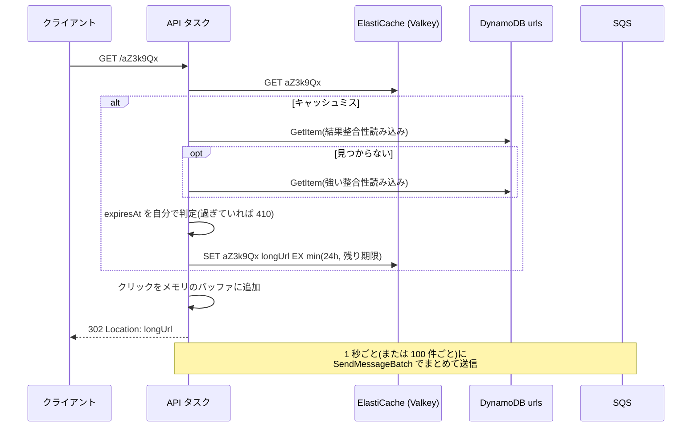
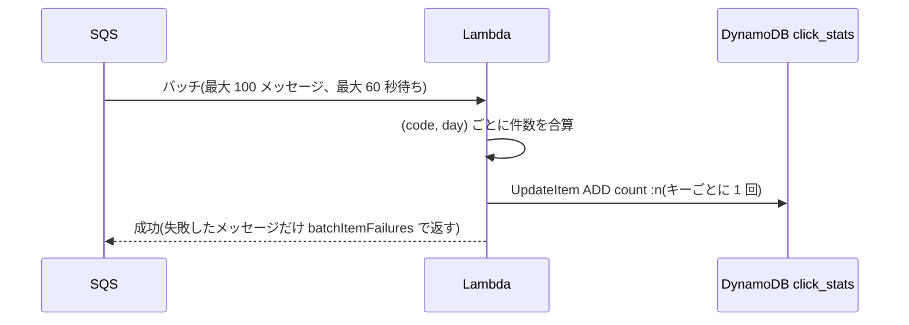
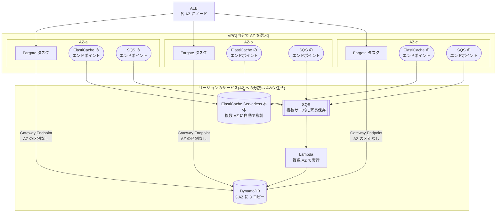

# 設計: URL 短縮サービス(AWS 版)

base: [../base/DESIGN.md](../base/DESIGN.md)

## 1. base との対応

| base の要素 | このバリアント | 変えた理由 | 関連質問 |
| --- | --- | --- | --- |
| ロードバランサ | ALB | HTTP レベルのヘルスチェックと AZ 分散がマネージドで済む | Q12 |
| API サーバ | ECS on Fargate(3 AZ、最低 3 タスク) | ID ブロックをメモリに持つ常駐プロセスが要る | Q06 |
| 採番 DB(RDB シーケンス) | DynamoDB のアトミックカウンタ(`id_counter` テーブル) | 採番のためだけに RDS を持たなくて済む。アクセスは 1 件/100 秒程度 | Q01, Q04 |
| URL ストア(KV DB) | DynamoDB `urls` テーブル(オンデマンド、TTL 有効) | キー検索のみ・水平スケール・運用不要 | Q07, Q08 |
| Redis | ElastiCache Serverless for Valkey | 容量計画が不要。Valkey は Redis OSS 互換で安い | Q05, Q13 |
| キュー | SQS 標準キュー | 順序不要・数分遅れで良い集計に十分 | Q09, Q16 |
| 集計ワーカー | Lambda(SQS イベントソース) | 常駐不要。バッチで受けてまとめて書く | Q03, Q14 |
| 集計 DB | DynamoDB `click_stats` テーブル | `ADD` で加算できる。URL ストアと同じ運用 | Q09 |

## 2. 全体構成

- 採番を RDB から **DynamoDB のアトミックカウンタ**に替え、データストアを DynamoDB に一本化した(→ Q01, Q04)
- API タスクはクリックを**メモリで 1 秒ぶん溜めて 1 メッセージにまとめて**から SQS に送る。SQS はリクエスト課金なので、1 クリック 1 メッセージだと高くつく(→ Q16)
- DynamoDB へは VPC の **Gateway Endpoint**(無料)、SQS へは Interface Endpoint で、NAT Gateway を通さない(→ Q02)
- 各サービスが AZ ごとにどう分かれ、どこにデータのコピーがあるかは [4.3](#43-az-ごとの配置とレプリカ)

## 3. 変わったフロー

### 3.1 ID ブロックの取得(採番)

- `UpdateItem` の `ADD` は 1 アイテムに対してアトミックに実行されるので、複数タスクが同時に取りに来ても**ブロックは重ならない**(→ Q01)
- 1 件のアイテムに書き込みが集中するが、作成 10 件/秒 ÷ 1,000 = **0.01 回/秒**なので、1 パーティションの上限(1,000 WCU/秒)には遠く及ばない(→ Q04)

### 3.2 短縮 URL の作成

- 連番なので本来は衝突しないが、バグや手動投入に備えて**条件付き書き込み**で上書きを防ぐ(→ Q10)
- `expiresAt` は TTL 属性(エポック秒)として保存する

### 3.3 リダイレクト

- 普段は安い**結果整合性読み込み**(強い整合性の半額)を使い、見つからないときだけ強い整合性で読み直す。作成直後のアクセスで誤って 404 を返さないため(→ Q11)
- DynamoDB の TTL は期限切れアイテムを**即座には消さない**(数日以内)。そのため有効期限の判定はアプリで行う(→ Q08)

### 3.4 クリック集計

- バッチウィンドウで溜めてから呼び出すので、Lambda の起動回数と DynamoDB への書き込み回数が減る(→ Q03, Q14)
- SQS + Lambda は **at-least-once**。同じメッセージが 2 回処理されると二重加算になる(→ Q09)

## 4. サービス固有の詳細

### 4.1 設定値

| 項目 | 設定・値 | 理由・出典 | 関連質問 |
| --- | --- | --- | --- |
| DynamoDB キャパシティ | オンデマンド | 事前の容量見積もり不要。急なバズにも追従 | Q07 |
| DynamoDB アイテム上限 | 400KB | 1 件 500B〜2KB なので問題なし([Quotas][ddb-quotas]) | - |
| 1 パーティションの上限 | 読み 3,000 / 書き 1,000 ユニット/秒 | ホットキー対策の上限値([Burst and adaptive capacity][ddb-adaptive]) | Q17 |
| `urls` の TTL | `expiresAt` 属性 | 削除は期限後「数日以内」で、書き込み容量を消費しない([TTL][ddb-ttl]) | Q08 |
| `urls` の PITR | 有効 | 誤削除・誤更新から 35 日以内の任意時点に戻せる | - |
| ElastiCache | Serverless / Valkey | 最小課金 100MB(Redis OSS は 1GB)([料金][ec-pricing]) | Q05, Q13 |
| SQS メッセージ | 1 メッセージに最大 100 クリック(約 10KB) | 最大サイズは 1 MiB だが、**64KB ごとに 1 リクエスト課金**([Quotas][sqs-quotas], [料金][sqs-pricing]) | Q16 |
| SQS 保持期間 | 4 日(デフォルト。最大 14 日) | 集計停止に気付いて直すまでの猶予([Quotas][sqs-quotas]) | Q15 |
| Lambda バッチ | サイズ 100 / ウィンドウ 60 秒 | 標準キューはサイズ最大 10,000、ウィンドウ最大 5 分。10 超は 1 秒以上のウィンドウ必須([ESM 設定][lambda-sqs-config]) | Q03 |
| SQS 可視性タイムアウト | Lambda タイムアウト × 6 + 60 秒 | AWS の推奨式([ESM 設定][lambda-sqs-config]) | Q15 |
| 部分バッチ応答 | `ReportBatchItemFailures` 有効 | 成功分まで再処理されないように([Lambda with SQS][lambda-sqs]) | Q09, Q15 |
| DLQ | `maxReceiveCount` = 5 | 壊れたメッセージで集計全体が止まらないように | Q15 |

### 4.2 月額の概算(5 年目、us-east-1)

| 項目 | 前提 | 計算 | 月額 |
| --- | --- | --- | --- |
| DynamoDB 書き込み | 作成 10 件/秒 × 260 万秒、1 件 1 WRU | 26M × $0.625/M | 約 $16 |
| DynamoDB 読み込み | キャッシュヒット率 90% → 100 件/秒、結果整合性で 0.5 RRU | 130M × $0.125/M | 約 $16 |
| DynamoDB ストレージ | 16 億件 × 500B ≒ 800GB(Standard) | 800 × $0.25 | 約 $200 |
| ElastiCache 容量 | ホットな URL を 1GB と仮定 | 1GB × $0.084 × 730h | 約 $61 |
| ElastiCache 処理 | GET + SET で約 1,100 回/秒、1 回 1 ECPU | 2.9B × $0.0023/M | 約 $7 |
| SQS | 1 秒ごとにまとめて 1 タスクあたり 1 リクエスト程度 | 数千万リクエスト × $0.40/M | 約 $10〜30 |

- 単価の出典: [DynamoDB オンデマンド料金][ddb-pricing]、[ElastiCache 料金][ec-pricing]。SQS の単価($0.40/100 万リクエスト)は料金ページが動的表示で取得できず、従来の値を使った([SQS 料金][sqs-pricing])
- ALB・Fargate・PITR・データ転送は省略
- 5 年目には**ストレージが最大の費用**になる。読み書きの料金はキャッシュのおかげで小さい(→ Q18)

### 4.3 AZ ごとの配置とレプリカ

AZ への分け方は 2 種類ある。

- **VPC の中**(ALB・Fargate・エンドポイント): どの AZ に置くかを、サブネットを選んで**自分で決める**
- **VPC の外**(DynamoDB・SQS・Lambda): リージョン単位のサービス。AZ への分散は **AWS が裏でやる**ので設定項目がない

| サービス | AZ への置き方 | 決めるのは | データのコピー |
| --- | --- | --- | --- |
| Route 53 | AZ・リージョンの外(グローバル) | AWS | - |
| ALB | 有効にした AZ のサブネットごとにノードを置く。最低 2 AZ で、この設計は 3 AZ([ALB][alb]) | 自分(サブネット) | 持たない |
| ECS on Fargate | サービスがタスクを AZ に散らす。最低 3 タスクなので各 AZ に 1 つ以上 | 自分(サブネット)+ ECS(配置) | 持たない。ID ブロックは各タスクのメモリにだけあり、タスクが落ちたら残りは捨てる(欠番になるだけ) |
| ElastiCache Serverless | 選んだサブネットにエンドポイントができ、本体は AWS 側の VPC にある。ノード数・配置は見えない([How ElastiCache works][ec-how]) | AWS | 複数 AZ に自動で複製 |
| SQS 用 Interface Endpoint | 1 AZ につき 1 サブネットに ENI を作る。3 AZ ぶん作る([Interface endpoint][vpce]) | 自分 | - |
| DynamoDB 用 Gateway Endpoint | ルートテーブルに経路を足すだけで、AZ ごとの実体はない | 自分(ルートテーブル) | - |
| DynamoDB | テーブルの設定は何もない | AWS | **3 AZ に 3 コピー**。リーダーに書き、残りは少し遅れて反映(→ F01)([Resilience][ddb-resilience]) |
| SQS | 設定項目なし。AZ 単位の配置は公開されていない | AWS | メッセージを複数サーバに冗長保存([SQS][sqs-arch]) |
| Lambda | 複数 AZ で実行される。この設計では VPC に接続しない(SQS の受信は Lambda 側のポーリング、DynamoDB へは公開エンドポイント)ので、サブネットの指定もない([Lambda の耐障害性][lambda-resilience]) | AWS | 持たない |

- データのコピーを持つのは **DynamoDB・ElastiCache・SQS** の 3 つで、どれも複製は AWS 任せ。自分で作るレプリカはない
- ALB・Fargate・Lambda は状態を持たない(Fargate の ID ブロックを除く)ので、どの AZ のものが処理しても結果は同じ
- 1 AZ が落ちたときの挙動は Q12 で扱う

## 5. 設計判断の要約

| 論点 | 選んだもの | 主な理由 | 関連質問 |
| --- | --- | --- | --- |
| 採番 | DynamoDB アトミックカウンタ | RDS を持たずに済む。負荷は 0.01 回/秒 | Q01, Q04 |
| API の実行基盤 | ECS on Fargate | ID ブロックを持つ常駐プロセス、サーバ管理不要 | Q06 |
| キャパシティ | オンデマンド | 見積もり不要、バズに追従 | Q07 |
| 有効期限 | TTL + アプリでの判定 | TTL は削除が遅れる | Q08 |
| 読み込みの整合性 | 結果整合性 → 見つからなければ強い整合性 | 費用半分、作成直後の 404 を防ぐ | Q11 |
| キャッシュ | ElastiCache Serverless(Valkey) | 容量計画不要、DAX より汎用 | Q05 |
| クリック送信 | API でまとめてから SQS | SQS はリクエスト課金 | Q16 |
| 集計 | SQS → Lambda(バッチ)→ `ADD` | 常駐不要、書き込み回数を削減 | Q03, Q09 |

[ddb-quotas]: https://docs.aws.amazon.com/amazondynamodb/latest/developerguide/ServiceQuotas.html
[ddb-adaptive]: https://docs.aws.amazon.com/amazondynamodb/latest/developerguide/burst-adaptive-capacity.html
[ddb-ttl]: https://docs.aws.amazon.com/amazondynamodb/latest/developerguide/howitworks-ttl.html
[ddb-pricing]: https://aws.amazon.com/dynamodb/pricing/on-demand/
[ec-pricing]: https://aws.amazon.com/elasticache/pricing/
[sqs-quotas]: https://docs.aws.amazon.com/AWSSimpleQueueService/latest/SQSDeveloperGuide/quotas-messages.html
[sqs-pricing]: https://aws.amazon.com/sqs/pricing/
[lambda-sqs]: https://docs.aws.amazon.com/lambda/latest/dg/with-sqs.html
[lambda-sqs-config]: https://docs.aws.amazon.com/lambda/latest/dg/services-sqs-configure.html
[alb]: https://docs.aws.amazon.com/elasticloadbalancing/latest/application/application-load-balancers.html
[ec-how]: https://docs.aws.amazon.com/AmazonElastiCache/latest/dg/WhatIs.corecomponents.html
[vpce]: https://docs.aws.amazon.com/vpc/latest/privatelink/create-interface-endpoint.html
[ddb-resilience]: https://docs.aws.amazon.com/amazondynamodb/latest/developerguide/disaster-recovery-resiliency.html
[sqs-arch]: https://docs.aws.amazon.com/AWSSimpleQueueService/latest/SQSDeveloperGuide/sqs-basic-architecture.html
[lambda-resilience]: https://docs.aws.amazon.com/lambda/latest/dg/security-resilience.html
