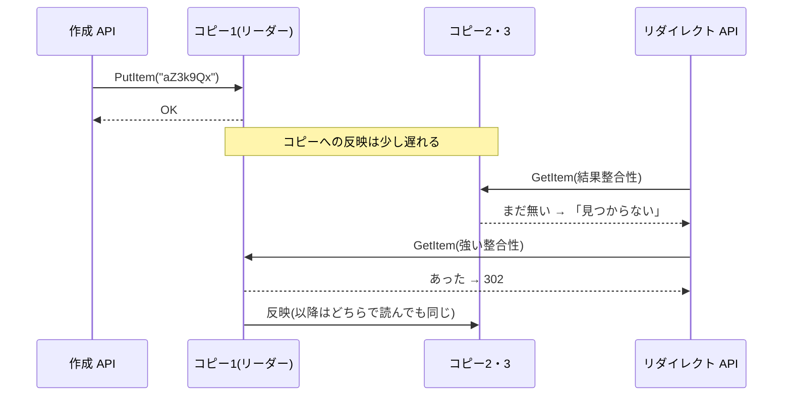

# 質問と回答

<!--
書式:
## Q03: <質問文>   (質問集から) / ## F01: <質問文>   (自由質問)

**結論**: ...

**理由**: ...

**トレードオフ**: ...

**改善案**: (設計の不備が見つかった場合のみ)

**次に聞くと良い質問**: Q0X, ...
-->

## F01: 「結果整合性読み込み」「強い整合性読み込み」って何の話?

**結論**: DynamoDB で `GetItem` するときに選べる**読み方の種類**の話。「最新の書き込みが反映されていないかもしれないが安い読み方(結果整合性)」と「必ず最新が返るが倍の料金の読み方(強い整合性)」がある。リダイレクトでは安い方で読み、見つからなかったときだけ高い方で読み直している。

**理由**:

DynamoDB は 1 つのデータを**同じリージョン内の 3 つの AZ に 3 コピー**持っている。書き込みはまずリーダー(代表のコピー)に入り、残りのコピーへは少し遅れて(通常 1 秒以内)伝わる。

| | 結果整合性読み込み(デフォルト) | 強い整合性読み込み |
| --- | --- | --- |
| どのコピーから読むか | どれか 1 つ(反映前のコピーに当たることがある) | リーダー |
| 返る値 | 古いことがある。時間が経てば最新になる(=「結果的に」整合する) | 直前に成功した書き込みが必ず反映されている |
| 料金(4KB まで) | 0.5 RRU | 1 RRU(倍) |
| 指定方法 | 何もしない | `ConsistentRead=true` |

- URL 短縮では、作成した直後にユーザーがすぐ短縮 URL を開くことがある。結果整合性だけで読むと、反映前のコピーに当たって**存在するのに 404** を返してしまう可能性がある
- 一方、リダイレクトの読みのほとんどは「とっくに作られた URL」なので、常に強い整合性で読むのは料金の無駄
- そこで「普段は半額の結果整合性 → 見つからなかったときだけ強い整合性で確認」という二段構えにしている。古い値が返る心配は「無い → ある」の場面だけで、URL は作成後に書き換えないので、見つかった場合はそのまま信用してよい
- 出典: [Read consistency(DynamoDB 開発者ガイド)](https://docs.aws.amazon.com/amazondynamodb/latest/developerguide/HowItWorks.ReadConsistency.html)

**トレードオフ**:

- 本当に存在しないコード(打ち間違い・ボットの総当たり)は、毎回 2 回読むことになり、むしろ高くつく(0.5 + 1 = 1.5 RRU)。総当たりが多いなら「存在しない」こともキャッシュする(ネガティブキャッシュ)などの対策が要る
- 強い整合性読み込みには制約もある(グローバルセカンダリインデックスでは使えない、Global Tables では他リージョンの書き込みまでは保証しない)。この設計ではテーブル本体へのキー検索だけなので問題にならない

**次に聞くと良い質問**: Q11(実際どれくらいの頻度で起きる?読み直しのコストは?), Q20(マルチリージョンにしたら整合性はどうなる?)
