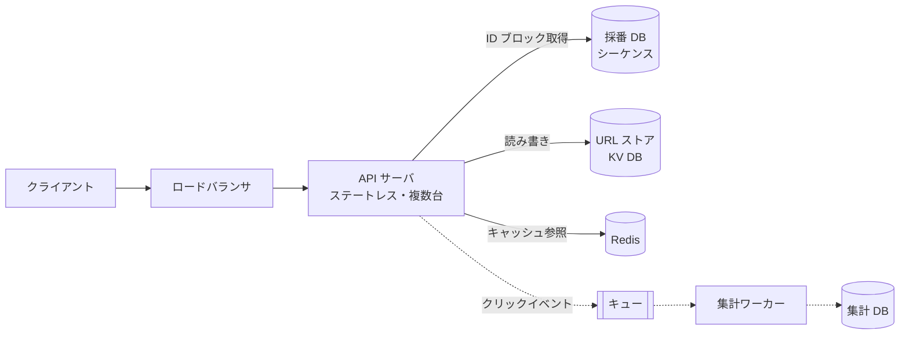
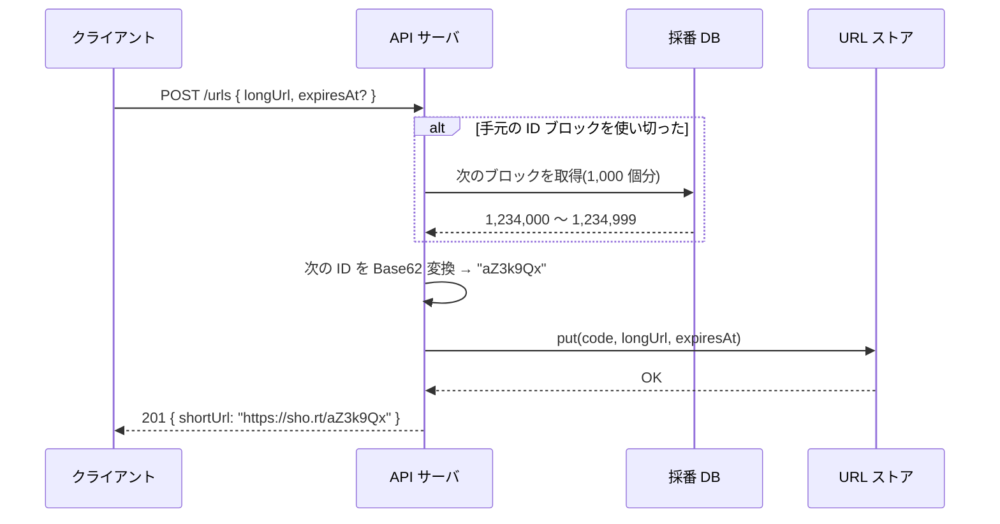
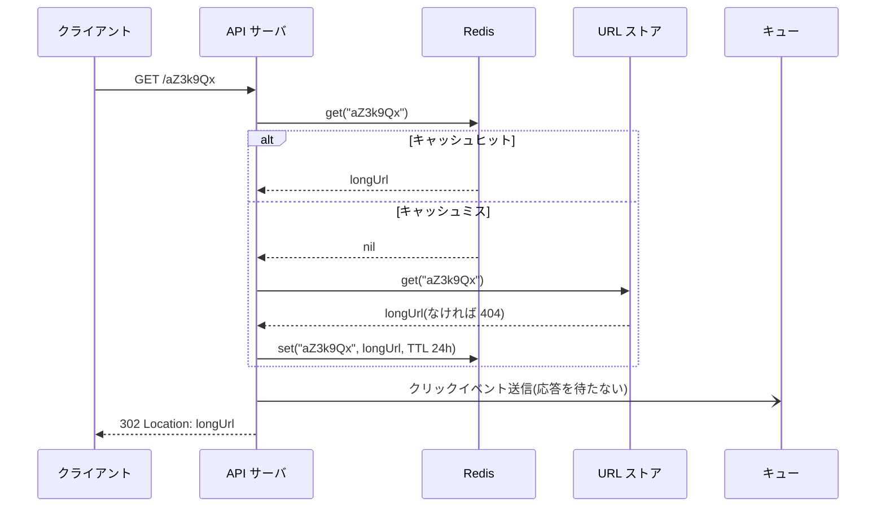
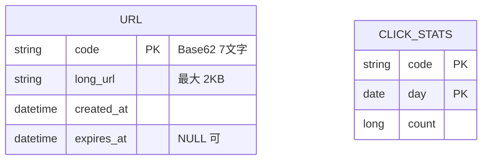

# 設計: URL 短縮サービス

## 1. 全体構成

- 読み(リダイレクト)が圧倒的に多いので、**Redis キャッシュで読みを吸収**する(→ Q01, Q09)
- 短縮コードは**採番 DB から連番をブロック単位で取得**し、Base62 に変換して作る(→ Q02, Q05)
- クリック集計はリダイレクトの応答を遅らせないよう**非同期**にする(→ Q03, Q08)

## 2. 主要フロー

### 2.1 短縮 URL の作成

- 各 API サーバは ID を 1,000 個ずつまとめて予約し、メモリ上で払い出す。採番 DB へのアクセスは 1,000 件に 1 回になる(→ Q06, Q11)
- 同じ長い URL を 2 回登録すると、**別の短縮コードが発行される**(重複排除しない)(→ Q04)

### 2.2 リダイレクト

- ステータスは **302(一時リダイレクト)** を返す(→ Q07)
- 期限切れの URL は 404 ではなく **410 Gone** を返す(→ Q09)

## 3. コンポーネント

| コンポーネント | 役割 | 技術(例) | 関連質問 |
| --- | --- | --- | --- |
| API サーバ | 作成・リダイレクト。状態は ID ブロックのみ | 任意の Web フレームワーク | Q11 |
| 採番 DB | グローバルな連番の払い出し | RDB のシーケンス | Q05, Q12 |
| URL ストア | code → longUrl の保存 | KV DB(DynamoDB / Cosmos DB など) | Q13, Q15 |
| Redis | 人気 URL のキャッシュ | Redis(LRU 追い出し) | Q09, Q10, Q14 |
| キュー + 集計ワーカー | クリック数の非同期集計 | 任意のメッセージキュー | Q08 |

## 4. データモデル

- 7 文字の Base62 は 62^7 ≒ **3.5 兆通り**。16 億件に対して十分な余裕がある(→ Q02)
- URL ストアは `code` による完全一致検索しかしないため、KV DB で十分(→ Q13)

## 5. 設計判断の要約

| 論点 | 選んだもの | 主な理由 | 関連質問 |
| --- | --- | --- | --- |
| コード生成 | 連番 + Base62 | 衝突チェック不要、短い | Q05, Q16 |
| 採番の分散 | ブロック予約 | 採番 DB の負荷を 1/1000 に | Q06, Q12 |
| リダイレクト種別 | 302 | クリック集計を取りこぼさない | Q07 |
| 読みの高速化 | Redis キャッシュ | 読み:書き = 100:1 | Q09 |
| 集計 | 非同期(キュー) | リダイレクト遅延に影響させない | Q08 |
| 保存先 | KV DB | キー検索のみ、水平スケールが容易 | Q13, Q17 |
