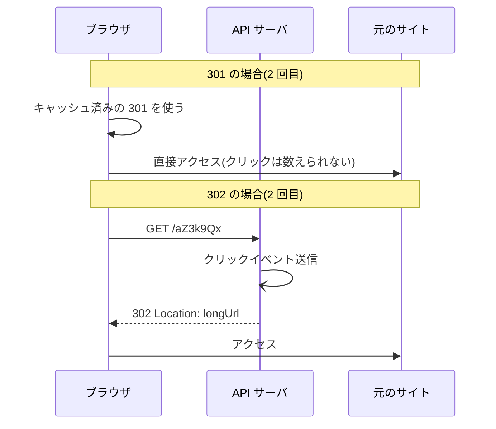

# 質問と回答

<!--
書式:
## Q03: <質問文>   (質問集から) / ## F01: <質問文>   (自由質問)

**結論**: ...

**理由**: ...

**トレードオフ**: ...

**改善案**: (設計の不備が見つかった場合のみ)

**次に聞くと良い質問**: Q0X, ...
-->

## Q07: 301 ではなく 302 を返すのはなぜ?

**結論**: クリックを毎回サーバで受けたいから。301 はブラウザにキャッシュされ、2 回目以降のクリックがサーバに届かなくなる。

**理由**:

| | 301 Moved Permanently | 302 Found |
| --- | --- | --- |
| 意味 | 恒久的な移転 | 一時的な移転 |
| ブラウザのキャッシュ | ヘッダ指定がなくても**キャッシュしてよい**(RFC 9110)。Chrome などは長期間覚える | `Cache-Control` / `Expires` を付けない限り**キャッシュしない** |
| 2 回目のクリック | ブラウザ内で直接 longUrl へ飛ぶ(サーバに来ない) | 毎回サーバに来る |

302 を選ぶと、次の 2 つの要件が守れる。

1. **クリック集計**: 同じ人の 2 回目以降のクリックも数えられる(前提の機能要件)
2. **有効期限・変更の反映**: 期限切れで 410 を返したい、不正 URL として止めたい、といったときに即座に効く。301 はブラウザに残った分を消す手段がない

**トレードオフ**:

- **サーバ負荷とレイテンシ**: 全クリックがサーバに来る。ブラウザキャッシュで吸収できる分を Redis で受けることになる(→ Q14)。ユーザーから見ても毎回 1 往復ぶん遅い
- **SEO**: 301 は「リンクの評価を移転先へ引き継ぐ」意味が明確。ただ短縮 URL は SNS などで共有されるもので、検索順位を気にする用途ではないので重視しない
- **中間案**: 301 + `Cache-Control: private, max-age=90` のように短いキャッシュ期間を明示する手もある。ブラウザでの短時間の連打は吸収しつつ、集計はおおむね取れる。「正確なクリック数」より「負荷」を優先するならこちら

**補足**: 302 でも、`Cache-Control` を付け忘れた上で CDN やプロキシ側の設定でキャッシュされることはありうる。確実にするなら `Cache-Control: no-store`(または `private, no-cache`)を明示して返す。

**次に聞くと良い質問**: Q14(バズったときの負荷), Q08(キューが落ちたらクリック数は?)
