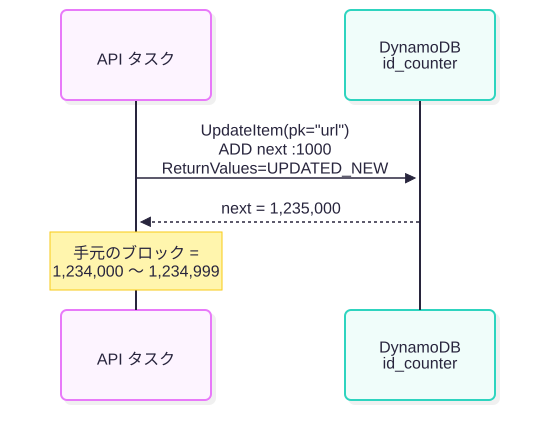
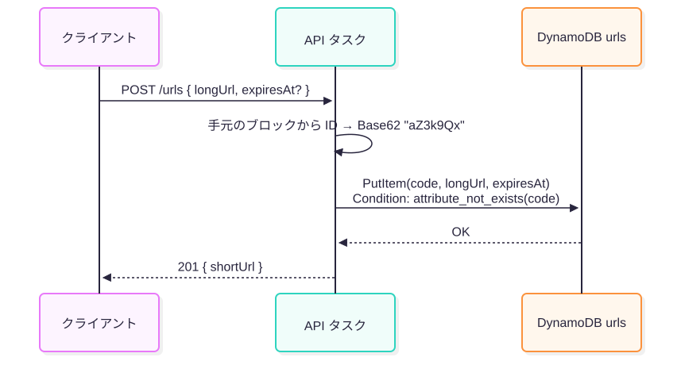
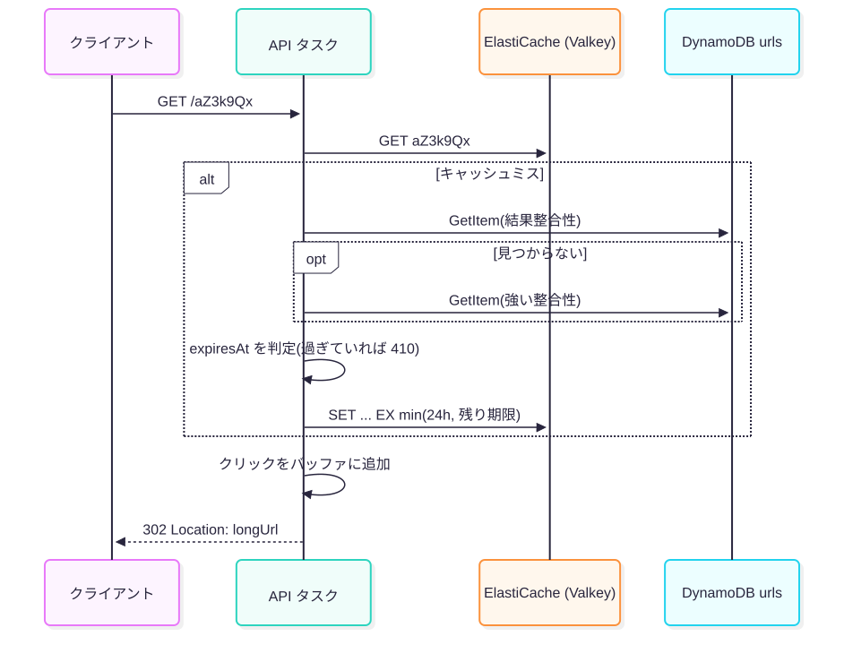
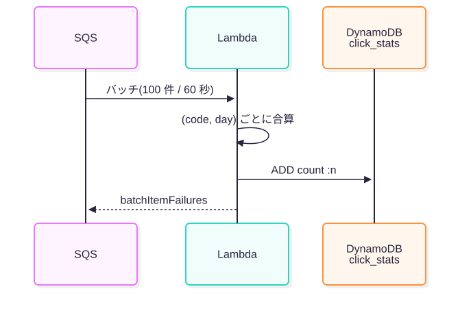

<!-- _class: lead -->
<!-- _paginate: false -->

# URL 短縮サービスの設計: AWS 版

DynamoDB・ElastiCache・SQS・Lambda・ECS で作る

<!--
前半で URL 短縮サービスの要件と基本の設計、後半でそれを AWS でどう実現するか、設定値と料金を話します。
-->

---

## どんなサービスか

**長い URL を 7 文字の短い URL に変え、アクセスされたら元の URL へリダイレクトする**

- 例: `https://sho.rt/aZ3k9Qx` → 元の長い URL
- 機能
  - 短縮 URL の作成 / リダイレクト / 有効期限(任意)
  - クリック数の集計(数分遅れで良い)
- スコープ外: ユーザー認証・管理画面、不正 URL の検査、マルチリージョン

<!--
このサービスの主題は「ID の作り方」と「大量のリダイレクトをどう速く返すか」の 2 つです。
-->

---

## 要件と規模

**読み(リダイレクト)が書き(作成)の 100 倍あり、5 年で 16 億件・800GB になる**

- リダイレクト: p99 50ms 以内、可用性 99.99%(作成側は 99.9%)
- 作成 平均 10 件/秒、リダイレクト 平均 1,000 件/秒・ピーク 5,000 件/秒
- 保存件数: 10 件/秒 × 5 年 ≒ 16 億件、1 件 500B として約 800GB
- 短縮 URL は推測されにくくなくて良い(公開リンク前提)

<!--
この「読み:書き = 100:1」と「推測されにくさは不要」の 2 点が、以降の設計判断の根拠になります。
-->

---

## 基本の設計方針

**連番 + Base62 で ID を作り、キャッシュで読みを吸収し、集計は非同期にする**

- ID: 連番を Base62 に変換。7 文字で 62^7 ≒ 3.5 兆通り → 衝突チェック不要
- 採番: API サーバが 1,000 個ずつ予約しメモリで払い出す → 採番 DB の負荷 1/1000
- 読み: キャッシュで吸収
- 集計: キュー経由で非同期
- 302 で返す(集計を取りこぼさない)、期限切れは 410 Gone

<!--
ここまではクラウドに依存しない設計です。次のスライドから、各部品を AWS のサービスに置き換えていきます。
-->

---

## 構成要素と AWS サービスの選定

**8 つの構成要素を AWS のマネージドサービスで実現し、データストアは DynamoDB に寄せた**

| 構成要素(役割) | AWS サービス | 選んだ理由 |
| --- | --- | --- |
| ロードバランサ | ALB | HTTP のヘルスチェックと AZ 分散がマネージド |
| API サーバ | ECS on Fargate(3 AZ、最低 3 タスク) | ID ブロックをメモリに持つ常駐プロセスが要る |
| 採番 DB | DynamoDB アトミックカウンタ | 採番のためだけに RDS を持たずに済む |
| URL ストア | DynamoDB `urls`(オンデマンド、TTL) | キー検索のみ・水平スケール・運用不要 |
| キャッシュ | ElastiCache Serverless for Valkey | 容量計画不要。Redis OSS 互換で安い |
| キュー | SQS 標準キュー | 順序不要・数分遅れで良い集計に十分 |
| 集計ワーカー | Lambda(SQS イベントソース) | 常駐不要。バッチで受けてまとめて書く |
| 集計 DB | DynamoDB `click_stats` | `ADD` で加算できる。URL ストアと同じ運用 |

<!--
採番は RDB のシーケンスでも作れますが、アクセスは 100 秒に 1 回程度しかありません。そのために RDS を持つより、DynamoDB のカウンタで済ませました。
-->

---

## 全体構成(AWS)

**データストアを DynamoDB に一本化し、VPC エンドポイントで NAT を通さない**

- DynamoDB は Gateway Endpoint(無料)、SQS は Interface Endpoint
- クリックは API タスクで 1 秒ぶん溜めて SQS にまとめて送る

<!--
実線が同期パス(Route 53 → ALB → ECS → Valkey / DynamoDB)、点線が非同期パス(SQS → Lambda → click_stats)です。前の基本設計の図と見比べてください。
-->

---

## 採番: DynamoDB のアトミックカウンタ

**`UpdateItem ADD` はアトミックなので、複数タスクが同時に取ってもブロックは重ならない**

- 1 回で 1,000 件ぶんのブロックを確保
- 書き込みは 10 件/秒 ÷ 1,000 = **0.01 回/秒**
- 1 パーティションの上限(1,000 WCU/秒)に遠く及ばない

<!--
1 アイテムへの書き込み集中、いわゆるホットキーが気になるところですが、頻度が低いので問題になりません。
-->

---

## 短縮 URL の作成

**連番でも条件付き書き込みで上書きを防ぎ、有効期限は TTL 属性で持つ**

- 手元のブロックから ID → Base62
- `attribute_not_exists(code)` で、バグ・手動投入による上書きを防ぐ
- `expiresAt` をエポック秒の TTL 属性として保存
- 同じ長い URL を 2 回登録すると別のコード(重複排除しない)

<!--
連番なので本来は衝突しませんが、保険として条件を付けるコストはほぼゼロです。
-->

---

## リダイレクト

**結果整合性で安く読み、見つからないときだけ強い整合性で読み直す。期限はアプリで判定する**

- まず Valkey、ミスしたら DynamoDB
- 結果整合性読み込みは強い整合性の半額。作成直後の誤 404 を防ぐため読み直す
- TTL は即座に消さない(数日以内)→ アプリで期限判定して 410
- キャッシュの有効期限は min(24h, 残り期限)

<!--
クリックはメモリのバッファに追加しておき、1 秒ごと、または 100 件ごとに SendMessageBatch でまとめて SQS に送ります。
-->

---

## クリック集計

**バッチで受けてキーごとに合算し、書き込み回数を減らす。ただし at-least-once なので二重加算はあり得る**

- バッチ: 最大 100 メッセージ / 最大 60 秒待ち
- (code, day) ごとに合算して `ADD count :n`
- 失敗分だけ `batchItemFailures` で返す

<!--
二重加算への対策は、設計ドキュメントでは未解決の論点(Q09)として残しています。
-->

---

## 主な設定値

**AWS の上限と課金単位を踏まえて設定値を決めている**

| 項目 | 設定・値 | 理由 |
| --- | --- | --- |
| DynamoDB キャパシティ | オンデマンド | 容量見積もり不要。急なバズにも追従 |
| 1 パーティションの上限 | 読み 3,000 / 書き 1,000 ユニット/秒 | ホットキー対策の上限値 |
| `urls` の TTL | `expiresAt` 属性 | 削除は期限後「数日以内」、書き込み容量を消費しない |
| ElastiCache | Serverless / Valkey | 最小課金 100MB(Redis OSS は 1GB) |
| SQS メッセージ | 1 メッセージに最大 100 クリック(約 10KB) | 最大 1 MiB だが **64KB ごとに 1 リクエスト課金** |
| Lambda バッチ | サイズ 100 / ウィンドウ 60 秒 | 10 超は 1 秒以上のウィンドウ必須 |
| SQS 可視性タイムアウト | Lambda タイムアウト × 6 + 60 秒 | AWS の推奨式 |
| 部分バッチ応答 / DLQ | 有効 / `maxReceiveCount` = 5 | 成功分の再処理と、壊れたメッセージでの停止を防ぐ |

<!--
特に SQS は「1 MiB まで送れるが 64KB ごとに 1 リクエスト課金」が効いていて、API 側でまとめて送る設計につながっています。
-->

---

## 月額の概算(5 年目)

**5 年目はストレージ(約 $200)が最大の費用で、読み書きはキャッシュのおかげで小さい**

| 項目 | 前提 | 月額 |
| --- | --- | --- |
| DynamoDB 書き込み | 作成 10 件/秒、1 件 1 WRU | 約 $16 |
| DynamoDB 読み込み | キャッシュヒット率 90% → 100 件/秒、結果整合性 | 約 $16 |
| **DynamoDB ストレージ** | **16 億件 × 500B ≒ 800GB(Standard)** | **約 $200** |
| ElastiCache 容量 | ホットな URL を 1GB と仮定 | 約 $61 |
| ElastiCache 処理 | GET + SET で約 1,100 回/秒 | 約 $7 |
| SQS | 1 秒ごとにまとめて 1 タスクあたり 1 リクエスト程度 | 約 $10〜30 |

us-east-1 の単価。ALB・Fargate・PITR・データ転送は省略。SQS 単価($0.40/100 万リクエスト)は従来値

<!--
SQS の単価は料金ページから取得できず、従来の値を使っている点に注意してください。
-->

---

## 設計判断のまとめ

**基本設計(連番・キャッシュ・非同期)を、AWS の課金単位と挙動の癖に合わせて具体化した**

| 論点 | 選んだもの | 主な理由 |
| --- | --- | --- |
| コード生成 | 連番 + Base62 | 衝突チェック不要、短い |
| 採番 | ブロック予約 + DynamoDB アトミックカウンタ | 負荷 1/1000(0.01 回/秒)、RDS 不要 |
| リダイレクト種別 | 302 | クリック集計を取りこぼさない |
| API の実行基盤 | ECS on Fargate | ID ブロックを持つ常駐プロセス、サーバ管理不要 |
| 保存先 | DynamoDB(オンデマンド) | キー検索のみ、水平スケール、見積もり不要 |
| キャッシュ | ElastiCache Serverless(Valkey) | 読み:書き = 100:1、容量計画不要 |
| 読み込みの整合性 | 結果整合性 → なければ強い整合性 | 費用半分、作成直後の 404 を防ぐ |
| 有効期限 | TTL + アプリでの判定 | TTL は削除が遅れる |
| 集計 | API でまとめて SQS → Lambda バッチ → `ADD` | リクエスト課金に合わせる、書き込み回数削減 |

<!--
一言でいうと、運用しない、課金単位に合わせる、サービスの癖はアプリで吸収する、の 3 点です。
-->
