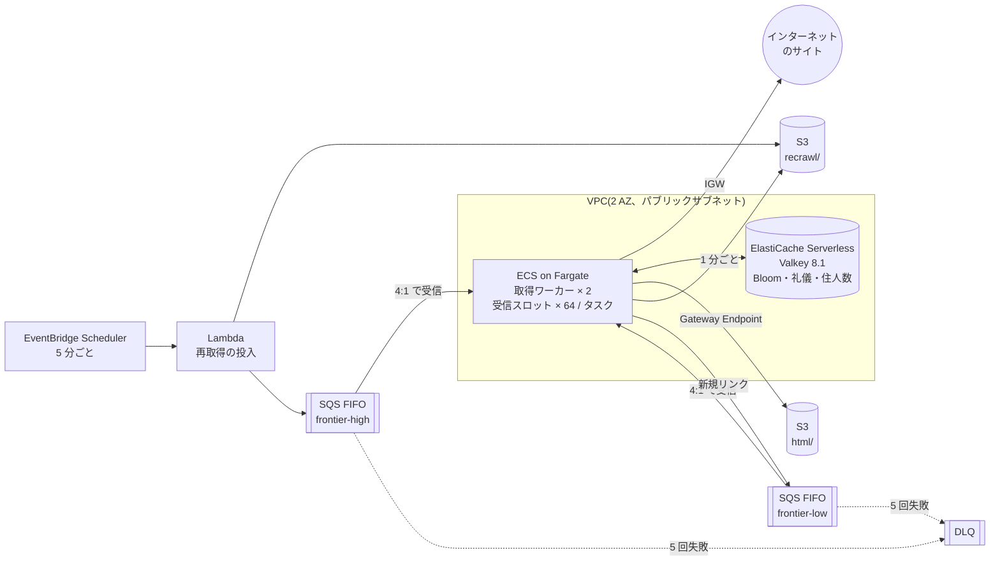
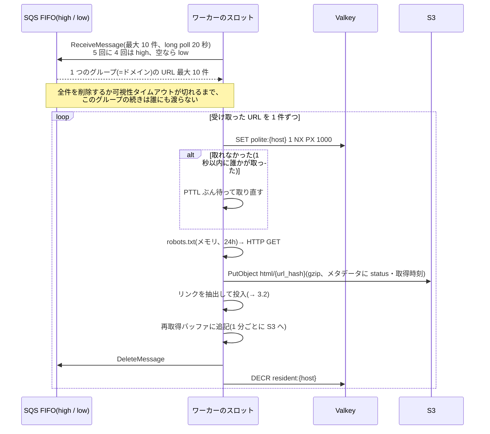
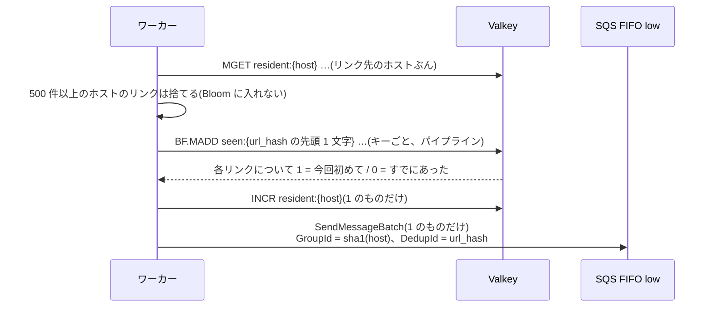
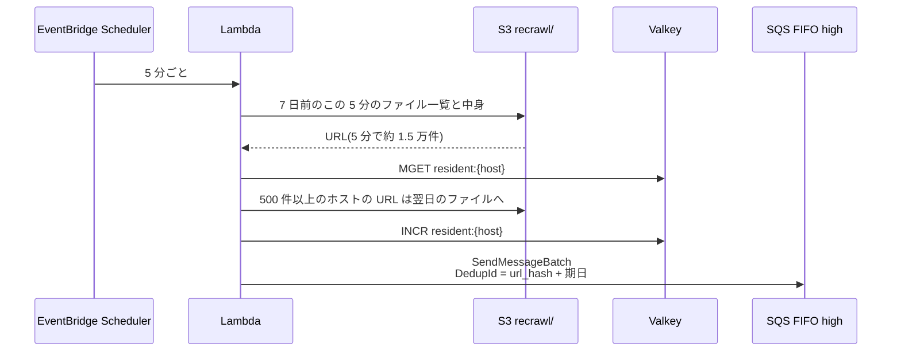

# 設計: Web クローラ(AWS 版)

base: [../base/DESIGN.md](../base/DESIGN.md)

## 1. base との対応

| base の要素 | このバリアント | 変えた理由 | 関連質問 |
| --- | --- | --- | --- |
| URL フロンティア(32 分割 × 高/低優先) | SQS FIFO `frontier-high.fifo` / `frontier-low.fifo`。`MessageGroupId` = ホストのハッシュ | 同じグループの続きは前のメッセージが消えるまで誰にも渡らない。これが「1 ドメインを同時に 1 人だけが取る」になる | Q01, Q04 |
| パーティションの専有 | やめた。どのワーカーもどのドメインでも取る | 専有は FIFO のグループが代わりにやる。リースの管理が要らない | Q01, Q18 |
| 礼儀の時計(メモリの `next_allowed_at`) | Valkey の `SET polite:{host} NX PX 1000` | キューが 2 本あるので、同じドメインが別々のワーカーに同時に渡りうる | Q05 |
| Bloom filter(1.4GB の共有ビット配列) | ElastiCache Serverless for Valkey 8.1 の Bloom filter。`seen:{0}`〜`seen:{f}` の 16 キー | `BF.ADD` / `BF.MADD` が「今回初めて追加したか」を原子的に返す。1 キー 128MB の上限があるので分ける | Q06, Q14 |
| オブジェクトストレージ | S3 Standard `html/{url_hash}` | 上書きでよい。キーがハッシュなので偏らない | Q17 |
| 7 日バケット + 日次ジョブ | S3 `recrawl/{分}/{タスク}.jsonl.gz` + 5 分ごとの Lambda | 1 日分(430 万件)を一度に入れると、FIFO の先頭 12 万件の制約に当たる | Q03, Q08 |
| 取得ワーカー | ECS on Fargate 2 タスク(1 vCPU / 2GB)、パブリックサブネット | 常駐して長い HTTP を待つ。NAT Gateway の処理料金を避ける | Q07, Q20 |
| (なし) | 1 ドメインあたりキューに置く URL の上限 500 件(Valkey の `resident:{host}`) | FIFO の制約で、巨大ドメインが他のドメインを止めるのを防ぐ | Q09, Q10, Q11 |

## 2. 全体構成

- base の「ドメインハッシュで分割し、ワーカーが専有する」を、**FIFO キューのメッセージグループ**に置き換えた。ドメインごとの直列化を SQS がやるので、ワーカーはどれも同じで、何台いても担当を決めなくてよい(→ Q01, Q04)
- ワーカーは**パブリック IP を持つ**。インターネットへの出口に NAT Gateway を使わない。S3 へは Gateway Endpoint、SQS へはパブリックエンドポイント(→ Q07)
- Valkey には Bloom filter のほかに、礼儀のキー(1 秒で消える)と、ドメインごとの「キューにいる URL 数」を置く(→ Q05, Q11)

## 3. 変わったフロー

### 3.1 1 ページの取得

ワーカーは 1 タスクに**受信スロットを 64 個**持ち、各スロットが次のループを回す。

- 1 つのスロットは同時に 1 ドメインしか持たない。50 ページ/秒には**同時に 50 以上のドメイン**を持つ必要があり、2 タスク × 64 スロット = 128 にした(→ Q02, Q16)
- `robots.txt` の取得に失敗したら、残りのメッセージの可視性タイムアウトを **1 時間**に延ばす。グループごと 1 時間誰にも渡らなくなり、base の「1 時間クロールしない」になる(→ Q15)
- 途中で落ちたら、削除していないメッセージは可視性タイムアウト(120 秒)の後に戻り、グループの続きが別のスロットに渡る(→ Q13)

### 3.2 リンクの投入(上限つき)

- FIFO キューは**先頭 12 万件だけを見て**、受け取れるグループを探す。1 ドメインの URL が先頭に 12 万件溜まると、後ろにいる他のドメインが止まる([FIFO の backlog][sqs-backlog])。上限 500 件なら、どこを 12 万件切り取っても 240 ドメイン以上が入っていて、128 スロットが埋まる(→ Q09)
- 上限で捨てたリンクは Bloom filter に入れないので、次にどこかで再発見されたときに改めて入る(→ Q10)
- 上限の確認と `INCR` は原子的ではない。同時に投入すると 500 件を少し超えるが、問題にならない(→ Q11)

### 3.3 再取得

- base の日次ジョブを **5 分ごと**に変えた。1 日分の 430 万件を一度に high キューへ入れると、先頭 12 万件の制約で一部のドメインしか取れなくなり、Lambda の 15 分の上限にも当たる。5 分なら 1 回 1.5 万件で、どちらにも当たらない(→ Q08)
- Lambda が失敗して再実行されても、5 分以内なら FIFO の重複排除で二重に入らない(→ Q12)

## 4. サービス固有の詳細

### 4.1 SQS FIFO の性質と、この設計での使い方

| 性質 | 値・挙動 | この設計での使い方 | 出典 | 関連質問 |
| --- | --- | --- | --- | --- |
| グループ内の受信 | 受け取ったメッセージを削除するか可視性タイムアウトが切れるまで、同じグループの続きは返らない。1 回に同じグループから最大 10 件 | ドメインの直列化 | [FIFO の配送ロジック][sqs-fifo-logic] | Q01, Q04 |
| 先頭のスキャン | 先頭 12 万件だけを見て受信できるグループを探す | 1 ドメイン 500 件の上限 | [FIFO の backlog][sqs-backlog] | Q09 |
| 受信中(in-flight)の上限 | 12 万件。超えてもエラーにならず、処理が遅くなる | 128 スロット × 10 件 = 最大 1,280 件 | [FIFO quotas][sqs-fifo-quotas] | Q16 |
| グループ数の上限 | なし | ホストの数だけグループができてよい | [FIFO quotas][sqs-fifo-quotas] | - |
| スループット | 高スループットモードで 1 パーティションあたり 300 件/秒(API ごと)、バッチなら 3,000 件/秒 | 1 キューあたり最大 50 件/秒なので通常モードで足りる | [High throughput][sqs-fifo-ht] | Q16 |
| 重複排除 | 同じ `MessageDeduplicationId` を 5 分間捨てる | 再試行や Lambda の再実行による二重投入を防ぐ | - | Q12 |
| 可視性タイムアウト | 最大 12 時間 | 通常 120 秒(10 件 × (5 秒 + 1 秒) の倍)。robots 失敗時に 1 時間 | [Message quotas][sqs-quotas] | Q13, Q15 |
| 保持期間 | 最大 14 日 | 14 日。フロンティアに長く滞留する URL があるため | [Message quotas][sqs-quotas] | - |
| `MessageGroupId` の長さ | 最大 128 文字 | ホスト名は 253 文字まであるので `sha1(host)` にする | - | - |
| DLQ | `maxReceiveCount` = 5 | 毎回ワーカーを落とす URL でグループが止まらないように | [FIFO の backlog][sqs-backlog] | Q15 |

### 4.2 Bloom filter のキー設計(ElastiCache for Valkey)

- Bloom filter は ElastiCache **バージョン 8.1 for Valkey** 以降で、Serverless・ノードベースの両方で使える([Bloom filter 対応の発表][ec-bloom-news])
- **1 つの Bloom filter オブジェクトは 128MB まで**([Bloom filters][ec-bloom])。1.4GB を 1 キーには置けないので、`url_hash` の先頭 1 文字(16 進)で 16 キーに分ける

| 項目 | 値 | 根拠 |
| --- | --- | --- |
| キー | `seen:{0}` 〜 `seen:{f}` | 正規化 URL のハッシュの先頭 1 文字。均等に散る |
| 1 キーの容量 | 6,900 万件 × 偽陽性 1% | 16 × 6,900 万 ≒ 11 億 = base の 1 年分 |
| 1 キーのメモリ | 約 83MB | 1% なら 1 件約 9.6 bit。6,900 万 × 9.6 bit ≒ 83MB < 128MB |
| 作り方 | `BF.RESERVE seen:{x} 0.01 69000000 NONSCALING` | 自動拡張させると、満杯の後に 128MB を超えて追加できなくなる |
| 退避 | 日次の自動スナップショット(S3 に保存)| 消えたら最大 1 日分のリンクが二重に投入される(→ Q14)([Snapshot][ec-backup]) |

### 4.3 ネットワーク

| 経路 | 選んだもの | 理由 | 関連質問 |
| --- | --- | --- | --- |
| インターネットへの GET | パブリックサブネット + タスクにパブリック IPv4。セキュリティグループは受信をすべて拒否 | NAT Gateway は通過量に $0.045/GB かかる。受信 3.9TB/月で約 $180 + 時間料金 | Q07 |
| S3 | Gateway Endpoint | 無料。ルートテーブルに足すだけ | - |
| SQS | パブリックエンドポイント(IGW 経由) | NAT を通らない。Interface Endpoint は今の規模では不要 | Q07 |
| DNS | VPC の Route 53 Resolver + ワーカーのメモリのキャッシュ | Resolver への問い合わせは **ENI ごとに 1,024 パケット/秒**で、引き上げできない([Amazon DNS][vpc-dns]) | Q16 |

### 4.4 月額の概算(稼働 1 年後、us-east-1)

| 項目 | 前提 | 計算 | 月額 |
| --- | --- | --- | --- |
| S3 PUT | 50 件/秒 × 263 万秒 = 1.3 億件 | 131,000 × $0.005 / 1,000 件 | 約 $660 |
| S3 ストレージ | 1 年で 11 億 URL × 30KB ≒ 33TB(最新版だけ) | 33,800GB × $0.023 | 約 $780 |
| SQS FIFO | 受信 25 + 削除 50 + 送信 10 ≒ 85 リクエスト/秒 → 2.2 億件 | 220 × $0.50 / 100 万件 | 約 $110 |
| ElastiCache 容量 | Bloom 1.4GB + 住人数など ≒ 1.5GB | 1.5 × $0.084 × 730h | 約 $92 |
| ElastiCache 処理 | 1 ページ 20 コマンド前後 → 約 1,500 ECPU/秒 | 39 億 × $0.0023 / 100 万 | 約 $9 |
| Fargate | 2 タスク × (1 vCPU + 2GB) | 2 × ($0.04048 + 2 × $0.004446) × 730h | 約 $72 |
| パブリック IPv4 | 2 個 | 2 × $0.005 × 730h | 約 $7 |
| Lambda・Scheduler | 5 分ごと、1 回数十秒 | - | 数ドル |
| **合計** | | | **約 $1,730** |

- 単価の出典: [S3 料金][s3-pricing]、[Fargate 料金][fargate-pricing](秒単価 $0.000011244/vCPU・$0.000001235/GB を時間に換算)、[ElastiCache 料金][ec-pricing]。SQS FIFO の $0.50 / 100 万件と NAT Gateway の $0.045 は、料金ページが動的表示で取得できず、第三者の解説記事の値を使った([SQS 料金][sqs-pricing])
- **S3 が 8 割以上**。PUT はページ数に比例し、ストレージは発見した URL の数に比例して増え続ける(→ Q17)
- インターネットからの受信は無料。ElastiCache と同じ AZ 内の通信料も省略した

## 5. 設計判断の要約

| 論点 | 選んだもの | 主な理由 | 関連質問 |
| --- | --- | --- | --- |
| フロンティア | SQS FIFO、グループ = ホスト | ドメインの直列化を SQS に任せ、パーティションの専有をなくす | Q01, Q04, Q18 |
| 優先度 | キュー 2 本を 4:1 で受信 | SQS に優先度はない | Q05 |
| 礼儀 | グループ + Valkey `SET NX PX 1000` | キュー 2 本にまたがる同じドメインの同時取得を防ぐ | Q05 |
| 巨大ドメイン | 1 ドメイン 500 件の上限。超えたら Bloom に入れずに捨てる | FIFO の先頭 12 万件の制約 | Q09, Q10 |
| 投入済み判定 | ElastiCache Valkey の Bloom filter × 16 キー | 原子的な `BF.MADD`。1 キー 128MB の上限 | Q06, Q19 |
| 再取得 | S3 の分ファイル + 5 分ごとの Lambda | 一度に大量に入れると FIFO の制約と Lambda の 15 分に当たる | Q03, Q08 |
| 出口 | パブリック IP、NAT なし | NAT の処理料金が受信量に比例する | Q07 |
| 実行基盤 | Fargate(オンデマンド) | 長い HTTP 待ちを常駐で抱える | Q20 |

[sqs-fifo-logic]: https://docs.aws.amazon.com/AWSSimpleQueueService/latest/SQSDeveloperGuide/FIFO-queues-understanding-logic.html
[sqs-backlog]: https://docs.aws.amazon.com/AWSSimpleQueueService/latest/SQSDeveloperGuide/avoid-backlog-with-the-same-message-group-id.html
[sqs-fifo-quotas]: https://docs.aws.amazon.com/AWSSimpleQueueService/latest/SQSDeveloperGuide/quotas-fifo.html
[sqs-fifo-ht]: https://docs.aws.amazon.com/AWSSimpleQueueService/latest/SQSDeveloperGuide/high-throughput-fifo.html
[sqs-quotas]: https://docs.aws.amazon.com/AWSSimpleQueueService/latest/SQSDeveloperGuide/quotas-messages.html
[sqs-pricing]: https://aws.amazon.com/sqs/pricing/
[ec-bloom]: https://docs.aws.amazon.com/AmazonElastiCache/latest/dg/BloomFilters.html
[ec-bloom-news]: https://aws.amazon.com/about-aws/whats-new/2025/07/bloom-filter-amazon-elasticache
[ec-backup]: https://docs.aws.amazon.com/AmazonElastiCache/latest/dg/backups.html
[ec-pricing]: https://aws.amazon.com/elasticache/pricing/
[vpc-dns]: https://docs.aws.amazon.com/vpc/latest/userguide/AmazonDNS-concepts.html
[s3-pricing]: https://aws.amazon.com/s3/pricing/
[fargate-pricing]: https://aws.amazon.com/fargate/pricing/
