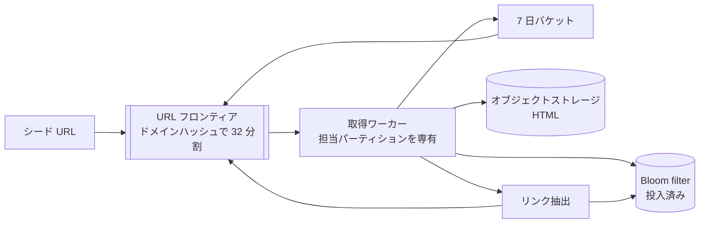
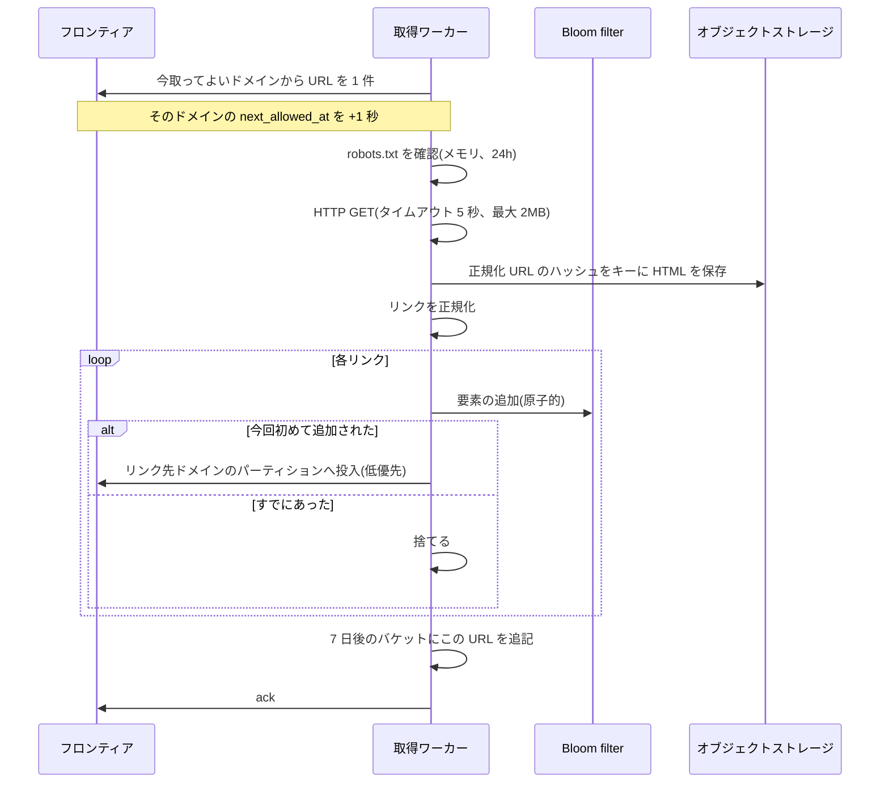
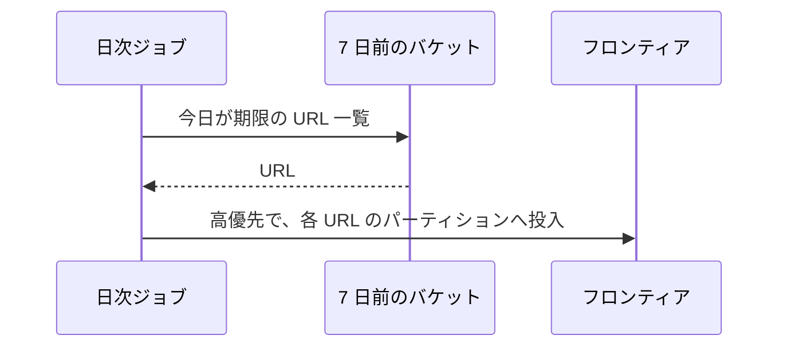
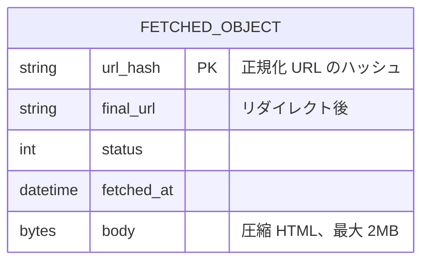

# 設計: Web クローラ

## 1. 全体構成

- キューは **ドメインのハッシュで 32 分割**し、各パーティションに高優先(再取得)と低優先(新規)の 2 本を置く。同じドメインはいつも同じワーカーが持ち、1 秒に 1 回をそのワーカーのメモリだけで守る(→ Q02, Q04)
- 50 ページ/秒なら 32 台は要らない。1 プロセスが複数パーティションを兼ね、増やすときはパーティション単位で分ける
- 「もうキューに入れたか」は共有の Bloom filter(約 1.4GB)。HTML の正本はオブジェクトストレージ(→ Q05, Q13)

## 2. 主要フロー

### 2.1 1 ページの取得

- この 1 周が 1 ページ分の流れ(→ Q01)。ack まで落ちたら URL はキューに戻る。保存は同じキーへの上書き。リンクは「Bloom filter へ今回初めて追加できたときだけ」投入するので、二重には入らない(→ Q12)
- 取得 5 回のうち 4 回は高優先、1 回は低優先の URL がある「今取ってよいドメイン」を選ぶ。再取得で新規が枯れない(→ Q03)
- 1 ドメインに URL が何万件あっても、そのドメインは 1 秒に 1 回だけ取り出される。他のドメインは同じワーカーの別スロットで進む(→ Q10, Q15)

### 2.2 再取得

- リンクを再度見つけても Bloom filter が捨てる。7 日後の再取得は、取得成功時に書いた日付バケットだけが源(→ Q03, Q09)
- ワーカーが担当パーティションの日付ファイルへ、分単位でまとめて書く。1 日 430 万 URL × 100B の仮定で、全体でも 1 日あたり約 430MB

## 3. コンポーネント

| コンポーネント | 役割 | 技術(例) | 関連質問 |
| --- | --- | --- | --- |
| URL フロンティア | パーティションごとの永続キュー。未 ack は戻る | 任意のメッセージキュー | Q04, Q12 |
| 取得ワーカー | 礼儀の時計、robots、HTTP、リンク抽出 | 常駐プロセス | Q02, Q06, Q15 |
| Bloom filter | 正規化 URL をキューへ入れたことの記録 | 共有のビット配列(約 1.4GB) | Q05, Q09, Q13 |
| オブジェクトストレージ | 圧縮 HTML・ステータス・取得時刻。最新だけ残す | オブジェクトストレージ | Q07 |
| 7 日バケット | 再取得用の URL リスト | オブジェクトストレージ上の日付ファイル | Q03 |

- `robots.txt` はドメインを持つワーカーのメモリに 24 時間置く。取得に失敗したドメインは 1 時間クロールしない(禁止か許可か分からないまま取らない)(→ Q06)
- DNS もワーカーのメモリに短時間キャッシュする。50 ページ/秒では専用の DNS リゾルバは置かない(→ Q14)
- 同時に走らせる GET はワーカーあたり数十。タイムアウト 5 秒なので、遅い 1 ドメインは枠を 1 つ使うだけで、担当パーティション全体は止まらない(→ Q15)

## 4. データモデル

正規化(この結果のハッシュが、Bloom filter と保存キーの入力になる):

- スキームとホストは小文字。デフォルトポートは捨てる
- `#` 以降(フラグメント)は捨てる
- クエリは名前順に並べ替える
- 末尾の `/` は残す。別ページのことがあるため(→ Q08)

- フロンティアのメッセージは `url` と優先度だけ。礼儀の `next_allowed_at` はワーカーのメモリにあり、再起動すると消える。消えても最悪そのドメインを短いあいだ少し速く取るだけにする(→ Q02)
- リダイレクトは最大 3 ホップ。接続するドメインごとに礼儀と `robots.txt` を見る(→ Q11)

## 5. 設計判断の要約

| 論点 | 選んだもの | 主な理由 | 関連質問 |
| --- | --- | --- | --- |
| キューの分割 | ドメインハッシュ | 礼儀を分散ロックなしで守れる。巨大ドメインが他を塞がない | Q04, Q10, Q16 |
| 投入済み判定 | Bloom filter(偽陽性約 1%) | 11 億 URL を約 1.4GB に収める。取りこぼしは許容する | Q05, Q09 |
| 再取得 | 7 日バケット | Bloom filter は時刻を持てない | Q03, Q17 |
| 保存キー | 正規化 URL のハッシュ | 長い URL をキーにしない。再取得は上書き | Q07 |
| robots の失敗 | そのドメインを取らない | 禁止ページを取りにいくより、取りこぼしを選ぶ | Q06 |
| 配送 | at-least-once | 落ちても URL は残る。二重 GET は同じキーへの上書き | Q12 |
