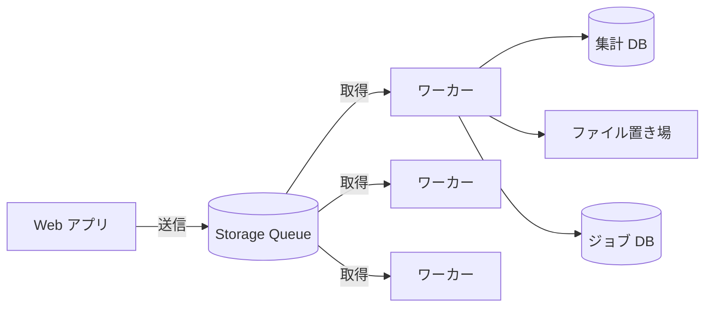

# 01. レポート生成ジョブキューの基本設計

## 状況

社内向け SaaS で、ユーザーが「月次レポートを作成」ボタンを押すと PDF レポートを生成する機能がある。生成は重いので、Storage Queue で非同期化したい。

- **Web アプリ** は、ジョブ ID とレポート条件(対象月、テナント ID など)を JSON にしてキューに送り、すぐに「作成中」を返す
- **ワーカー**(VM 上の常駐プロセス、3台)はキューからメッセージを取得し、**集計 DB** を読んで PDF を作り、**ファイル置き場** に保存する。最後に **ジョブ DB** のステータスを「完了」にする
- 1件の処理時間は **通常 30 秒〜2 分、大きいテナントでは最大 15 分**
- 1メッセージは数百バイト程度
- ワーカーは SDK の既定値のまま `ReceiveMessages` → 処理 → `DeleteMessage` という素朴な実装になっている

リリース後、次のことが分かった。

1. 大きいテナントのレポートが **2〜3 個同時に生成される** ことがある。ファイル置き場には同じレポートが上書きされ、集計 DB の負荷も跳ね上がる
2. 対象月の指定が壊れたメッセージがまれに混ざる。このメッセージは何度処理しても例外になり、いつまでもキューから消えない
3. ワーカーを再起動すると、処理中だったレポートの生成が **しばらく再開されない** ことがある

## 問題

1. 分かったこと 1(同じレポートが同時に生成される)の原因を、Storage Queue のメッセージ取得の仕組み(可視性タイムアウト)を使って説明してください
2. 問題 1 への対処を考えてください。「可視性タイムアウトを 15 分より長くする」だけで解決しますか? それ以外の方法(`UpdateMessage` など)も含めて、トレードオフを答えてください
    - ヒント: 分かったこと 3 との関係も考えてみてください
3. 分かったこと 2(壊れたメッセージ)について、Storage Queue には Service Bus のような自動のデッドレターキューがありません。どの情報を使って、どう対処しますか? その後の運用(原因調査や再投入)も含めて答えてください
4. 対処をしても、同じジョブが2回処理される可能性は残りますか? 残るなら、どこで防ぎますか?
5. (おまけ)このワーカーを Azure Functions のキュートリガーに置き換えると、問題 2・3 のどの部分が楽になり、どの部分は残りますか?

## 回答

<!-- ここに回答を書いてください -->

## レビュー

## ポイント
