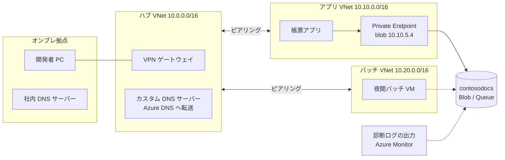

# 01. 閉域化したら一部だけつながらない

## 状況

社内の帳票システムが、ストレージアカウント `contosodocs`(Standard GPv2、HNS なし、東日本リージョン)を使っている。Blob に帳票 PDF を置き、Queue で帳票生成ジョブを受け渡している。

セキュリティ監査で「ストレージがインターネットから到達可能」と指摘され、インフラ担当が次の作業を行った。

1. **アプリ VNet**(`10.10.0.0/16`、東日本)の PE 用サブネットに、`contosodocs` の **blob** 向け Private Endpoint を作成した(IP は `10.10.5.4`)。ポータルの既定のまま、Private DNS ゾーン `privatelink.blob.core.windows.net` も作られ、アプリ VNet にリンクされた
2. ストレージアカウントのネットワーク設定を「**選択した仮想ネットワークと IP アドレスから有効**」にし、規則は何も追加しなかった
3. 認証はこれまでどおり。アプリはマネージド ID + RBAC、バッチは接続文字列(アカウントキー)

- バッチ VNet は DNS サーバーとしてハブの **カスタム DNS サーバー** を指定している(このサーバーは、知らない名前を Azure の既定 DNS `168.63.129.16` に転送する)
- Private DNS ゾーンにリンクされているのは **アプリ VNet だけ**
- オンプレの社内 DNS は、`*.core.windows.net` を普通にインターネットの DNS で解決している

作業後、次のことが起きた。

| # | 誰が | 何をしたか | 結果 |
| --- | --- | --- | --- |
| A | 帳票アプリ | Blob から PDF を読む | 成功 |
| B | 帳票アプリ | Queue にジョブを送る | `403 AuthorizationFailure`(This request is not authorized to perform this operation) |
| C | 夜間バッチ VM | Blob に PDF を書く | `403 AuthorizationFailure`。VM 上で `nslookup contosodocs.blob.core.windows.net` すると **パブリック IP** が返る |
| D | 開発者 PC(VPN 接続中) | Storage Explorer で Blob を開く | 403。`nslookup` は **パブリック IP** |
| E | 開発者 PC(VPN 接続中) | Azure ポータルでストレージアカウントを開く | コンテナー一覧は表示される。コンテナーを開くと「このリクエストは、この操作を実行する権限がありません」 |
| F | Azure Monitor | 他リソースの診断ログを `contosodocs` に出力 | 出力が止まった |

さらに、別の担当者が C を直そうとして、IP 規則に `10.20.0.0/16` を追加しようとしたが、**保存時にエラー** になった。そこで今度はバッチ VM の NIC に付いているパブリック IP を IP 規則に追加したが、**C は直らなかった**。

## 問題

1. 通信がストレージに届くまでの関門を「名前解決 → 経路(Private Endpoint / パブリックエンドポイント)→ ネットワーク規則(ファイアウォール)→ 認証・認可」の4層に分けて、A〜F がそれぞれ **どの層で止まった(または通った)か** を表にしてください
2. 手順 2 で規則を1つも追加していないのに、A が成功するのはなぜですか? Private Endpoint 経由の通信とストレージファイアウォールの関係を説明してください
    - あわせて、「Private Endpoint を作れば、パブリックエンドポイントは自動で閉じる」は正しいか答えてください
3. B(Queue だけ失敗)の原因と対処を答えてください。将来 Data Lake(HNS)に移行する場合、同じ観点で気をつけることは何ですか?
4. C と D を直すには、DNS をどう構成しますか? バッチ VNet(カスタム DNS 経由)とオンプレ(社内 DNS)の両方について、名前解決の流れを含めて答えてください
    - ヒント: アプリが接続先として `contosodocs.privatelink.blob.core.windows.net` を直接指定する、という直し方は適切ですか?
5. IP 規則の2つの失敗について答えてください
    - `10.20.0.0/16` の追加がエラーになった理由
    - バッチ VM のパブリック IP を許可しても直らなかった理由
6. E で「コンテナー一覧は見えるのに中身が見えない」のはなぜですか? ファイアウォールが対象にする操作の範囲から説明してください
7. F を直す方法を答えてください。「信頼されたサービスの例外」と「リソースインスタンス規則」の違いも含めてください
8. 最終的に「パブリックネットワークアクセスを **無効**」にしたいです。無効化しても残ってしまうアクセス経路はありますか? また、アカウントキーで接続しているバッチについて、ネットワーク以外の観点で気になる点があれば挙げてください
9. (おまけ)今回、Private Endpoint ではなく「サービスエンドポイント + 仮想ネットワーク規則」で閉じる案もありました。C・D・F のそれぞれで、どちらが楽か・どちらでないと実現できないかを比べてください

## 回答

<!-- ここに回答を書いてください -->

### 問題1

- B: 認証・認可で止まる
- C: 経路
- D: 経路
- E: ネットワーク規則
- F: 認証・認可

## レビュー

### 問題1

E は正解。B・F は層の取り違え、C・D は「原因」と「止まった場所」が混ざっています。A も表に入れておくと、通る経路と比べやすくなります。

| # | 名前解決 | 経路 | ネットワーク規則 | 認証・認可 | 止まった層 |
| --- | --- | --- | --- | --- | --- |
| A | プライベート IP(`10.10.5.4`) | PE | 対象外(PE 経由はファイアウォールを通る) | RBAC OK | 通過(成功) |
| B | **パブリック IP**(queue 用の PE がない) | パブリック | **拒否**(規則なし) | (ここまで届かない) | **ネットワーク規則** |
| C | **パブリック IP**(バッチ VNet がゾーンにリンクされていない) | パブリック | **拒否** | (届かない) | **ネットワーク規則**(根本原因は名前解決) |
| D | **パブリック IP**(社内 DNS がインターネットで解決) | パブリック(VPN を通らない) | **拒否** | (届かない) | **ネットワーク規則**(根本原因は名前解決) |
| E | パブリック IP | 一覧取得は管理プレーン、中身はパブリックのデータプレーン | 中身の取得で **拒否** | (届かない) | **ネットワーク規則** |
| F | ー(Azure 内部から) | パブリック | **拒否**(信頼されたサービスの例外なし) | (届かない) | **ネットワーク規則** |

指摘

- **B・F は認証・認可ではなくネットワーク規則で止まっている**
    - 決め手はエラーコード。ストレージは層ごとに 403 のコードが違う
        - ファイアウォールで拒否: `AuthorizationFailure` / "This request is not authorized to perform this operation."
        - RBAC のロール不足: `AuthorizationPermissionMismatch` / "... **using this permission**."
        - キーや SAS の署名不正: `AuthenticationFailed`
    - B は `AuthorizationFailure` なので、マネージド ID に Queue のロールがあるかどうかを確認する前に、ファイアウォールで弾かれている。名前は "Authorization" でも、ネットワーク規則のエラーである点が紛らわしい
    - F の Azure Monitor は VNet の外(Microsoft のバックボーン)からパブリックエンドポイントに来るので、規則なしのファイアウォールで弾かれる。どう許可するかは問題7で扱う
    - 参考: [Troubleshoot 403 errors in Azure Blob Storage](https://learn.microsoft.com/en-us/troubleshoot/azure/azure-storage/blobs/authentication/storage-troubleshoot-403-errors)
- **C・D は「どこで止まったか」と「なぜそうなったか」を分けて書く**
    - 経路がパブリックになったこと自体はエラーではない。パブリックに来た通信が、**ネットワーク規則で拒否**されている
    - パブリックになった根本原因は **名前解決**(`nslookup` でパブリック IP が返っている)。経路は名前解決の結果で決まるだけ
    - 4層は「上の層で間違えると、下の層で止まる」関係になる。表には「止まった層」と「根本原因の層」の両方を書くと、直す場所(C・D なら DNS)を間違えない
- **E は正解**。一覧が見えて中身が見えないのは、操作によって通るプレーンが違うから(詳しくは問題6)

## ポイント
